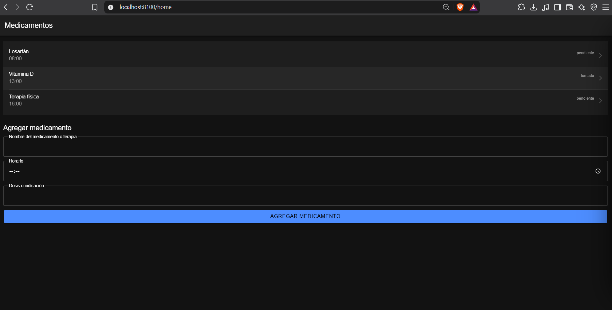
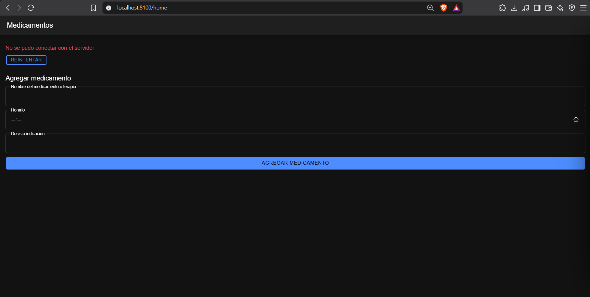
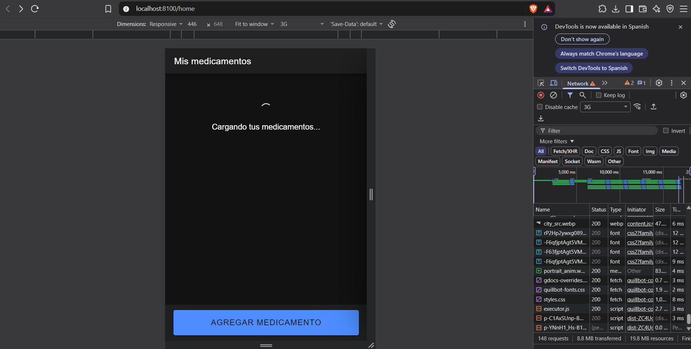
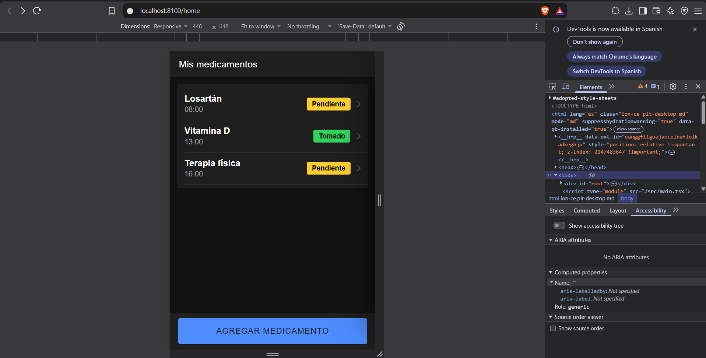
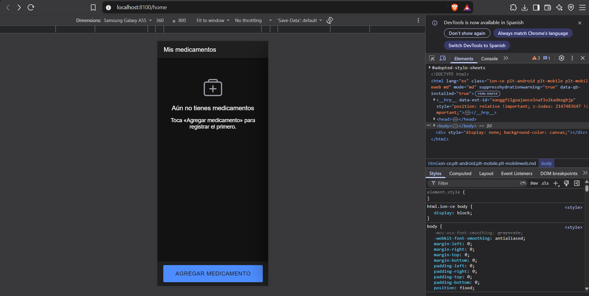
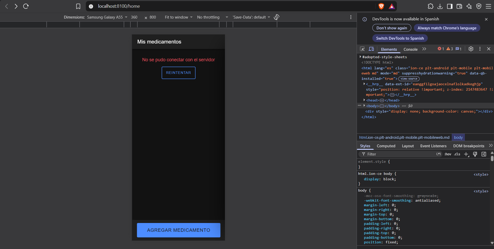
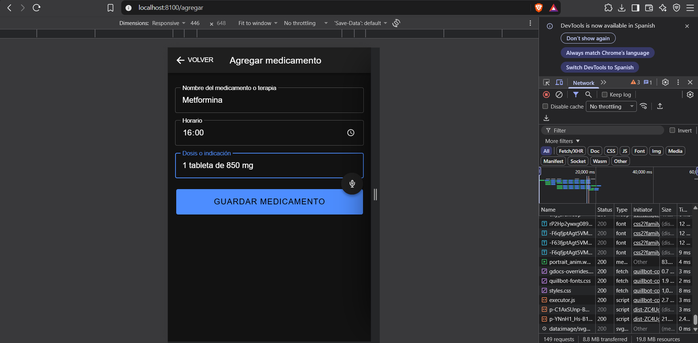
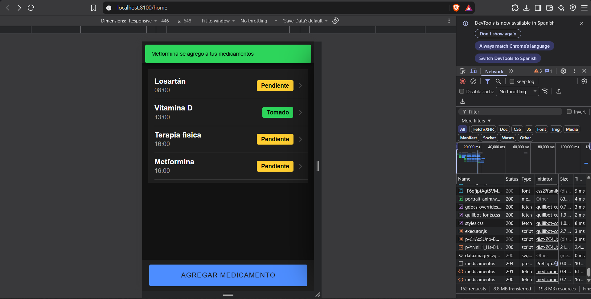
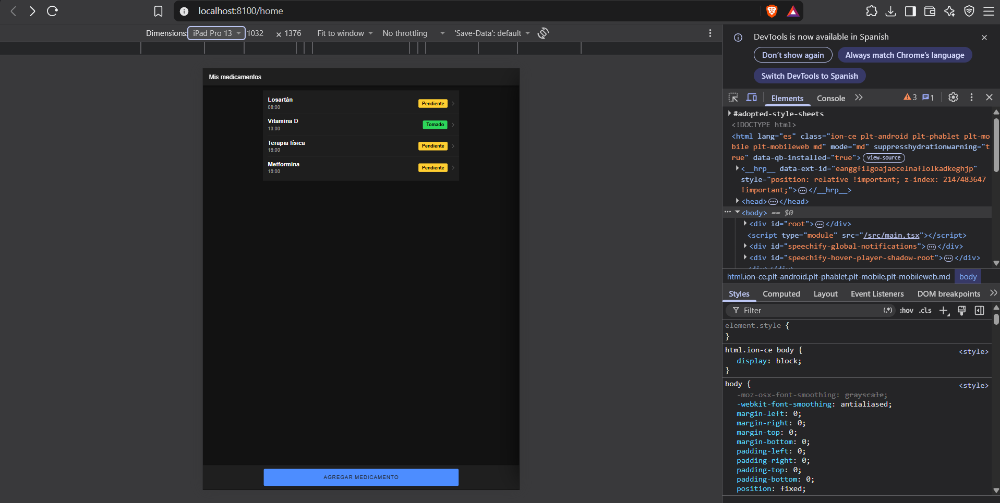

# Semana 11 · HelpHealth: rediseño UX de la pantalla de medicamentos

**Asignatura:** Programación Móvil
**Nombre:** Juan Camilo Bernal Gordillo
**Usuario de GitHub:** JuanBernalCorhuila

## Descripción

Se rediseñó la pantalla de **medicamentos** de HelpHealth, la que se construyó en la semana 10, aplicando principios de UX/UI móvil: una sola acción principal por pantalla, navegación tipo stack, los estados de carga, datos, vacío y error, y una revisión de accesibilidad (contraste, tamaño del texto y áreas táctiles).

Para HelpHealth esto importa más que en otras apps. Los usuarios son personas con discapacidad motriz, visual o auditiva y sus cuidadores, y el proyecto tiene desde el Corte 1 un requerimiento de accesibilidad (**RNF1**) que pide texto legible y alto contraste en todas las pantallas. Una pantalla confusa, con botones pequeños o que se queda en blanco sin explicar nada, es justo lo que esta app no se puede permitir.

## La pantalla antes del rediseño

Así quedó la pantalla en la semana 10:

| Con datos | Con la API apagada |
|---|---|
|  |  |

Funcionaba, pero al usarla aparecen estos problemas:

| Problema | Por qué afecta al usuario |
|---|---|
| La lista y el formulario completo están en la misma pantalla | Hay dos tareas compitiendo y ninguna destaca. El botón para agregar queda abajo del todo, después de tres campos. |
| Si la API falla, el formulario sigue ahí | El usuario ve un error y debajo un formulario que tampoco va a funcionar. |
| No hay estado vacío | Si no hay medicamentos, la pantalla queda en blanco y no dice nada. |
| El estado (`pendiente`, `tomado`) es un texto gris pequeño | Es difícil de leer con baja visión y no resalta lo que más importa: qué falta por tomar. |
| El botón "Reintentar" es pequeño | Cuesta tocarlo con poca precisión en las manos. |
| En pantallas anchas todo se estira de lado a lado | En tablet o computador las filas y los campos quedan larguísimos y cuesta leerlos. |
| El spinner de carga no tiene texto | Quien usa lector de pantalla no se entera de que la app está cargando. |

## La pantalla después del rediseño

### 1. Jerarquía: una acción principal

La pantalla ahora tiene un solo objetivo: **ver los medicamentos**. La única acción, **Agregar medicamento**, es un botón grande y fijo en la parte de abajo, al alcance del pulgar, y no se pierde aunque la lista sea larga.

```tsx
{/* Acción principal: fija abajo, al alcance del pulgar */}
<IonFooter className="pie-accion">
  <IonToolbar>
    <div className="contenedor">
      <IonButton routerLink="/agregar" expand="block" size="large">
        Agregar medicamento
      </IonButton>
    </div>
  </IonToolbar>
</IonFooter>
```

Dentro de cada fila también hay jerarquía: primero el nombre, más grande y en negrita; debajo el horario, y a la derecha el estado.

### 2. Navegación stack

El formulario pasó a su propia pantalla. Con eso, Medicamentos queda como una pantalla de la que salen dos caminos y a la que siempre se vuelve con "atrás":

```
                ┌──> Agregar medicamento  (← Volver)
Mis medicamentos┤
                └──> Detalle del medicamento  (← Volver)
```

Se usa stack porque es un flujo jerárquico (lista → detalle, lista → agregar) y porque mantiene el mapa de navegación de la semana 4, donde a cada sección se entra y se regresa con el botón de atrás. Las rutas están en `App.tsx`:

```tsx
<Route path="/home" element={<Home />} />
<Route path="/agregar" element={<Agregar />} />
<Route path="/detalle/:id" element={<Detalle />} />
```

Al guardar, `Agregar.tsx` muestra un mensaje de éxito y regresa solo a la lista:

```tsx
const nuevo = await crearMedicamento(medicamento);
mostrarToast({
  message: `${nuevo.nombre} se agregó a tus medicamentos`,
  duration: 2500,
  color: 'success',
  position: 'top',
});
router.goBack();
```

Para que el medicamento nuevo aparezca al volver, `Home` ya no carga la lista con `useEffect`, sino con `useIonViewWillEnter`. Ionic deja montada la pantalla anterior cuando se navega hacia adelante, así que `useEffect` no se volvería a ejecutar. `useIonViewWillEnter`, en cambio, se ejecuta cada vez que la pantalla se va a mostrar:

```tsx
useIonViewWillEnter(() => {
  cargar();
});
```

### 3. Estados de la interfaz

La pantalla muestra siempre **uno** de estos estados, nunca una pantalla en blanco:

```tsx
function contenido() {
  if (cargando) {
    return <EstadoCarga mensaje="Cargando tus medicamentos..." />;
  }
  if (error) {
    return <MensajeError mensaje={error} onReintentar={cargar} />;
  }
  if (medicamentos.length === 0) {
    return (
      <EstadoVacio
        titulo="Aún no tienes medicamentos"
        mensaje="Toca «Agregar medicamento» para registrar el primero."
      />
    );
  }
  return <ListaMedicamentos medicamentos={medicamentos} />;
}
```

| Estado | Qué ve el usuario | Componente |
|---|---|---|
| Cargando | Spinner con el texto "Cargando tus medicamentos..." | `EstadoCarga.tsx` |
| Con datos | La lista con nombre, horario y estado de cada medicamento | `ListaMedicamentos.tsx` |
| Vacío | Un ícono, "Aún no tienes medicamentos" y qué hacer para registrar el primero | `EstadoVacio.tsx` |
| Error | El mensaje del error y el botón **Reintentar** | `MensajeError.tsx` |

El orden de los `if` importa: el vacío solo se muestra cuando la petición salió bien y llegó una lista sin elementos. Así no se confunde "no tienes medicamentos" con "no se pudo conectar".

Los mismos componentes se usan en la pantalla de detalle (carga y error) y en la de agregar (error al guardar). Así todos los estados se ven igual en toda la app.

| Cargando | Con datos | Vacío | Error |
|---|---|---|---|
|  |  |  |  |

| Pantalla Agregar | Mensaje de éxito al guardar |
|---|---|
|  |  |

### 4. Accesibilidad

**Contraste.** El estado de cada medicamento pasó de un texto gris pequeño a una etiqueta (`IonBadge`) con color y con la palabra escrita. El color ayuda a distinguirlos de un vistazo, pero no es lo único que da la información, así que también sirve para personas con daltonismo o baja visión. Con los colores de Ionic, todos superan el mínimo de contraste de 4.5:1 que pide la norma WCAG para texto:

| Elemento | Colores | Contraste |
|---|---|---|
| Etiqueta "Pendiente" | texto negro sobre amarillo `#ffc409` | 13.2 : 1 |
| Etiqueta "Tomado" | texto negro sobre verde `#2dd55b` | 10.8 : 1 |
| Etiqueta "Pospuesto" | texto blanco sobre gris `#636469` | 5.9 : 1 |
| Mensaje de error (modo oscuro) | rojo `#ff4961` sobre fondo `#121212` | 5.7 : 1 |

```tsx
const COLORES: Record<string, string> = {
  pendiente: 'warning',
  tomado: 'success',
  pospuesto: 'medium',
};

<IonBadge className="estado-badge" color={COLORES[estado] ?? 'medium'}>
  {estado.charAt(0).toUpperCase() + estado.slice(1)}
</IonBadge>
```

**Áreas táctiles.** Todo lo que se puede tocar mide al menos 44px de alto:

| Elemento | Antes | Después |
|---|---|---|
| Fila de la lista | alto por defecto | `--min-height: 3.5rem` (56px) |
| Botón principal y botón de guardar | botón normal | `size="large"` y `min-height: 3.5rem` (56px) |
| Botón "Reintentar" | `size="small"` | tamaño normal con `min-height: 3rem` (48px) |

**Textos legibles.** El nombre del medicamento pasó a `1.2rem` en negrita y los mensajes de los estados a `1.1rem`. Se usa `rem` y no `px` para que los textos crezcan si el usuario aumenta el tamaño de letra en su teléfono, que es lo que pide RNF1.

**Lector de pantalla.**
- El estado de carga tiene `role="status"`, así el lector anuncia "Cargando tus medicamentos...".
- El mensaje de error tiene `role="alert"`, así se lee apenas aparece.
- Los íconos decorativos (el spinner y el ícono del estado vacío) llevan `aria-hidden="true"` para que el lector no los lea sin sentido.

**Diseño responsivo.** El contenido y el botón principal viven dentro de `.contenedor`, una columna que en el teléfono ocupa todo el ancho y en tablet o computador se queda centrada:

```css
.contenedor {
  max-width: 40rem;
  margin: 0 auto;
}
```



### Resumen: antes y después

| | Antes (semana 10) | Después (semana 11) |
|---|---|---|
| Acción principal | Formulario completo debajo de la lista | Un botón grande fijo abajo |
| Navegación | Lista → detalle | Stack: lista → agregar y lista → detalle, con "Volver" |
| Estados | Cargando, datos y error | Cargando (con texto), datos, **vacío** y error |
| Feedback al guardar | El medicamento aparece al final de la lista | Mensaje "… se agregó a tus medicamentos" y regreso a la lista |
| Estado del medicamento | Texto gris pequeño | Etiqueta de color con la palabra escrita |
| Áreas táctiles | Botón "Reintentar" pequeño | Todo lo tocable mide 48px o más |
| Pantallas anchas | Todo estirado de lado a lado | Columna centrada de máximo 40rem |
| Lector de pantalla | Solo el error tenía `role="alert"` | Carga con `role="status"` e íconos ocultos al lector |

## Estructura

```
11-week/03-optional-activity/
├── api/                                  -> backend con Node.js + Express (igual que en la semana 10)
│   ├── package.json
│   ├── server.js
│   ├── routes/
│   │   └── medicamentos.js               -> GET y POST de /medicamentos
│   └── data/
│       └── medicamentos.js               -> datos de prueba en memoria
├── app/                                  -> app Ionic React
│   └── src/
│       ├── App.tsx                       -> rutas: /home, /agregar y /detalle/:id
│       ├── theme/
│       │   └── layout.css                -> columna centrada (.contenedor) para todas las pantallas
│       ├── services/
│       │   └── medicamentosApi.ts        -> llamadas fetch a la API
│       ├── components/
│       │   ├── EstadoCarga.tsx / .css    -> estado "cargando" (spinner + texto)
│       │   ├── EstadoVacio.tsx / .css    -> estado "vacío"
│       │   ├── MensajeError.tsx / .css   -> estado "error" con botón "Reintentar"
│       │   ├── EstadoBadge.tsx / .css    -> etiqueta de color del estado del medicamento
│       │   ├── ListaMedicamentos.tsx / .css
│       │   └── FormularioMedicamento.tsx / .css
│       └── pages/
│           ├── Home.tsx / .css           -> lista + botón principal fijo abajo
│           ├── Agregar.tsx               -> formulario en su propia pantalla
│           └── Detalle.tsx               -> detalle de un medicamento
└── capturas/                             -> evidencias del antes y el después
```

Los archivos nuevos son `Agregar.tsx`, los componentes de estado (`EstadoCarga`, `EstadoVacio`, `EstadoBadge`) y `layout.css`. Los demás se ajustaron a partir de la semana 10. La API no cambió.

## Cómo ejecutarlo

**1. API** (en una terminal):

```bash
cd api
npm install
npm start
```

Queda corriendo en `http://localhost:3000`.

**2. App** (en otra terminal, con la API encendida):

```bash
cd app
npm install
ionic serve
```

Se abre en `http://localhost:8100`.

**Para ver cada estado:**
- **Cargando:** en las herramientas de desarrollador del navegador (F12 → pestaña *Network*), cambia la velocidad a *Slow 3G* y recarga.
- **Vacío:** deja el arreglo de `api/data/medicamentos.js` vacío (`[]`) y reinicia la API.
- **Error:** apaga la API (Ctrl + C) y recarga la app.
