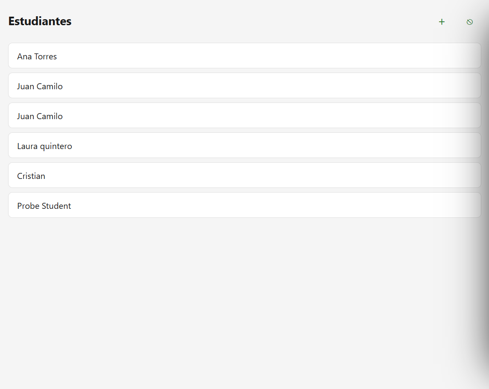
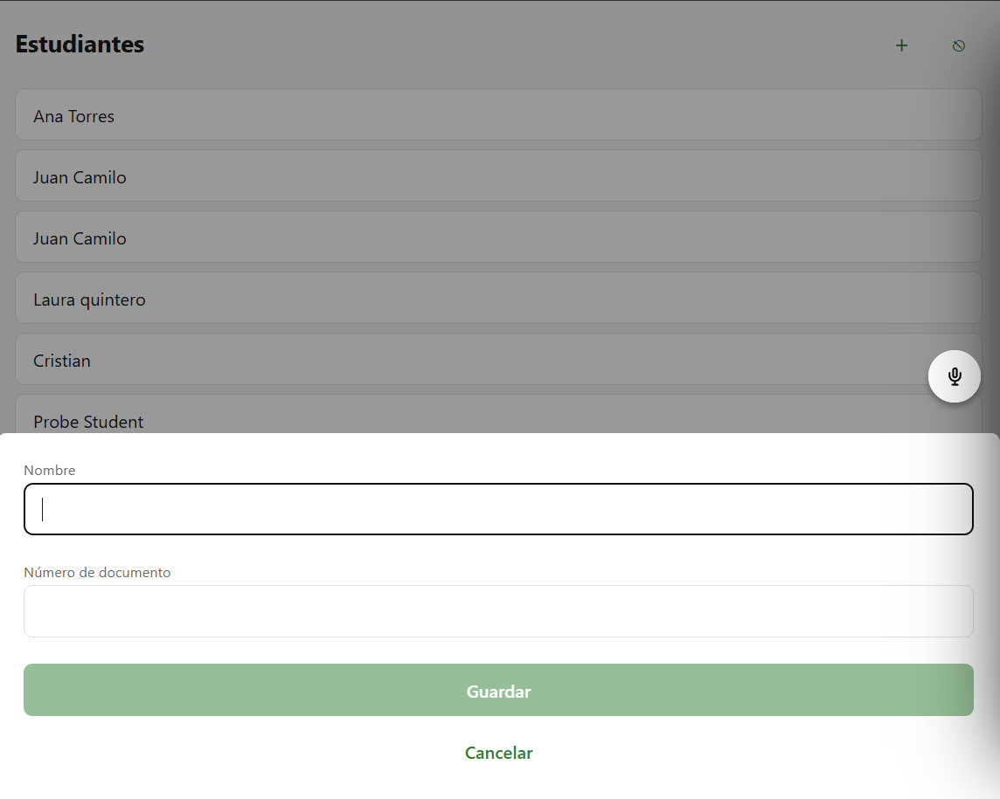
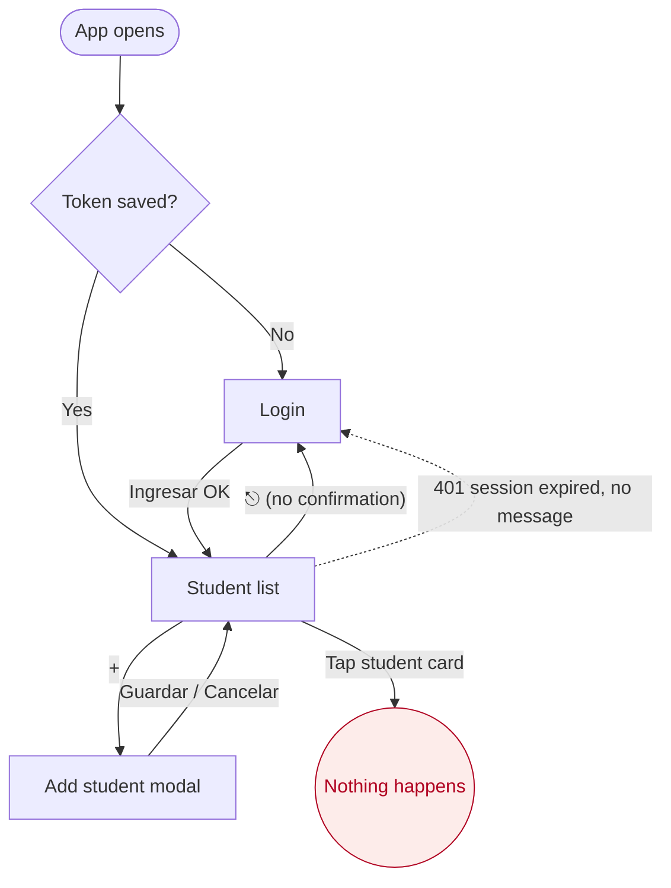

# CP1 — UX audit of my screens

My screens: **Student list** (`StudentListScreen`, HU7) and the **Add student** modal
(`AddStudentModal`, HU5). The list is the screen that loads data (`GET /students`).

Screenshots of the current state:

| Student list | Add student modal |
|--------------|-------------------|
|  |  |

## Findings

| # | Screen | Problem | Principle | Severity | Proposed fix |
|---|--------|---------|-----------|----------|--------------|
| 1 | Student list | The logout button is the glyph "⎋" (in the browser it renders as a crossed circle) right next to "+". It does not read as "log out" and one wrong tap closes the session with no confirmation | Visual hierarchy / error prevention | High | Move "Cerrar sesión" away from "+" in the stack header and ask for confirmation before logging out |
| 2 | Student list | Each card is announced as a button but tapping it does nothing (StudentDetail is not built) | Feedback / labels | High | Remove the button role until the detail exists; wire it to `StudentDetail` in CP7 |
| 3 | Student list | After saving a student the modal just closes; the trainer is not told the student was created | Feedback | High | Show a success message ("Estudiante registrado") |
| 4 | Student list | The card only shows the name. Two students with the same name look identical | Visual hierarchy | Medium | Add the document number as a second line in caption style |
| 5 | Student list | The header is built by hand inside the screen, not with the stack header, so the screen does not follow the same pattern the detail screen will need | Navigation pattern | Medium | Use the native stack header (title + actions) for every authenticated screen |
| 6 | Student list | The skeleton rows are flat grey blocks with no label; a screen reader user gets no hint that something is loading | Interface states / accessibility | Medium | Skeleton with the shape of a real card (name + document lines) and an accessible "Cargando estudiantes" label |
| 7 | Student list | Pull to refresh never shows the spinner (`refreshing={false}`) and the whole list switches to skeleton, so the content flashes | Feedback | Medium | Keep the list visible and show the refresh spinner while reloading |
| 8 | Student list | The error state shows the same text for "no internet" and "server failed" and gives no next step besides retry | Feedback / messages | Medium | Clear message per cause, keep "Reintentar" as the main action |
| 9 | Student list | The disabled "+" (offline) uses 40 % opacity: `#2E7D32` drops to about 1.6:1 against the background and the reason is only in the banner | Contrast / colour as only signal | Medium | Disabled style that keeps 3:1 and an accessibility hint saying why it is disabled |
| 10 | Student list | At 768 px the cards stretch across the whole width; the name sits far from the edge of the card and lines are hard to follow | Responsive layout | Low | Limit the content width and centre it on tablets |
| 11 | Student list | Card border `#E0E0E0` on background `#F5F5F5` is 1.21:1, the card edges are barely visible | Contrast (non-text, 3:1) | Low | Darker border token for cards |
| 12 | Add student modal | The modal has no title; the trainer only sees two fields and has to guess what they are for | Visual hierarchy | High | Title "Nuevo estudiante" at the top of the sheet |
| 13 | Add student modal | "Guardar" is disabled with no explanation and there is no message under each field (e.g. letters in the document number) | Feedback / form validation | High | Inline validation message under each field (CP6) |
| 14 | Add student modal | "Cancelar" closes and erases what was typed with no warning | Error prevention | Low | Confirm before discarding a filled form (CP6) |

## Current navigation map

Where the user gets lost:

- **Tapping a student card** leads nowhere: the trainer expects to see the student's
  detail and attendance, and the app gives no response.
- **The "⎋" icon** sends the trainer back to Login by accident.
- **Session expired (401)** drops the trainer on Login without saying why.
