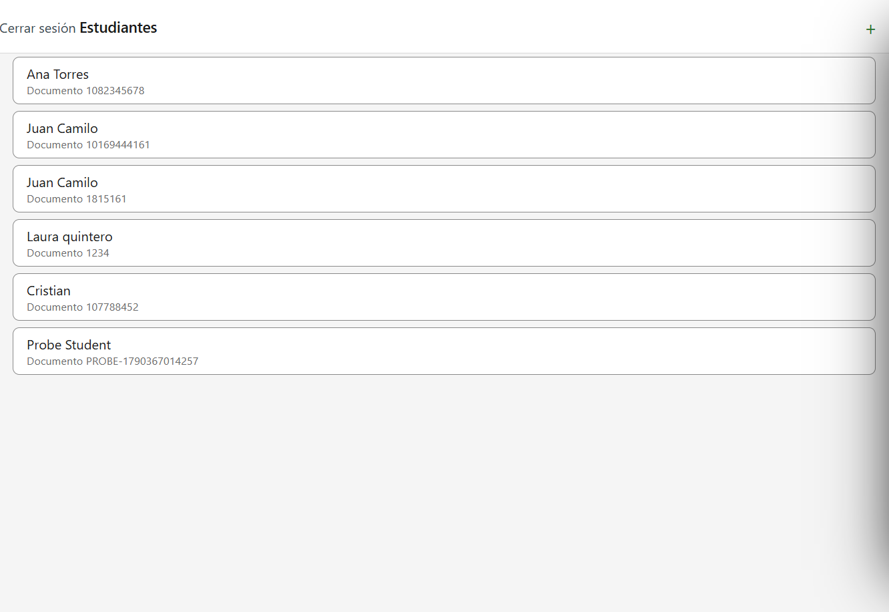
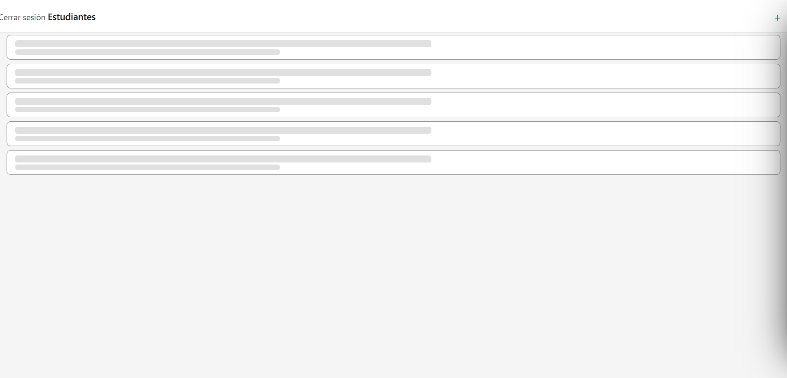
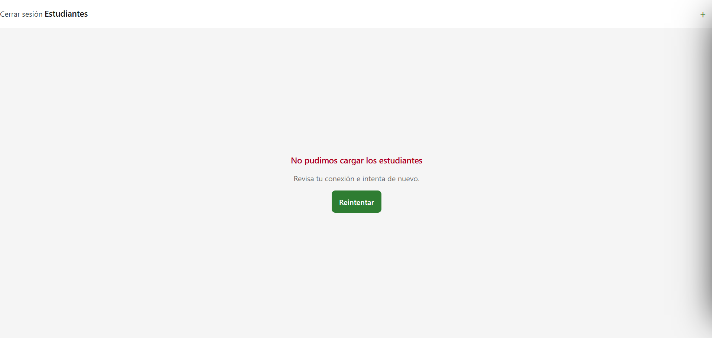
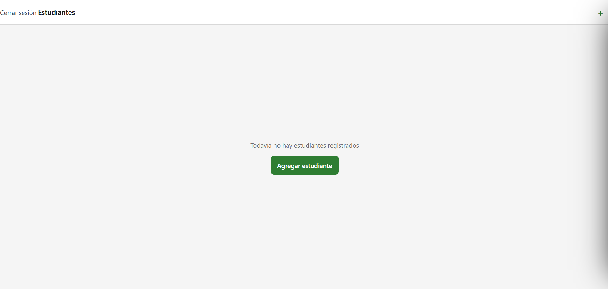

# CP3 — Student list states

`StudentListScreen` loads the trainer's students with `GET /students`
(`useStudentList` → `GetStudents` → `StudentRepositoryImpl`). The state type already
existed in the team app (`'loading' | 'loaded' | 'empty' | 'error'`, from
[`features/students.md`](https://github.com/code-corhuila/healt-track-docs/blob/main/01-architecture/features/students.md));
this checkpoint makes each state clear to the trainer and makes it possible to force each
one without touching the backend.

## How each state is forced

The simulation lives in `StudentRepositoryImpl.getStudents()` and reads three variables
from `app/.env`. Expo reads `.env` only when it starts, so stop the app (`Ctrl+C`) and run
`npm run web` again after each change. With none of them set the app behaves as before.

| State | `app/.env` | What the trainer sees |
|-------|------------|-----------------------|
| Loaded | nothing extra (backend running) | One card per student: name and "Documento …" |
| Loading | `EXPO_PUBLIC_SIMULATE_DELAY_MS=3000` | 5 skeleton cards with the same shape as a real card (name line + document line), read by the screen reader as "Cargando estudiantes" |
| Error | `EXPO_PUBLIC_SIMULATE_FAILURE=true` | "No pudimos cargar los estudiantes" in red, a hint "Revisa tu conexión e intenta de nuevo." and the "Reintentar" button |
| Empty | `EXPO_PUBLIC_SIMULATE_EMPTY=true` | "Todavía no hay estudiantes registrados" and the "Agregar estudiante" button, which opens the add student modal |

The delay can be combined with the other two to see the skeleton first and then the error
or empty state.

## Screenshots

| Loaded | Loading |
|--------|---------|
|  |  |

| Error | Empty |
|-------|-------|
|  |  |

## What changed

| Before | After | Audit finding |
|--------|-------|---------------|
| Flat grey blocks with no label | Skeleton shaped like a student card, with an accessible label | 6 |
| Error text identical to the empty text style, no hint | Red title, a hint with the next step and "Reintentar" | 8 |
| Card shows only the name | Card shows name and document number | 4 |
| Pull to refresh never showed the spinner and swapped the list for the skeleton | The list stays on screen and the `RefreshControl` spinner shows while it reloads (`refresh` in `useStudentList`) | 7 |

## Automated test

`app/src/features/students/presentation/__tests__/StudentListScreen.test.tsx` uses Jest
(`jest-expo` preset) and React Native Testing Library. It mocks `GetStudents` from the DI
container and checks that:

1. when the request fails, the screen shows "No pudimos cargar los estudiantes" and the
   "Reintentar" button;
2. pressing "Reintentar" calls `GetStudents` again and the student list appears.

Run it from `app/` with `npm test`.

## Running it in the browser

The team backend has no CORS middleware (`backend/src/app.ts` explains it is not needed for
React Native). The browser does enforce CORS, so to run this workshop on the web the local
copy of the backend needs `app.use(cors())`. That change stays local and is not part of
this repository.
