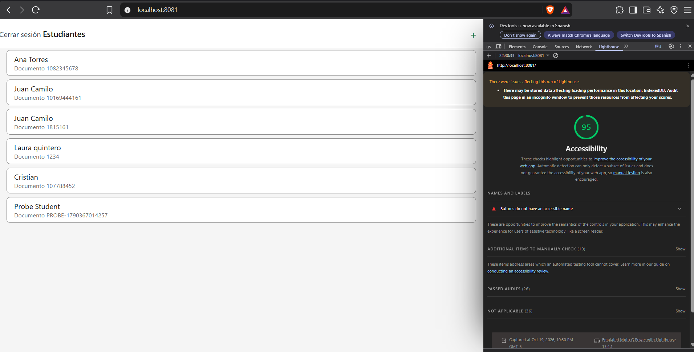
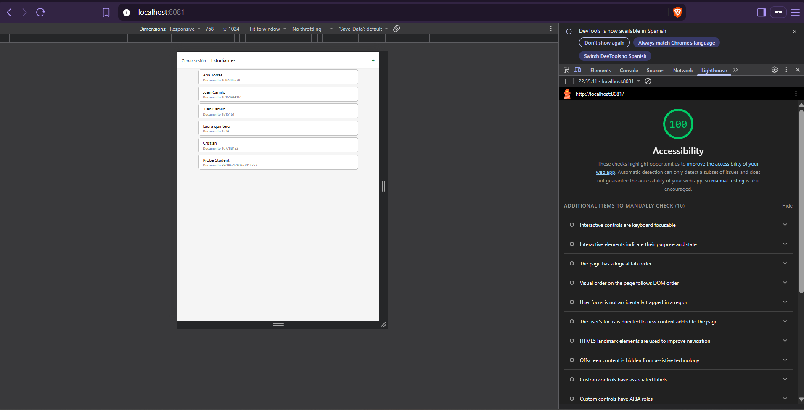
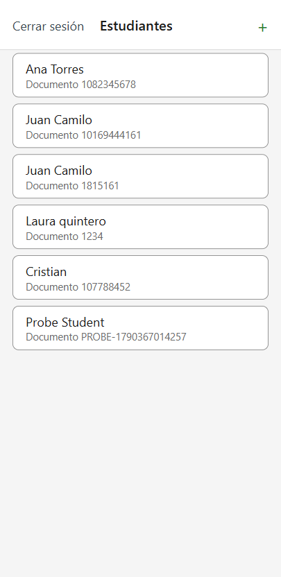
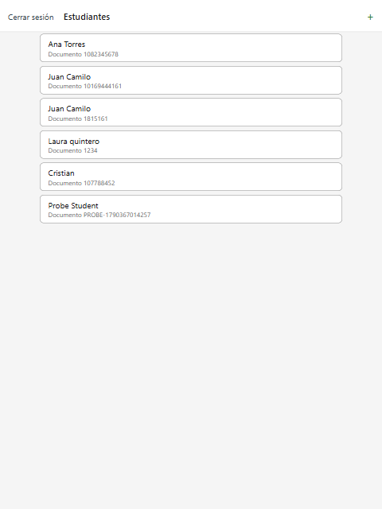
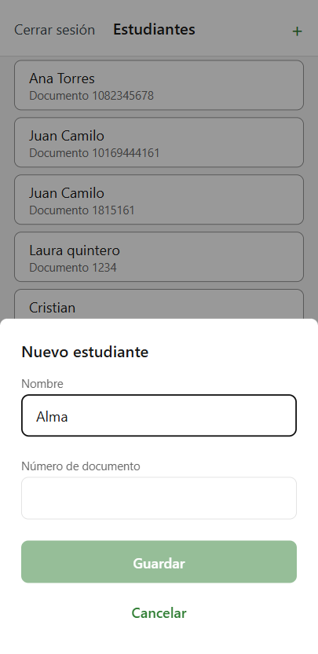
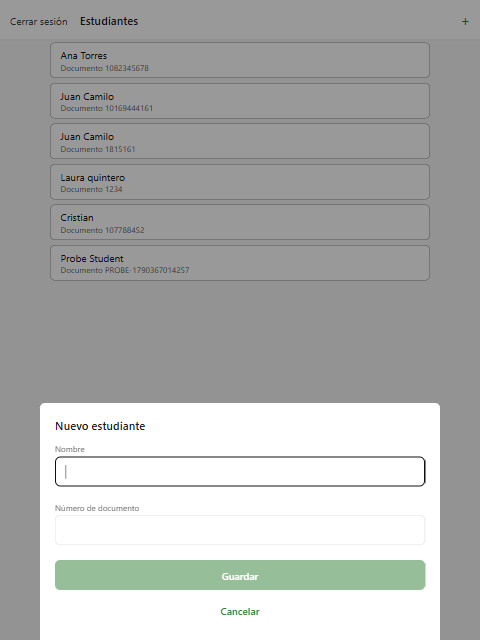

# CP4 — Accessibility and responsive layout

Screens reviewed: **Student list** and **Add student** modal, against the team rules in
[`02-code-and-ui/accessibility.md`](https://github.com/code-corhuila/healt-track-docs/blob/main/02-code-and-ui/accessibility.md)
and the CP1 audit.

## What was fixed

| # | Problem | Fix | Where |
|---|---------|-----|-------|
| 1 | The student card was announced as a button but tapping it did nothing (audit finding 2) | The card is plain content until `StudentDetail` exists; it is read as one item: "Ana Torres, Documento 1082345678" | `StudentListScreen.tsx` → `StudentCard` |
| 2 | The disabled "+" faded to 40 % opacity (about 1.6:1) and only the banner said why (finding 9) | Disabled "+" uses `borderStrong` (3:1), sets `accessibilityState.disabled` and the hint "Necesitas conexión para agregar estudiantes" | `StudentListScreen.tsx` header |
| 3 | The header buttons lost `accessible` when they moved to the stack header in CP2; the team rule asks for it on every interactive element | `accessible` + `accessibilityRole="button"` + `accessibilityLabel` on "Cerrar sesión" and "+" | `StudentListScreen.tsx` header |
| 4 | "Cerrar sesión" touched the left edge of the screen and its first letter was cut off | Horizontal padding on the header buttons; both keep the 44 × 44 minimum area | `headerButton` style |
| 5 | The modal had no title (finding 12) | Title "Nuevo estudiante", marked as a header for screen readers | `AddStudentModal.tsx` |
| 6 | At 768 px the cards and the modal stretched across the whole width (finding 10) | Content and modal stop at `theme.layout.maxContentWidth` (640) and stay centred | `theme.ts`, `StudentListScreen.tsx`, `AddStudentModal.tsx` |

Checked and already fine: every text uses the size tokens and React Native lets it grow
with the system font size (no `allowFontScaling={false}`); there are no images in these
screens; the inputs keep a 48 px height; offline state is shown with text in the banner,
not only with colour.

## Lighthouse (Accessibility, Mobile)

Both runs were done in an incognito window, on the student list with the trainer signed
in. A first run in a normal window gave 95 because of a button injected by a browser
extension (`div.px-dock … button.send`), not by the app, so it was discarded.

| Before | After |
|--------|-------|
| **100** | **100** |
|  |  |

The automatic score was already 100, so the fixes above come from the manual review:
Lighthouse itself lists 10 "additional items to manually check" (purpose and state of
interactive elements, custom controls with labels and roles), which is where findings 1 to
3 belong.

## 360 px and 768 px

| | 360 px | 768 px |
|---|--------|--------|
| Student list |  |  |
| Add student modal |  |  |
