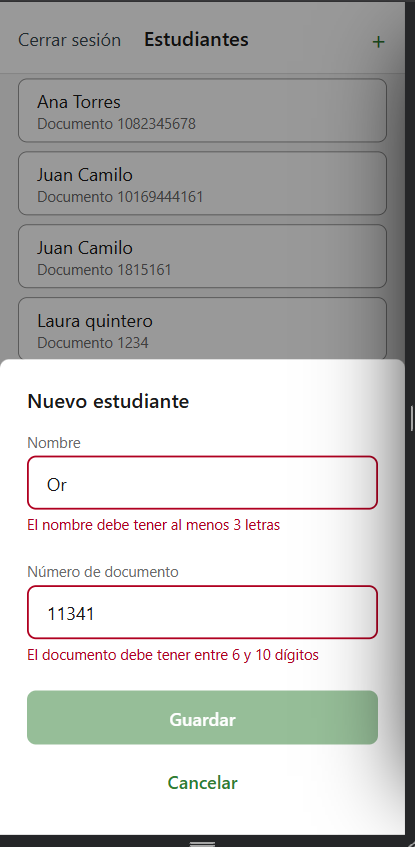
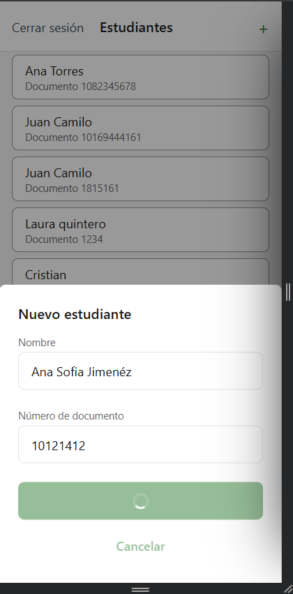
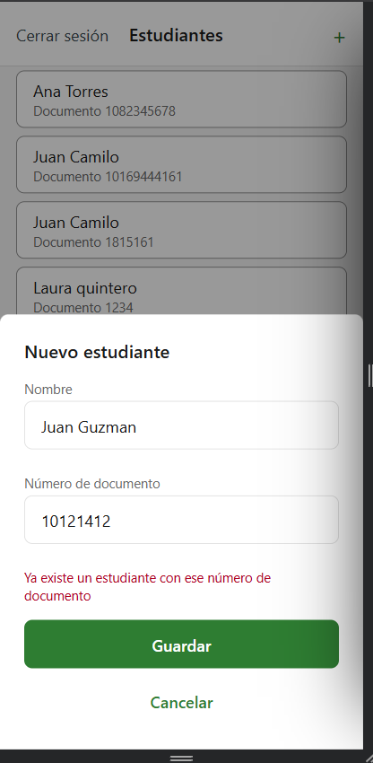
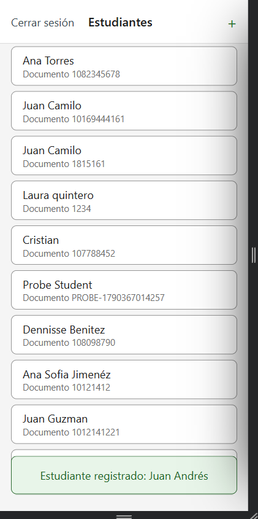
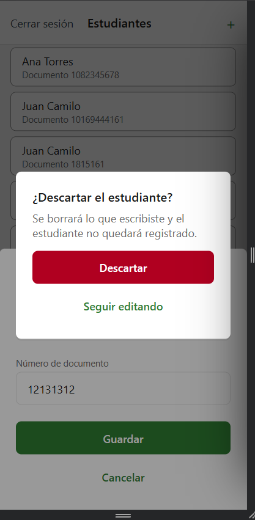
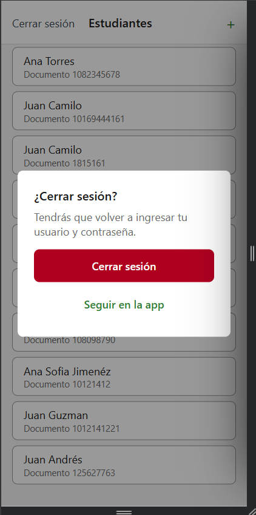

# CP6 — Add student form: validation and feedback

The main form of Health Track is the **Add student** modal (`AddStudentModal`, HU5), opened
with "+" from the student list. It sends `POST /students` (`CreateStudent`,
[`api-contract.md` E-02](https://github.com/code-corhuila/healt-track-docs/blob/main/03-api-and-data/api-contract.md)).

## Validation rules

The API only rejects a blank `name` or `documentNumber` and a repeated `documentNumber`
(409). The app adds stricter rules that come from how the trainer works in the gym; they
live in `app/src/features/students/domain/validateStudent.ts` and are covered by
`domain/__tests__/validateStudent.test.ts`.

| Field | Rule | Message under the field | Why it exists in this domain |
|-------|------|-------------------------|------------------------------|
| Nombre | Required | "Escribe el nombre del estudiante" | The list and the future attendance screens identify the student by name |
| Nombre | Only letters and spaces (accents and ñ allowed) | "Usa solo letras y espacios" | Students are people; a digit in the name is almost always a typing mistake (e.g. typing the document in the wrong field) |
| Nombre | 3 to 60 characters | "El nombre debe tener al menos 3 letras" / "…máximo 60 caracteres" | One or two letters do not tell students apart; 60 fits two names and two surnames and keeps the card readable. The field does not accept more than 60 characters |
| Número de documento | Required | "Escribe el número de documento" | It is how the trainer tells apart two students with the same name (HU5) |
| Número de documento | Only digits, no dots or spaces | "Usa solo números, sin puntos ni espacios" | Colombian ID cards (cédula, tarjeta de identidad) are numbers; people often write them with dots ("1.082.345.678"), which would create a second record for the same person |
| Número de documento | 6 to 10 digits | "El documento debe tener entre 6 y 10 dígitos" | Cédulas and tarjetas de identidad have between 6 and 10 digits; fewer or more means a digit was missed or repeated. The field does not accept more than 10 characters |
| Número de documento | Not repeated (checked by the backend) | "Ya existe un estudiante con ese número de documento" | HU5-CA2: one student, one record. The app recognises the API's `409` and shows this message instead of the generic one |

A message appears when the trainer leaves the field, not while typing the first letter.
"Guardar" stays disabled while any field has an error or while the request is in flight.

> These rules are stricter than the API on purpose. Existing records created before this
> change (e.g. the `PROBE-…` document from the API probes) are still listed; the rules only
> apply to new students.

## Form states

| State | What the trainer sees |
|-------|-----------------------|
| Field with an error | Red border, the message under the field (read by screen readers), "Guardar" disabled |
| Submitting | Spinner inside "Guardar"; fields and "Cancelar" disabled |
| Success | The modal closes, the list stays on screen and a toast says "Estudiante registrado: <nombre>" for 3 seconds |
| Server error | The modal stays open with what was typed, so the trainer can retry; the message is the duplicate one for a `409` and "No pudimos guardar el estudiante, intenta de nuevo" for anything else |
| Cancel with data | Confirmation "¿Descartar el estudiante?" — "Descartar" closes and clears the form, "Seguir editando" goes back to it. With an empty form "Cancelar" closes directly |
| Log out | Confirmation "¿Cerrar sesión?" before the session is closed (audit finding 1) |

The toast and the confirmation dialog are `app/src/shared/Toast.tsx` and
`app/src/shared/ConfirmDialog.tsx`. They replace `IonToast` and `IonAlert` from the course
examples; `ConfirmDialog` is built on `Modal` because React Native's `Alert.alert` does
nothing in the web build.

## How each state was produced for the screenshots

- **Field errors:** type "Or" in Nombre and "11341" in Número de documento, then leave each field.
- **Submitting:** DevTools → Network → throttling "Slow 4G", then press "Guardar" with valid data.
- **Duplicate:** save a student with a document number that is already in the list.
- **Success, discard and log out:** normal use.

## Screenshots

| Field errors | Submitting | Duplicate (server error) |
|--------------|------------|--------------------------|
|  |  |  |

| Success toast | Discard confirmation | Log out confirmation |
|---------------|----------------------|----------------------|
|  |  |  |

## Tests

`npm test` in `app/` also runs `presentation/__tests__/AddStudentModal.test.tsx`: a `409`
from the API shows the duplicate message, and a successful save passes the created student
to the list (which shows the toast).
