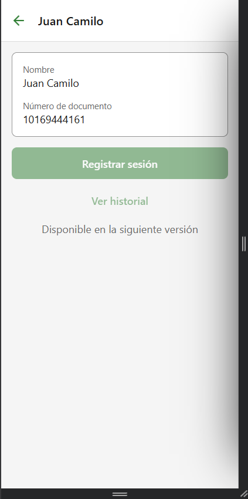
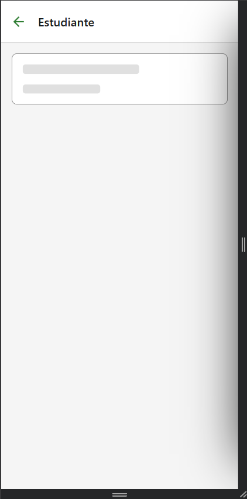
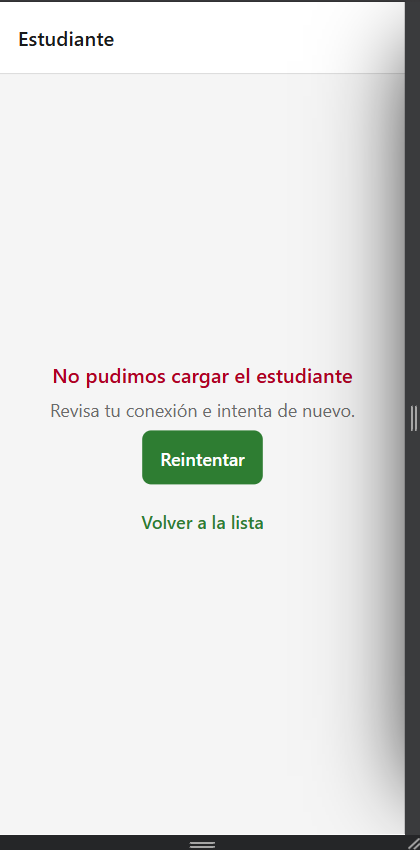
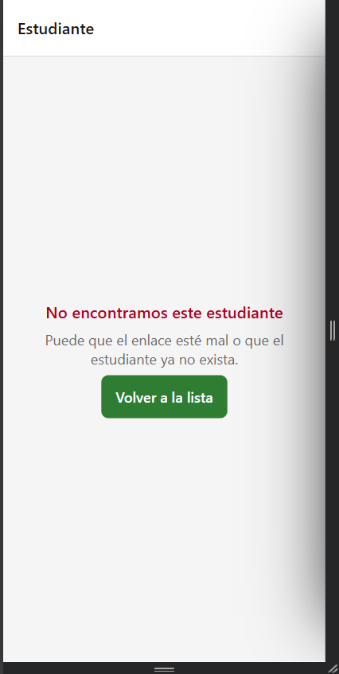
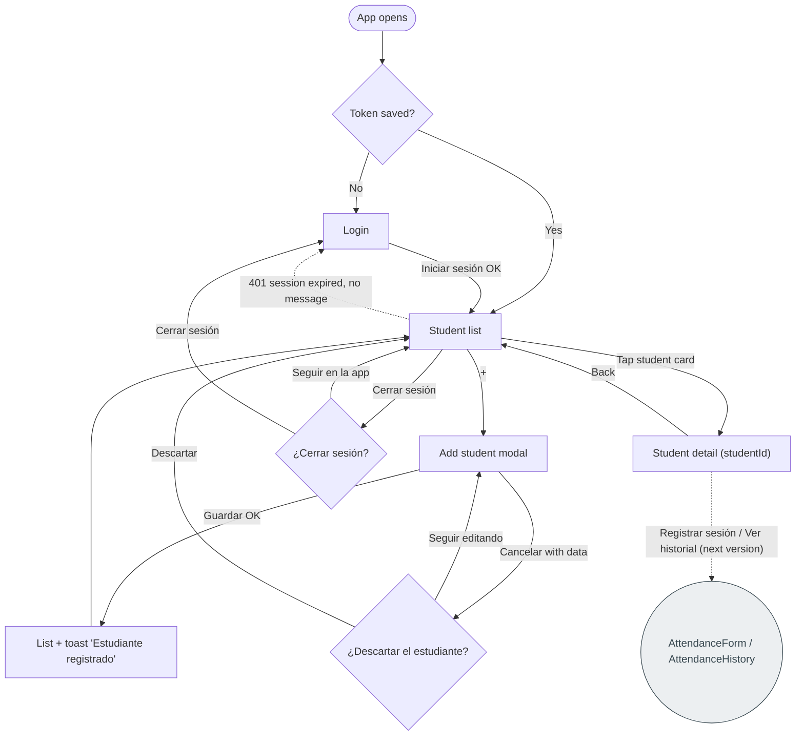

# CP7 — Student detail and complete navigation flow

## The detail screen

`StudentDetailScreen` (`app/src/features/students/presentation/`) is the `StudentDetail`
route of the team's route registry
([`navigation.md`](https://github.com/code-corhuila/healt-track-docs/blob/main/01-architecture/navigation.md)),
built from its spec
([`screens/student-detail.md`](https://github.com/code-corhuila/healt-track-docs/blob/main/01-architecture/screens/student-detail.md)).

- **Opened from the list:** tapping a student card calls
  `navigation.navigate("StudentDetail", { studentId })`. Only the id travels; the screen loads
  the student again, as `navigation.md` asks.
- **Identifier in the route:** in the browser the same route is a URL,
  `/students/<studentId>` (`linking` in `RootNavigator.tsx`).
- **Back:** the native stack header shows the back arrow. If the screen was opened straight
  from a URL there is nothing behind it, so "Volver a la lista" replaces it with the list.
- **Data:** `GetStudentById` → `StudentRepository.getStudentById()`. `GET /students/:id`
  (E-04) does not exist yet in the backend (gap G-06 in `api-contract.md`), so the repository
  looks the id up in the `GET /students` response. When E-04 ships, only that method changes.
- **"Registrar sesión" and "Ver historial":** shown disabled with "Disponible en la siguiente
  versión", because `AttendanceForm` and `AttendanceHistory` (HU1–HU4) are not built yet.

| State | When | What the trainer sees | How it was forced |
|-------|------|-----------------------|-------------------|
| Loading | Request in flight | A skeleton card with the shape of the info card | `EXPO_PUBLIC_SIMULATE_DELAY_MS=3000` in `app/.env` |
| Loaded | Student found | Header with the student's name, card with name and document, the two buttons disabled | Normal use |
| Error | Request failed | "No pudimos cargar el estudiante", the hint, "Reintentar" and "Volver a la lista" | `EXPO_PUBLIC_SIMULATE_FAILURE=true`, then open `/students/<id>` |
| Not found | No student has that id | "No encontramos este estudiante" and "Volver a la lista" | Open `/students/no-existe` |

`presentation/__tests__/useStudentDetail.test.ts` covers loaded, not found and error.

| Loaded | Loading |
|--------|---------|
|  |  |

| Error | Not found |
|-------|-----------|
|  |  |

## Navigation map now

## Compared with the CP1 map

| CP1 (before) | Now | What the trainer saves |
|--------------|-----|------------------------|
| Tapping a card led nowhere (dead end) | Tapping a card opens the student's detail | No more "tap and nothing happens"; the student's data is one tap away and comes back with one tap |
| "⎋" next to "+" logged out in one tap | "Cerrar sesión" is on the other side of the header and asks first | One accidental tap no longer costs signing in again (username and password) |
| After "Guardar" the modal closed silently | The list stays and a toast names the new student | The trainer does not have to look through the list to check the student was created |
| "Cancelar" erased what was typed | Asks "¿Descartar el estudiante?" when there is data | Retyping the form after a mistaken tap |
| — | The detail has its own URL | The trainer (or a teammate testing) can open a student directly |

Still open, outside this checkpoint: a `401` still sends the trainer to Login without saying
why (marked with a dotted line in both maps).
