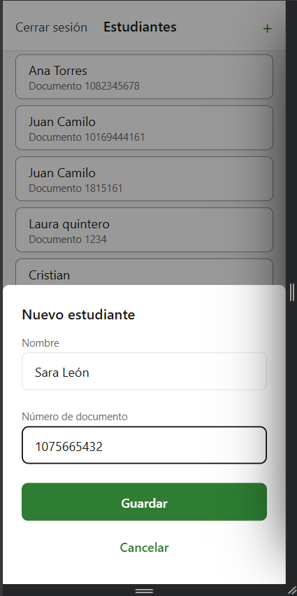

# CP8 — Usability test with two real people

## Setup

- **Date:** 2026-10-21. Both sessions were **in person**, on the facilitator's laptop.
- **App:** the workshop app at the end of CP7, in Brave (Chromium) at 360 × 740 (device mode, with the
  DevTools window minimised so only the app was visible). Backend running locally, no
  simulation variables in `app/.env`.
- **Starting point:** trainer already signed in, on the student list. Login is not one of my
  screens, so it was not tested.
- **Script read to both participants:** "This app is for a gym trainer to register their
  students. I will give you 3 tasks. I am testing the app, not you. Please say out loud what you
  think while you do it. I cannot help you, but you can give up if you get stuck."
- The facilitator did not help or point at the screen. Time was measured from the end of
  reading the task until its end condition.

## Participants

| | Profile | Uses apps daily | Knew the app before |
|---|---------|-----------------|---------------------|
| P1 | University classmate from another team, Systems Engineering | Yes | No |
| P2 | Friend from school | Yes | No |

## Tasks

| # | Task (said in Spanish) | Screens it covers | Ends when |
|---|------------------------|-------------------|-----------|
| T1 | Register a new student: P1 "Valentina Rojas · 1075234567", P2 "Mateo Vargas · 1075345678" | Student list → Add student modal → success toast | The toast "Estudiante registrado: …" appears |
| T2 | Find Ana Torres's document number and go back to the list | Student list → Student detail → back | They say the number and are on the list again |
| T3 | Register a student with the document written **with dots**, exactly as given: P1 "Carlos Méndez · 1.075.998.123", P2 "Laura Gómez · 1.075.887.654" | Add student modal: field validation and correcting an error | The student is saved |

## Results

| Task | Participant | Completed | Time | Errors or doubts | What they said (summary, key quotes in Spanish) |
|------|-------------|-----------|------|------------------|-------------------------------------------------|
| T1 | P1 | Yes | 54 s | None | Went to "+" at the top right, typed name and document, pressed "Guardar" |
| T1 | P2 | Yes | 52 s | None | "supongo que en el primer cuadro pongo el nombre, luego en el segundo el documento" |
| T2 | P1 | Yes | 48 s | Hesitated on the card | "Señalar a Ana Torres, no sale nada", then pressed the name; came back with the arrow at the top left |
| T2 | P2 | Yes | 36 s | None | Pressed Ana Torres, read name and document, came back with the arrow |
| T3 | P1 | Yes | 77 s | Could not type the last 3 digits; "Guardar" stayed disabled | "¿Por qué no se puede poner todos los números si hay puntos?" — "No me está dejando escribir los últimos tres dígitos que faltan, y no me deja ni guardar". Removed the dots himself and then saved (`1075998123`) |
| T3 | P2 | Yes | 97 s | Could not type "654"; did not know if dots were required | "¿Por qué no me deja seguir colocando el 654?" — "¿Si a fuerza se necesitan los puntos?" — "¿Por qué no me deja guardar con puntos y sin ellos puedo guardar normal?". Removed the dots and saved (`1075887654`) |

All 6 task runs were completed without help. T3 was by far the slowest for both (77 s and
97 s, against 36–54 s for the others).

**Incident (not counted as an app problem):** during T3, P2 pressed a microphone button that
a browser extension injects into every page. The extension opened another tab; when it was
closed the modal was still open with the digits typed so far. The extension was disabled and
the task went on normally. It is the same extension whose button lowered the first
Lighthouse run in CP4.

## The three most important problems

| # | Problem | Evidence | Principle | Severity |
|---|---------|----------|-----------|----------|
| 1 | With dots, the document field does not let the trainer finish the number: the 10-character limit (`maxLength`, CP6) also counts the dots, so "1.075.998.123" is cut after "1.075.998." | 2 of 2 participants, the two slowest runs; "no me deja seguir colocando el 654" | Error prevention — the limit meant to prevent a mistake blocks a correct number written the usual way | High |
| 2 | The format is only explained after leaving the field; while typing, "Guardar" stays disabled with no reason given | 2 of 2; "¿Si a fuerza se necesitan los puntos?", "¿Por qué no me deja guardar con puntos?" | Feedback | Medium |
| 3 | The student card gives no sign that it can be tapped (nothing changes on hover or press) | 1 of 2; "Señalar a Ana Torres, no sale nada" | Affordance / visual hierarchy | Low |

Problems 1 and 2 come from a rule I added in CP6 and that looked fine in my own tests: people
write their cédula with dots, which is exactly why `06-forms.md` says the field only accepts
digits — but the field made them remove the dots by hand instead of doing it for them.

## Problem chosen to fix

**Problem 1** (and most of problem 2): the document field removes dots and spaces while the
trainer types, so "1.075.887.654" becomes "1075887654".

## Fix applied

Commit `fix(w11): address usability finding`, in
`app/src/features/students/presentation/AddStudentModal.tsx`:

| Before (CP6) | After |
|--------------|-------|
| The field accepted at most 10 characters, dots included, and showed "Usa solo números, sin puntos ni espacios" only after leaving it | Dots and spaces are removed as the trainer types or pastes; the field accepts up to 13 characters (a 10-digit cédula with its 3 dots), and more than 10 digits still shows "El documento debe tener entre 6 y 10 dígitos" |
| A document with dots kept "Guardar" disabled | "1.075.887.654" turns into "1075887654" and "Guardar" is enabled |
| Message for invalid characters: "Usa solo números, sin puntos ni espacios" | "Usa solo números" (dots and spaces no longer reach validation, so the message only covers letters and other symbols) |

The domain rule in `06-forms.md` does not change — the stored document is still 6 to 10
digits — only the way the field gets there: it now does the cleaning the participants had to
do by hand. `presentation/__tests__/AddStudentModal.test.tsx` checks that typing
"1.075.887.654" sends "1075887654" to `CreateStudent`.

Problem 3 (card affordance) stays open and goes to the team stories in CP9.
