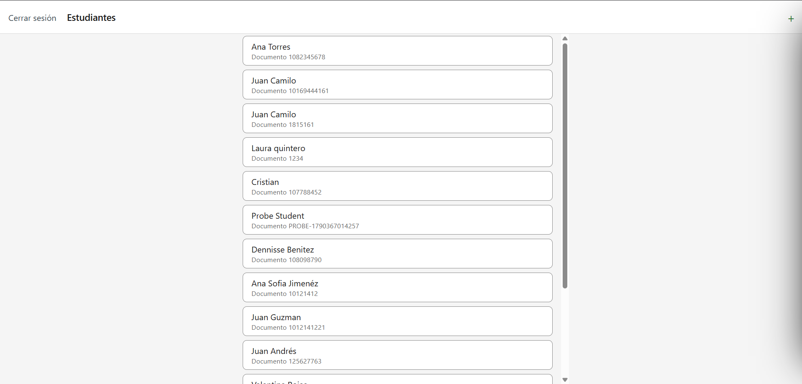
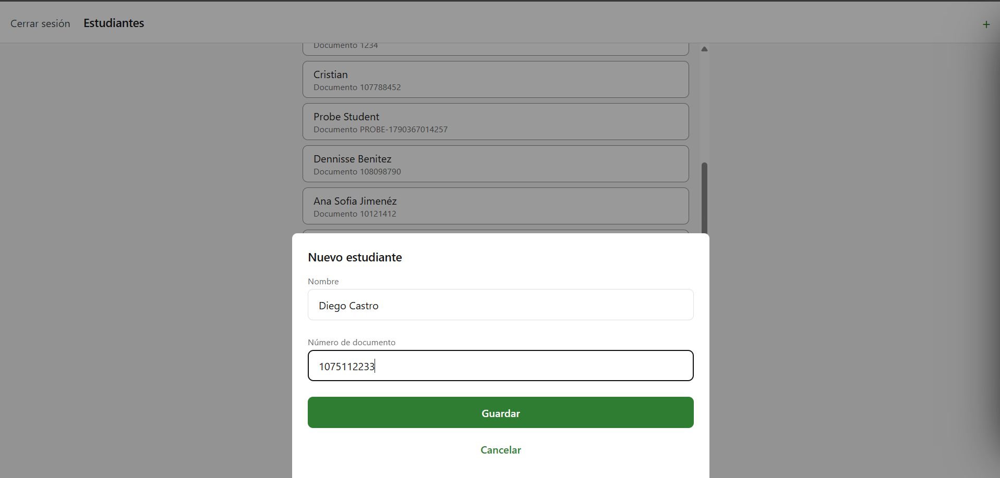

# CP9 — Before and after, and stories for the team

## Before and after

"Before" is the team app as imported in CP0 (v1.0.0). "After" is the app at the end of CP8.

### Student list (HU7)

| Before | After |
|--------|-------|
|  |  |

- **Header:** "Cerrar sesión" moved away from "+" into the native stack header and now asks
  for confirmation. *Principle: visual hierarchy and error prevention (CP2, CP6).*
- **Cards:** name plus document number, a border with 3.16:1 contrast, read as one item by
  screen readers, and they open the student's detail. *Principles: visual hierarchy,
  non-text contrast, labels (CP2, CP3, CP4, CP7).*
- **States:** skeleton shaped like a card, error with a hint and "Reintentar", empty state
  with "Agregar estudiante", spinner on pull to refresh, toast after saving. *Principles:
  interface states and feedback (CP3, CP6).*
- **Tablet:** content stops at 640 px instead of stretching. *Principle: responsive layout
  (CP4).*

### Add student modal (HU5)

| Before | After |
|--------|-------|
|  |  |

> The round microphone button over the list in the "before" capture is not part of the app:
> it is injected by a browser extension (the same one noted in CP4 and CP8).

- **Title** "Nuevo estudiante", so the trainer knows what the form is for. *Principle:
  visual hierarchy (CP4).*
- **Validation per field** with the message under the field, "Guardar" disabled while there
  are errors, spinner while saving, duplicate document message, and dots removed from the
  document while typing. *Principles: feedback and error prevention (CP6, CP8).*
- **"Cancelar" with data** asks before discarding. *Principle: error prevention (CP6).*

### Student detail (new)

| Before | After |
|--------|-------|
| No screen: tapping a student card did nothing (CP1, finding 2) |  |

- One tap opens the student's data and one tap comes back; a wrong link shows "No
  encontramos este estudiante". *Principles: navigation pattern and interface states (CP7).*

## Stories for the team backlog

Written with the team's
[Definition of Ready](https://github.com/code-corhuila/healt-track-docs/blob/main/00-governance/definition-of-ready.md).
The ids are temporary until the team adds them to the backlog; the points are a proposal for
refinement, not the team's estimate.

### W11-1 · Register a student with validation and feedback

**As** a trainer, **I want** the "Add student" form to tell me in each field what is wrong
and to confirm what happened when I save, **so that** I register each student once, with a
correct document, without losing what I typed.

- **UI reference:** `docs/06-forms.md` and `docs/08-usability-test.md` of this workshop.
- **API contract:** `POST /students` (E-02); the duplicate is the `409` response.
- **States:** field error, submitting, success, server error, duplicate, discard
  confirmation. Offline: saving fails with the generic message (no queue, as in
  `offline-sync.md`).
- **Dependencies:** none. Note: the rules are stricter than the API; `data-model.md` and
  `api-contract.md` should say so when this story is done.
- **Proposed points:** 5.

**Acceptance criteria**

1. **Given** the modal is open, **when** the trainer types "Al" in Nombre and leaves the
   field, **then** "El nombre debe tener al menos 3 letras" appears under it and "Guardar"
   is disabled.
2. **Given** the modal is open, **when** the trainer types "1.075.887.654" in Número de
   documento, **then** the field shows "1075887654" and no error.
3. **Given** a student with document 1082345678 exists, **when** the trainer saves another
   student with that document, **then** the modal stays open with what was typed and shows
   "Ya existe un estudiante con ese número de documento".
4. **Given** valid data, **when** the trainer presses "Guardar", **then** "Guardar" shows a
   spinner, the modal closes, the list stays on screen and the toast "Estudiante registrado:
   <nombre>" appears.
5. **Given** the trainer typed something, **when** they press "Cancelar", **then** "¿Descartar
   el estudiante?" appears, and "Seguir editando" keeps the data.

### W11-2 · Open a student's detail from the list

**As** a trainer, **I want** to tap a student in the list and see their data, **so that** I
can check who they are before registering their session.

- **UI reference:** `01-architecture/screens/student-detail.md` (team docs) and
  `docs/07-navigation-flow.md` of this workshop.
- **API contract:** `GET /students/:id` (E-04). Until it exists (G-06), the detail can look
  the id up in `GET /students`, as the workshop does.
- **States:** loading (skeleton card), loaded, error with "Reintentar", not found, offline
  with cached data as described in `student-detail.md`.
- **Dependencies:** E-04 in the backend for the final version; "Registrar sesión" and "Ver
  historial" stay disabled until HU1–HU4.
- **Proposed points:** 5.

**Acceptance criteria**

1. **Given** the student list, **when** the trainer taps "Ana Torres", **then** the detail
   opens with "Ana Torres" in the header and her name and document in a card.
2. **Given** the detail is open, **when** the trainer presses back, **then** the list is shown
   again.
3. **Given** an id that matches no student, **when** the detail opens, **then** it shows "No
   encontramos este estudiante" and "Volver a la lista".
4. **Given** the request fails, **when** the detail opens, **then** it shows "No pudimos
   cargar el estudiante" with "Reintentar" and "Volver a la lista".
5. **Given** the detail is open, **then** "Registrar sesión" and "Ver historial" are shown
   disabled with "Disponible en la siguiente versión".

### W11-3 · A clear, safe and accessible student list

**As** a trainer, **I want** the student list to always show me what is happening, to make
it obvious what I can tap, and to not log me out by mistake, **so that** I find my students
quickly on any phone or tablet.

- **UI reference:** `docs/03-states.md`, `docs/04-a11y-responsive.md` and problem 3 of
  `docs/08-usability-test.md` of this workshop.
- **API contract:** `GET /students` (E-03).
- **States:** loading, loaded, empty, error, offline banner, refreshing.
- **Dependencies:** none. Adds the tokens `secondary`, `success`, `successContainer`,
  `errorContainer`, `borderStrong`, `subtitle` and `layout.maxContentWidth` to `theme.ts`
  and to `design-system.md`.
- **Proposed points:** 3.

**Acceptance criteria**

1. **Given** the list is loading, **then** 5 skeleton cards with a name line and a document
   line are shown, and a screen reader reads "Cargando estudiantes".
2. **Given** the request fails, **then** "No pudimos cargar los estudiantes", "Revisa tu
   conexión e intenta de nuevo." and "Reintentar" are shown; pressing "Reintentar" asks for
   the list again.
3. **Given** the list is shown, **then** each card shows the name and "Documento <número>",
   and its border has at least 3:1 contrast with the background.
4. **Given** the list is shown, **when** the trainer hovers or presses a card, **then** the
   card changes (for example a "›" and a pressed color), so it is clear it can be tapped
   (usability test, problem 3 — not built in the workshop).
5. **Given** the list is shown, **when** the trainer presses "Cerrar sesión", **then**
   "¿Cerrar sesión?" appears and "Seguir en la app" keeps the session.
6. **Given** a screen 768 px wide, **then** the cards are at most 640 px wide and centred.
