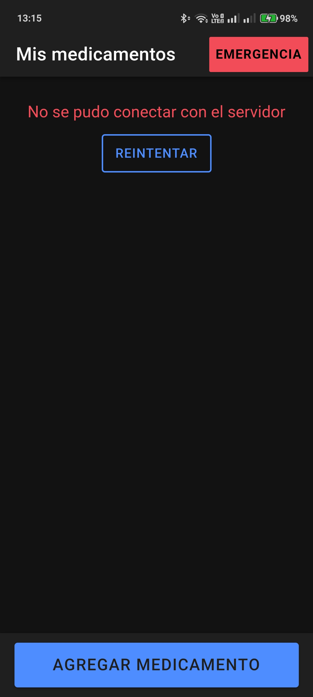
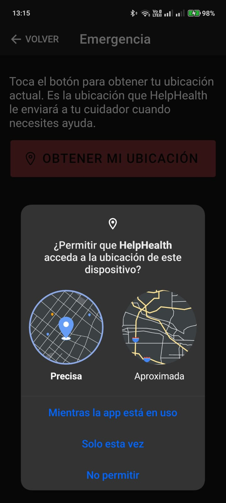
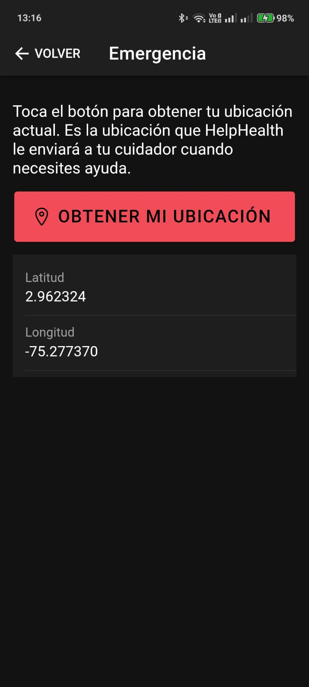
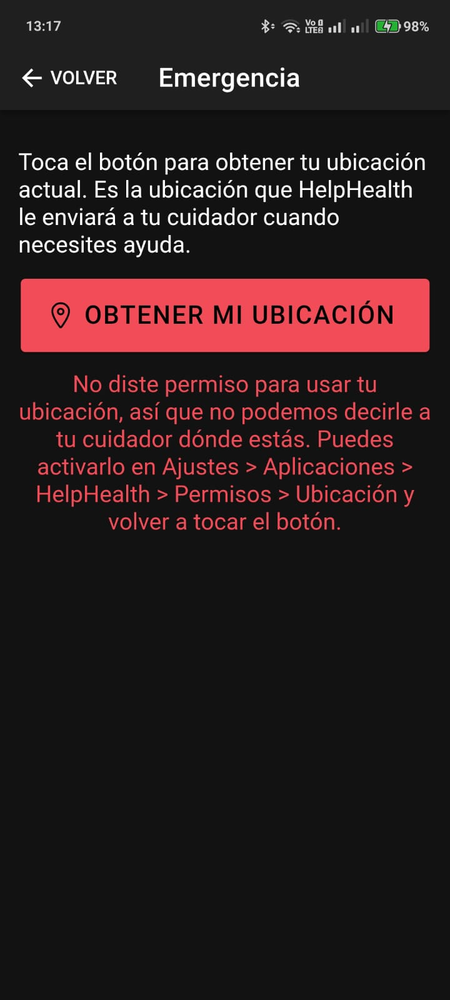
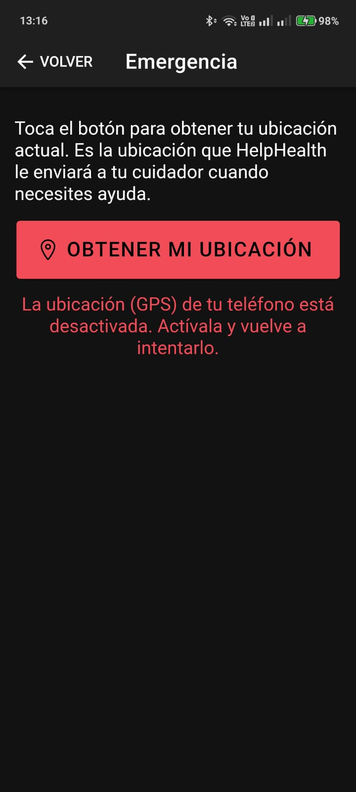

# Semana 12 · HelpHealth: ubicación GPS para el botón de emergencia

**Asignatura:** Programación Móvil
**Nombre:** Juan Camilo Bernal Gordillo
**Usuario de GitHub:** JuanBernalCorhuila

## Descripción

Se integró el plugin de **geolocalización de Capacitor** (`@capacitor/geolocation`) en HelpHealth para obtener la ubicación del usuario (latitud y longitud) desde una nueva pantalla de **Emergencia**. La app pide el permiso de ubicación y, si el usuario lo niega, le explica qué pasó y cómo activarlo, sin romperse.

Se eligió el GPS y no la cámara porque es lo que el proyecto necesita desde el Corte 1. El botón de emergencia es una de las tres funciones del MVP:

- La historia **H2** dice: *"quiero presionar un botón grande y fácil de usar en caso de emergencia, para enviar mi ubicación en tiempo real a mi cuidador"*.
- El requerimiento **RF2** pide enviar esa ubicación al contacto de confianza.
- En el caso de uso *Enviar alerta de emergencia*, el paso 3 es "el sistema captura la ubicación GPS actual del usuario", y el flujo alternativo 1 es justamente que el GPS esté desactivado.

Esta semana se construyó ese paso 3: capturar la ubicación con sus permisos. El envío al cuidador (paso 4) necesita guardar los datos del cuidador y un canal de envío, así que queda para más adelante.

## Cómo funciona

```
Tu código (Emergencia.tsx) → ubicacionService.ts → plugin @capacitor/geolocation → GPS del teléfono
```

### 1. El acceso a la pantalla de emergencia

En el wireframe de la semana 4 el botón de emergencia está siempre a la vista. Por eso en **Mis medicamentos** se agregó un botón rojo **Emergencia** en el encabezado. Va arriba y no abajo porque la acción principal de esa pantalla sigue siendo "Agregar medicamento" (como se definió en la semana 11). Además está en el encabezado, así que aparece aunque la lista esté cargando o haya fallado la API.

```tsx
<IonButtons slot="end">
  <IonButton className="boton-ir-emergencia" routerLink="/emergencia" color="danger" fill="solid">
    Emergencia
  </IonButton>
</IonButtons>
```

La ruta nueva está en `App.tsx`, siguiendo la navegación stack: se entra desde la lista y se vuelve con "Volver".

```tsx
<Route path="/emergencia" element={<Emergencia />} />
```

### 2. Pedir el permiso y leer el GPS (`services/ubicacionService.ts`)

Toda la lógica del plugin está en un servicio aparte, igual que las llamadas a la API están en `medicamentosApi.ts`. Así la pantalla solo se encarga de mostrar.

Primero se revisa el permiso con `checkPermissions()`. Si el usuario todavía no ha respondido, se le pregunta con `requestPermissions()`, que es lo que hace aparecer el diálogo de Android:

```ts
let permiso = await Geolocation.checkPermissions();
if (permiso.location === 'prompt' || permiso.location === 'prompt-with-rationale') {
  permiso = await Geolocation.requestPermissions(); // aquí aparece el diálogo del sistema
}

// En Android el usuario puede elegir ubicación "precisa" o "aproximada"; las dos sirven
return permiso.location === 'granted' || permiso.coarseLocation === 'granted';
```

Se acepta también la ubicación aproximada porque desde Android 12 el diálogo deja elegirla, y para saber en qué zona está el usuario sigue siendo útil.

Solo si hay permiso se lee la posición, igual que en el ejemplo de clase:

```ts
const pos = await Geolocation.getCurrentPosition();
return {
  tipo: 'ok',
  ubicacion: { lat: pos.coords.latitude, lng: pos.coords.longitude },
};
```

El servicio nunca deja escapar un error sin explicación. Siempre devuelve uno de tres resultados:

| Resultado | Cuándo pasa |
|---|---|
| `ok` | Hay permiso y el GPS respondió con la latitud y la longitud |
| `denegado` | El usuario no dio el permiso (en el diálogo o antes, desde Ajustes) |
| `error` | Hay permiso pero no se pudo leer la ubicación, por ejemplo con el GPS apagado |

Para distinguirlos se usan los códigos de error que da el plugin:

```ts
// OS-PLUG-GLOC-0003: permiso negado en el teléfono. 1: permiso negado en el navegador.
if (codigo === 'OS-PLUG-GLOC-0003' || codigo === 1) {
  return { tipo: 'denegado' };
}
// OS-PLUG-GLOC-0007 / 0009: la ubicación (GPS) del teléfono está apagada
if (codigo === 'OS-PLUG-GLOC-0007' || codigo === 'OS-PLUG-GLOC-0009') {
  return { tipo: 'error', mensaje: 'La ubicación (GPS) de tu teléfono está desactivada. ...' };
}
```

El caso del GPS apagado es el flujo alternativo 1 del caso de uso: un mensaje que le pide al usuario activarlo y la posibilidad de volver a intentar.

### 3. Qué pasa si el usuario niega el permiso

La app sigue funcionando. La pantalla muestra un mensaje que dice qué pasó, por qué importa y cómo arreglarlo:

> No diste permiso para usar tu ubicación, así que no podemos decirle a tu cuidador dónde estás. Puedes activarlo en Ajustes > Aplicaciones > HelpHealth > Permisos > Ubicación y volver a tocar el botón.

Se indica la ruta de Ajustes porque, si el usuario niega el permiso dos veces, Android ya no vuelve a mostrar el diálogo y la única forma de darlo es desde ahí. El usuario puede volver a la lista de medicamentos y seguir usando el resto de la app.

### 4. La pantalla (`pages/Emergencia.tsx`)

Tiene un botón rojo grande, **Obtener mi ubicación**, y debajo se muestra un solo estado a la vez, reutilizando los componentes de la semana 11:

```tsx
function contenido() {
  if (cargando) {
    return <EstadoCarga mensaje="Obteniendo tu ubicación..." />;
  }
  if (resultado?.tipo === 'denegado') {
    return <MensajeError mensaje={MENSAJE_DENEGADO} />;
  }
  if (resultado?.tipo === 'error') {
    return <MensajeError mensaje={resultado.mensaje} />;
  }
  if (resultado?.tipo === 'ok') {
    // muestra latitud y longitud con 6 decimales
  }
  return null; // todavía no se ha tocado el botón
}
```

| Estado | Qué ve el usuario |
|---|---|
| Cargando | Spinner con "Obteniendo tu ubicación..." y el botón desactivado para no pedirla dos veces |
| Ubicación obtenida | Latitud y longitud con 6 decimales, suficientes para ubicar a la persona en un mapa |
| Permiso negado | El mensaje anterior en rojo |
| GPS apagado u otro fallo | Mensaje que pide activar el GPS |

Aquí `MensajeError` se usa sin el botón "Reintentar", porque el mismo botón rojo ya sirve para intentarlo otra vez y dos botones que hacen lo mismo confunden.

Se mantuvo lo de accesibilidad (RNF1): el botón mide 64px de alto (`min-height: 4rem` en `Emergencia.css`), el botón del encabezado 44px, el ícono es decorativo (`aria-hidden="true"`), el error se lee apenas aparece (`role="alert"`) y la ubicación se anuncia con `role="status"`.

### 5. Declarar el permiso en Android

En Android no basta con pedir el permiso desde el código: también hay que declararlo en `android/app/src/main/AndroidManifest.xml`. Si no se declara, el diálogo nunca aparece y el plugin falla.

```xml
<!-- Permisos de ubicación para el botón de emergencia -->
<uses-permission android:name="android.permission.ACCESS_COARSE_LOCATION" />
<uses-permission android:name="android.permission.ACCESS_FINE_LOCATION" />
```

`FINE` es la ubicación precisa (GPS) y `COARSE` la aproximada (redes). Se piden las dos para que el usuario pueda elegir.

## Estructura

```
12-week/03-optional-activity/
├── api/                                  -> backend con Node.js + Express (igual que en la semana 11)
│   ├── package.json
│   ├── server.js
│   ├── routes/
│   │   └── medicamentos.js
│   └── data/
│       └── medicamentos.js
├── app/                                  -> app Ionic React
│   ├── package.json                      -> se agregaron @capacitor/geolocation y @capacitor/android
│   ├── capacitor.config.ts
│   ├── android/                          -> proyecto nativo de Android generado por Capacitor
│   │   └── app/src/main/AndroidManifest.xml  -> permisos de ubicación
│   └── src/
│       ├── App.tsx                       -> nueva ruta /emergencia
│       ├── services/
│       │   ├── medicamentosApi.ts
│       │   └── ubicacionService.ts       -> permisos + lectura del GPS (nuevo)
│       ├── components/                   -> EstadoCarga, MensajeError, etc. (de la semana 11)
│       └── pages/
│           ├── Home.tsx / .css           -> botón "Emergencia" en el encabezado
│           ├── Emergencia.tsx / .css     -> pantalla de emergencia (nuevo)
│           ├── Agregar.tsx
│           └── Detalle.tsx
└── capturas/                             -> evidencias en el teléfono
```

Los archivos nuevos son `ubicacionService.ts`, `Emergencia.tsx`, `Emergencia.css` y la carpeta `android/`. Se ajustaron `App.tsx`, `Home.tsx`, `Home.css` y `package.json`. La API no cambió.

## Cómo ejecutarlo

### En el navegador (para probar rápido)

```bash
cd app
npm install
ionic serve
```

El navegador pregunta por el permiso de ubicación. Sirve para revisar la pantalla, pero la prueba de verdad es en el teléfono, porque ahí actúan el GPS y el diálogo de permisos de Android.

### En un teléfono Android

Se necesita Android Studio instalado y el teléfono con la **depuración USB** activada (Ajustes > Opciones de desarrollador).

```bash
cd app
npm install
npm run build          # genera la carpeta dist con la app web
npx cap add android    # solo la primera vez: crea la carpeta android/
npx cap sync android   # copia la app y los plugins al proyecto Android
npx cap open android   # abre el proyecto en Android Studio
```

En Android Studio se conecta el teléfono por USB y se presiona **Run ▶**. La app se instala como **HelpHealth**.

La lista de medicamentos usa la API en `http://localhost:3000`, que corre en el computador y no en el teléfono, así que en el teléfono esa pantalla muestra el estado de error con "Reintentar". La pantalla de emergencia no usa la API: funciona sola con el GPS del teléfono.

**Para ver cada caso en el teléfono:**
- **Permiso concedido:** abre Emergencia, toca "Obtener mi ubicación" y elige "Mientras la app está en uso".
- **Permiso negado:** desinstala la app (o ve a Ajustes > Aplicaciones > HelpHealth > Permisos > Ubicación > No permitir), vuelve a tocar el botón y elige "No permitir".
- **GPS apagado:** con el permiso dado, apaga la Ubicación desde el panel rápido del teléfono y toca el botón.

## Evidencias en el dispositivo

| Acceso desde la lista | Diálogo de permiso | Ubicación obtenida |
|---|---|---|
|  |  |  |

| Permiso negado | GPS apagado |
|---|---|
|  |  |
