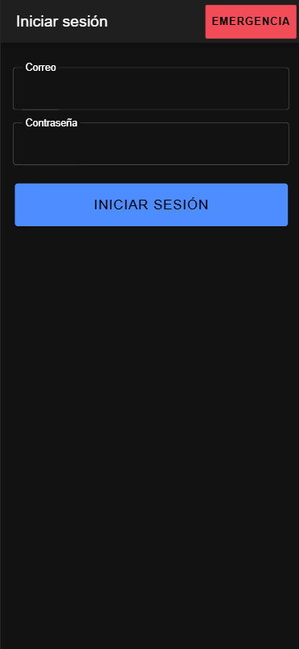
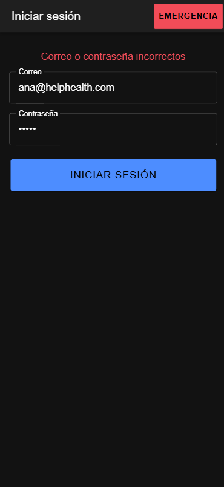
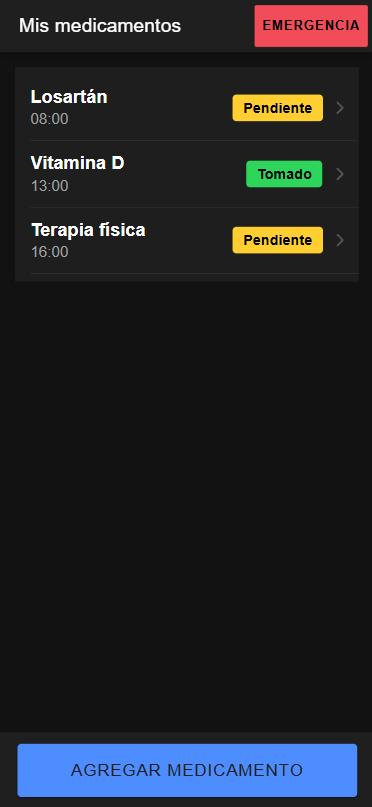
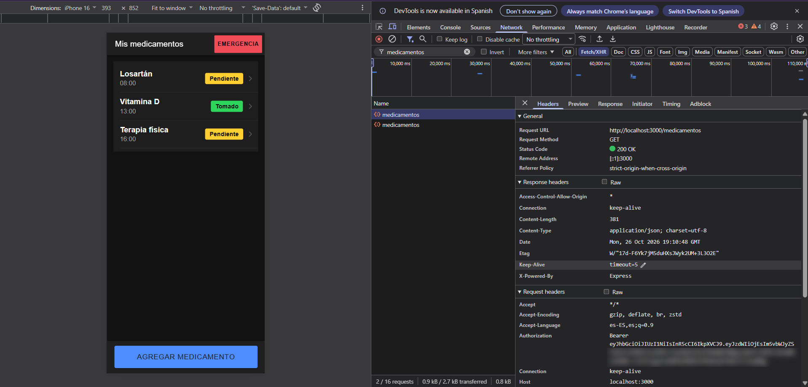
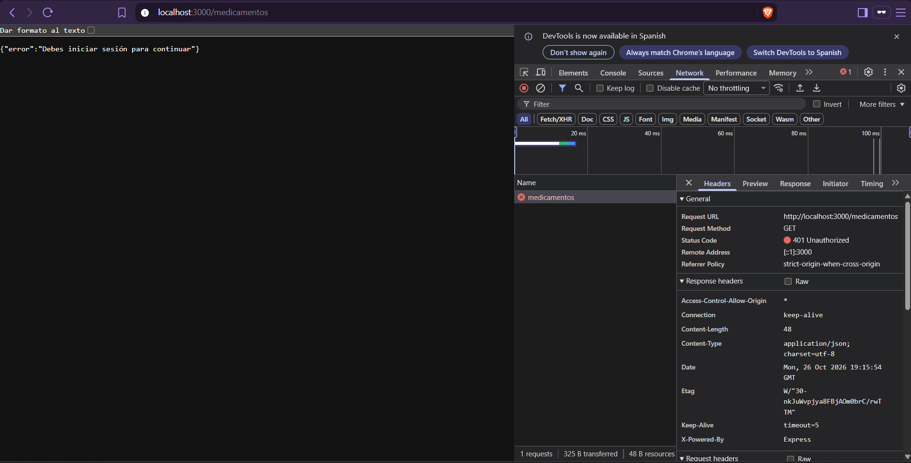
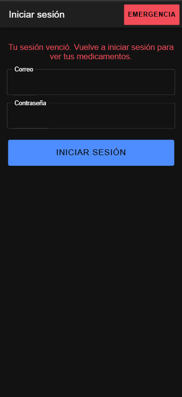
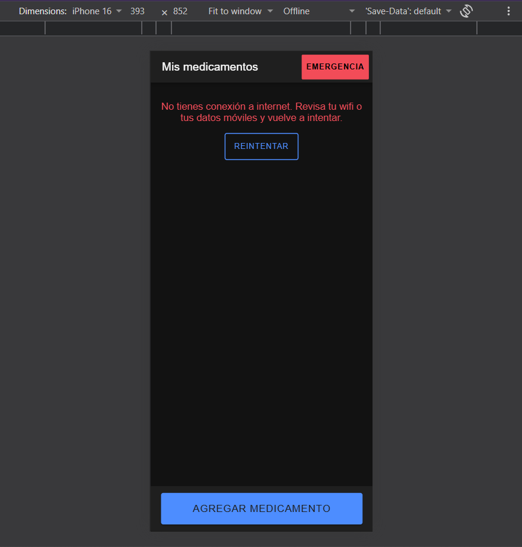
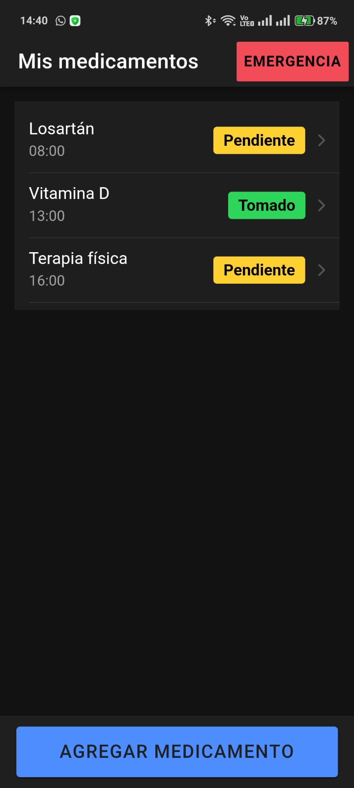
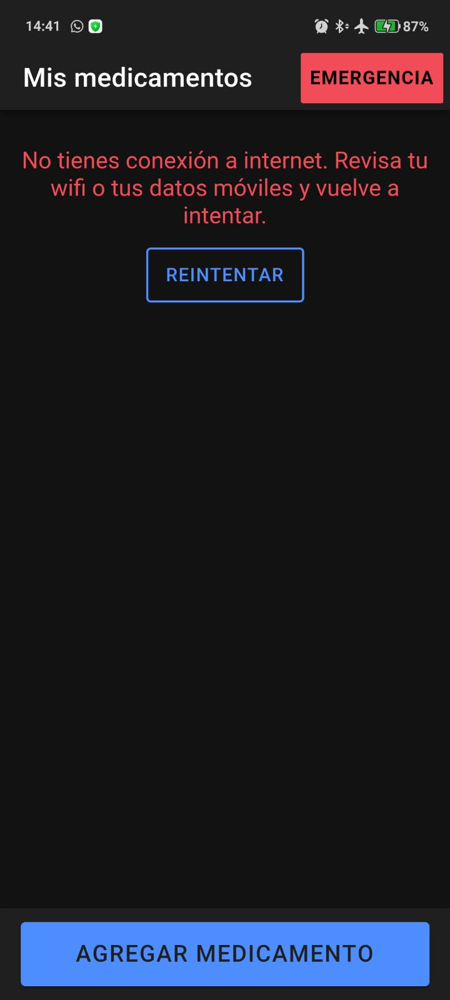

# Semana 13 · HelpHealth: inicio de sesión con token y manejo de la conexión

**Asignatura:** Programación Móvil
**Nombre:** Juan Camilo Bernal Gordillo
**Usuario de GitHub:** JuanBernalCorhuila

## Descripción

Hasta la semana 12 cualquiera que abriera HelpHealth veía la lista de medicamentos, y la API se los entregaba a cualquiera que los pidiera. Esta semana se cerró esa puerta: ahora el usuario **inicia sesión**, la API le entrega un **token JWT**, la app lo guarda en el **almacenamiento seguro** del teléfono y lo envía en cada petición a `/medicamentos`.

También se hizo que la app no se quede pegada cuando algo falla:

- Si el token **vence o no es válido** (el servidor responde **401**), la app borra el token y lleva al usuario al login con un mensaje que le explica qué pasó.
- Si **no hay internet**, la app lo detecta antes de hacer la petición y lo dice con un mensaje claro, distinto al de "el servidor no responde".

Todo el acceso a la API quedó en **un solo servicio** (`services/api.ts`): la URL, el token y los errores se manejan ahí y ninguna pantalla los repite.

Esto continúa lo que ya estaba definido en el proyecto:

- En el modelo de datos (semana 5), la entidad **Usuario** es dueña de sus medicamentos (`usuario_id`), y en la tabla de almacenamiento los *datos del perfil* van en el servidor para poder **iniciar sesión** desde otro dispositivo.
- Ahora la API usa ese `usuario_id`: cada usuario ve y crea **solo sus** medicamentos, y quién hace la petición sale del token, no de lo que envía la app.

## Cómo funciona

```
Pantalla (Login, Home, Detalle, Agregar)
   └─> authApi.ts / medicamentosApi.ts   (qué endpoint se llama)
         └─> api.ts                      (red, token, URL y errores: un solo lugar)
               ├─> tokenStorage.ts        (guarda el token en el almacenamiento seguro)
               └─> API Express  ──>  middleware verificarToken  ──>  /medicamentos
```

### 1. La API entrega el token (`api/routes/auth.js`)

`POST /login` recibe `{ correo, clave }`. Si son correctos, firma un JWT con el id del usuario y lo devuelve:

```js
const token = jwt.sign({ sub: usuario.id, nombre: usuario.nombre }, process.env.JWT_SECRET, {
  expiresIn: process.env.JWT_EXPIRES_IN || "15m",
});
res.json({ token });
```

- `sub` es el id del usuario; con eso la API sabe de quién son los medicamentos.
- `expiresIn` hace que el token **venza** (15 minutos por defecto). Así, si alguien llega a copiarlo, solo le sirve un rato.
- Si el correo no existe o la clave está mal, la respuesta es la misma (**401** "Correo o contraseña incorrectos"), para no revelar qué correos están registrados.

**La contraseña no se guarda.** En `data/usuarios.js` está el resultado de pasarla por `scrypt` (viene incluido en Node, no hace falta instalar nada) con una sal. Al iniciar sesión se calcula el hash de lo que escribió el usuario y se compara:

```js
const [sal, hashGuardado] = claveHash.split(":");
const hashEscrito = crypto.scryptSync(clave, sal, 64);
return crypto.timingSafeEqual(hashEscrito, Buffer.from(hashGuardado, "hex"));
```

La clave para firmar los tokens (`JWT_SECRET`) tampoco está en el código: se lee del archivo `.env`, que no se sube a GitHub. En el repositorio solo está `.env.example`, sin valores. Si falta, el servidor no arranca y lo dice.

### 2. La API protege los medicamentos (`api/middleware/autenticacion.js`)

En `server.js`, todo lo que empieza por `/medicamentos` pasa antes por un middleware que revisa el token:

```js
app.use("/", authRoutes); // POST /login es público
app.use("/medicamentos", verificarToken, medicamentosRoutes); // todo /medicamentos pide token
```

El middleware lee la cabecera `Authorization: Bearer <token>` y verifica la firma y la fecha de vencimiento. El servidor no guarda sesiones: le basta con el token.

```js
const datos = jwt.verify(token, process.env.JWT_SECRET);
req.usuario = { id: datos.sub }; // quién hace la petición sale del token, no del cuerpo
```

| Caso | Respuesta |
|---|---|
| Sin cabecera o sin `Bearer` | 401 "Debes iniciar sesión para continuar" |
| Token vencido | 401 "Tu sesión venció" |
| Token alterado o firmado con otra clave | 401 "Tu sesión no es válida" |
| Token válido | Pasa a la ruta, con `req.usuario.id` disponible |

En `routes/medicamentos.js` se usa ese id para filtrar la lista y el detalle, y para poner el dueño al crear un medicamento. Si la app enviara un `usuario_id` en el cuerpo, se ignora.

### 3. La app guarda el token de forma segura (`app/src/services/tokenStorage.ts`)

El token es como una llave temporal de la cuenta, así que no se guarda en `localStorage` ni en preferencias normales. Se usa el plugin `@aparajita/capacitor-secure-storage`:

```ts
export function guardarToken(token: string): Promise<void> {
  return SecureStorage.setItem(CLAVE_TOKEN, token);
}
```

- En **Android** el plugin cifra el dato (AES-GCM) con una llave que genera y guarda el **Android Keystore**, y solo esta app puede leerlo.
- En **iOS** lo guarda en el **Keychain**.
- En el **navegador** (`ionic serve`) usa `localStorage` sin cifrar. Sirve para desarrollar, pero no es seguro, por eso la app real es la del teléfono.

Se eligió este plugin porque es compatible con Capacitor 8, que es la versión que usa la app desde la semana 12.

### 4. El servicio central (`app/src/services/api.ts`)

Es la única parte de la app que llama a `fetch`. `medicamentosApi.ts` y `authApi.ts` solo dicen qué ruta piden; todo lo demás lo hace `pedir()` en este orden:

```ts
// 1. Sin red: se avisa antes de intentar la petición
const red = await Network.getStatus();
if (!red.connected) {
  throw new Error('No tienes conexión a internet. Revisa tu wifi o tus datos móviles y vuelve a intentar.');
}

// 2. El token va en la cabecera Authorization: Bearer <token>
cabeceras.set('Authorization', `Bearer ${token}`);

// 3. fetch lanza TypeError cuando no logra conectarse (hay red, pero el servidor no responde)

// 4. 401 en una ruta protegida: el token venció o no es válido. Se borra y se vuelve al login
if (resp.status === 401 && conToken) {
  await borrarToken();
  alPerderSesion('vencida');
  throw new Error('Tu sesión venció. Inicia sesión de nuevo.');
}

// 5. Cualquier otro error (400, 404, 500): fetch no lanza, hay que revisar resp.ok
```

- Para saber si hay red se usa el plugin oficial `@capacitor/network`. Así se distinguen dos problemas que el usuario arregla de forma distinta: **"no tengo internet"** (revisar wifi o datos) y **"el servidor no responde"** (esperar e intentar más tarde).
- El login llama a `pedir()` con `conToken = false`, porque es la única ruta pública. Por eso un 401 en el login muestra "Correo o contraseña incorrectos" y no saca al usuario a ninguna parte.
- Si no hay token guardado ni siquiera se hace la petición: se lleva al usuario al login.

Así se cambia una sola vez lo que antes estaría repetido en cada pantalla:

```ts
// medicamentosApi.ts: solo dice qué endpoint se llama
export function listarMedicamentos(): Promise<Medicamento[]> {
  return pedir<Medicamento[]>('/medicamentos');
}
```

### 5. Volver al login cuando se pierde la sesión (`app/src/App.tsx`)

El servicio no sabe de pantallas, solo avisa. En `App.tsx` se registra una sola vez qué hacer con ese aviso:

```tsx
const VigilanteSesion: React.FC = () => {
  const router = useIonRouter();
  useEffect(() => {
    cuandoSePierdaLaSesion((motivo) => {
      router.push(motivo === 'vencida' ? '/login?motivo=vencida' : '/login', 'root', 'replace');
    });
  }, [router]);
  return null;
};
```

Con `'root'` se limpia el historial de navegación, así el botón "atrás" no devuelve a una pantalla que ya no puede cargar datos. Como esto vive en un solo lugar, funciona igual si el 401 llega en la lista, en el detalle o al guardar un medicamento.

### 6. La pantalla de login (`app/src/pages/Login.tsx`)

Tiene el correo, la contraseña y un botón grande **Iniciar sesión**. Mantiene lo de accesibilidad de las semanas anteriores: campos con etiqueta visible, botón de 56px de alto, y los errores se leen apenas aparecen gracias a `role="alert"` de `MensajeError`.

| Estado | Qué ve el usuario |
|---|---|
| Enviando | El botón dice "Entrando..." y se desactiva para no enviar dos veces |
| Datos incorrectos | "Correo o contraseña incorrectos" |
| Campos vacíos | "Escribe tu correo y tu contraseña" |
| Llegó porque el token venció | "Tu sesión venció. Vuelve a iniciar sesión para ver tus medicamentos." |
| Sin internet / servidor apagado | El mensaje correspondiente del servicio |
| Datos correctos | Entra a "Mis medicamentos" |

El botón rojo **Emergencia** también está en el encabezado del login. La pantalla de emergencia no usa la API ni el token, y una persona que necesita ayuda no debería tener que iniciar sesión primero. Por eso su ruta sigue sin protección. El estilo de ese botón se movió a `theme/layout.css` para no copiarlo en dos pantallas.

En "Mis medicamentos", "Detalle" y "Agregar" no cambió nada visual: los errores de red y de servidor siguen saliendo en el `MensajeError` con **Reintentar** de la semana 11, solo que ahora con mensajes más precisos.

### 7. Excepción para probar en el teléfono (`android/.../network_security_config.xml`)

Android bloquea las conexiones HTTP sin cifrar. La API de desarrollo corre en el computador con HTTP, así que se agregó una excepción **solo para `localhost`**:

```xml
<domain-config cleartextTrafficPermitted="true">
    <domain includeSubdomains="false">localhost</domain>
</domain-config>
```

Con `adb reverse tcp:3000 tcp:3000`, el `localhost:3000` del teléfono apunta a la API del computador. Cualquier otro dominio sigue exigiendo HTTPS. Sin esto, en el teléfono no se podría comprobar que el token queda en el almacenamiento seguro.

## Estructura

```
13-week/03-optional-activity/
├── api/                                     -> backend con Node.js + Express
│   ├── .env.example                         -> JWT_SECRET y JWT_EXPIRES_IN, sin valores reales (nuevo)
│   ├── .gitignore                           -> ignora node_modules y .env
│   ├── package.json                         -> se agregó jsonwebtoken; start lee el .env
│   ├── server.js                            -> /login público y /medicamentos protegido
│   ├── middleware/
│   │   └── autenticacion.js                 -> verifica el token (nuevo)
│   ├── routes/
│   │   ├── auth.js                          -> POST /login (nuevo)
│   │   └── medicamentos.js                  -> filtra por el usuario del token
│   └── data/
│       ├── usuarios.js                      -> usuario de prueba con la clave en hash (nuevo)
│       └── medicamentos.js                  -> ahora con usuario_id
├── app/                                     -> app Ionic React
│   ├── package.json                         -> se agregaron el almacenamiento seguro y @capacitor/network
│   ├── android/
│   │   └── app/src/main/
│   │       ├── AndroidManifest.xml          -> usa la excepción de red
│   │       └── res/xml/network_security_config.xml  -> HTTP solo hacia localhost (nuevo)
│   └── src/
│       ├── App.tsx                          -> ruta /login y VigilanteSesion
│       ├── theme/layout.css                 -> estilo compartido del botón Emergencia
│       ├── services/
│       │   ├── api.ts                       -> servicio central: red, token, URL y errores (nuevo)
│       │   ├── tokenStorage.ts              -> guardar, leer y borrar el token (nuevo)
│       │   ├── authApi.ts                   -> iniciar sesión (nuevo)
│       │   ├── medicamentosApi.ts           -> ahora usa api.ts
│       │   └── ubicacionService.ts
│       ├── components/                      -> EstadoCarga, MensajeError, etc. (de la semana 11)
│       └── pages/
│           ├── Login.tsx / .css             -> pantalla de inicio de sesión (nuevo)
│           ├── Home.tsx / .css
│           ├── Detalle.tsx
│           ├── Agregar.tsx
│           └── Emergencia.tsx / .css
└── capturas/                                -> evidencias
```

## Cómo ejecutarlo

### 1. La API

```bash
cd api
npm install
copy .env.example .env      # en Windows (en Mac/Linux: cp .env.example .env)
```

Abre `.env` y escribe una clave en `JWT_SECRET`, por ejemplo `JWT_SECRET=helphealth-clave-de-desarrollo-2026`. Luego:

```bash
npm start
```

Debe decir `API en http://localhost:3000`. Se necesita Node 20.6 o más reciente, porque `npm start` usa `node --env-file=.env`.

**Usuario de prueba:** `ana@helphealth.com` / `Salud2026*`

### 2. La app en el navegador

```bash
cd app
npm install
ionic serve
```

### 3. Para ver cada caso

- **Login correcto:** entra con el usuario de prueba. Aparece "Mis medicamentos".
- **Login incorrecto:** escribe otra contraseña.
- **Petición protegida:** con las herramientas del navegador (F12 > Red), toca la petición `medicamentos` y mira la cabecera `Authorization: Bearer ...`. Abriendo `http://localhost:3000/medicamentos` directamente en el navegador (sin token) se ve el 401.
- **Token vencido (401):** apaga la API, cambia en `.env` a `JWT_EXPIRES_IN=1m`, enciéndela, inicia sesión y espera un minuto. Al tocar un medicamento para ver su detalle, la petición recibe 401 y la app vuelve al login con el aviso de sesión vencida.
- **Sin internet:** en F12 > Red, cambia "Sin limitación" por **Sin conexión** y toca "Reintentar".
- **Servidor apagado:** con internet, detén la API (Ctrl + C) y toca "Reintentar".

### 4. En un teléfono Android (para el almacenamiento seguro)

Con Android Studio y la depuración USB activada, igual que en la semana 12:

```bash
cd app
npm install
npm run build
npx cap sync android        # registra los plugins nuevos en el proyecto Android
adb reverse tcp:3000 tcp:3000  # con el celular conectado por USB
npx cap open android
```

Si Windows no reconoce `adb`, se usa con su ruta completa: `& "$env:LOCALAPPDATA\Android\Sdk\platform-tools\adb.exe" reverse tcp:3000 tcp:3000`. Este paso se repite cada vez que se desconecta el cable.

En Android Studio se presiona **Run ▶**. Con la API encendida en el computador, el login y la lista funcionan en el teléfono.

- **Token guardado de forma segura:** después de iniciar sesión, se cierra la app por completo y se vuelve a abrir. Entra directo a la lista sin pedir la contraseña, porque el token quedó cifrado en el almacenamiento del teléfono.
- **Sin internet:** se activa el **modo avión**, se entra a "Agregar medicamento" y se toca "Volver".

## Evidencias

### En el navegador

1. **Login:** la pantalla de inicio de sesión con el botón Emergencia arriba.
2. **Datos incorrectos:** el mensaje "Correo o contraseña incorrectos".
3. **Lista con token:** después de entrar, "Mis medicamentos" con los datos del usuario.
4. **Cabecera Authorization:** la petición a `/medicamentos` en la pestaña Red responde 200 y lleva el token en la cabecera. En la captura se difuminó la parte final del token, porque un token no se debe publicar.
5. **API sin token:** `/medicamentos` pedido sin token responde 401.
6. **Sesión vencida:** con el token vencido la app vuelve al login y explica por qué.
7. **Sin conexión:** con el navegador en modo "Offline", la lista muestra el mensaje de "No tienes conexión a internet" con "Reintentar". La app detecta que no hay red antes de llamar a la API, así que no se queda esperando una respuesta que no va a llegar.

| Login | Datos incorrectos | Lista con token |
|---|---|---|
|  |  |  |

| Cabecera Authorization | API sin token (401) |
|---|---|
|  |  |

| Sesión vencida | Sin conexión |
|---|---|
|  |  |

### En el celular

8. **Sesión guardada:** la lista en un celular Android real, después de cerrar la app por completo y volver a abrirla. No pidió iniciar sesión otra vez porque el token sigue guardado en el almacenamiento seguro del teléfono.
9. **Sin conexión en el celular:** con el modo avión activado, la app avisa que no hay internet y deja reintentar.

| Sesión guardada | Sin conexión en el celular |
|---|---|
|  |  |
