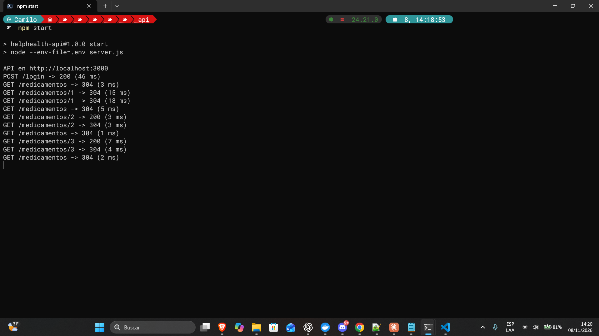
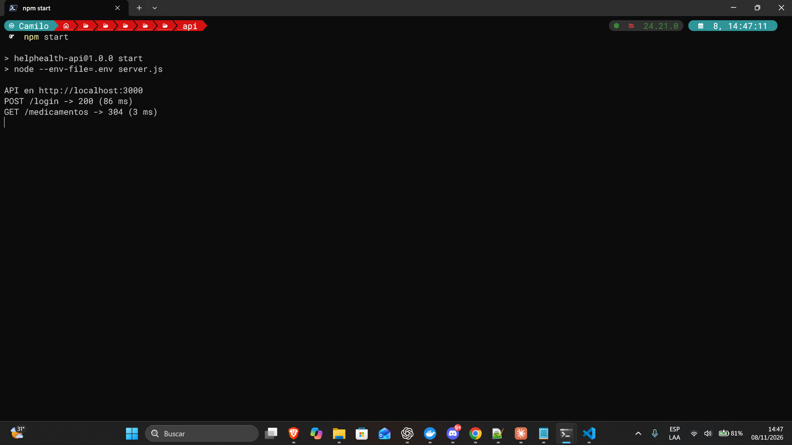
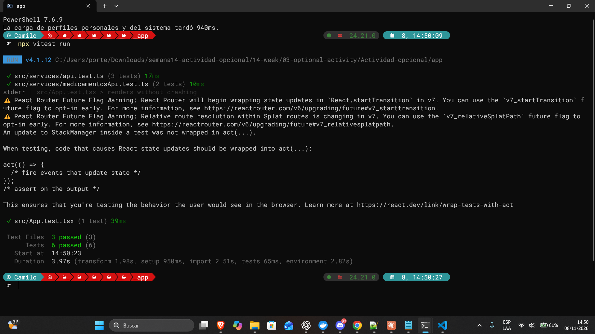

# Semana 14 · HelpHealth: optimización y pruebas

**Asignatura:** Programación Móvil
**Nombre:** Juan Camilo Bernal Gordillo
**Usuario de GitHub:** JuanBernalCorhuila

## Descripción

Esta semana se optimizó la pantalla **Mis medicamentos** de HelpHealth y se escribieron pruebas unitarias para comprobar que la mejora funciona. Se trabajó sobre la misma app y la misma API de las semanas anteriores (login con token, lista y detalle de medicamentos), sin cambiar cómo se ve ni cómo se usa.

Primero se **midió** y después se optimizó, porque optimizar sin medir es adivinar. La medición mostró un problema claro: la app le pedía a la API los mismos datos una y otra vez. En un celular eso gasta datos móviles y batería, y la persona espera más de lo necesario.

## Qué se encontró al medir

Para medir se agregó un registro en la API que escribe en la terminal cada petición que recibe. Con eso se recorrió una secuencia sencilla, la que haría cualquier persona: abrir la lista, entrar al detalle de cada uno de los tres medicamentos y volver a la lista después de cada uno.

Antes de optimizar, cada vez que se volvía a la lista la app la pedía otra vez, y cada detalle volvía a pedir un medicamento que la lista ya había traído completo. Resultado: **10 llamadas** para ver tres medicamentos.

## Qué se optimizó

Se guarda en memoria una copia de la lista de medicamentos durante un minuto. Mientras esa copia sea reciente, la app la reutiliza en lugar de llamar a la API. Los cambios son pequeños y están en tres archivos:

### 1. `app/src/services/cacheMedicamentos.ts` (nuevo)

Es la copia en memoria. Tiene tres funciones: guardar la lista, leerla (solo si todavía es reciente) y borrarla.

```ts
// Cuánto tiempo se considera "fresca" la copia. Con 0 nunca se reutiliza,
// que es como se comportaba la app antes de optimizar (útil para comparar).
export const VIGENCIA_MS = 60_000;

// Devuelve la lista guardada si todavía está vigente; si venció o no hay, devuelve null
export function leerCopia(): Medicamento[] | null {
  if (copia && Date.now() - copia.guardadaEn < VIGENCIA_MS) {
    return copia.datos;
  }
  return null;
}
```

Se puso una vigencia de un minuto porque los medicamentos cambian poco: así se evita el pedido repetido y, aun así, los datos no quedan viejos por mucho tiempo.

### 2. `app/src/services/medicamentosApi.ts` (modificado)

`listarMedicamentos` primero mira si hay una copia reciente. `obtenerMedicamento` la usa también: si el medicamento ya está en la lista guardada, no hace falta llamar a la API para pedirlo de nuevo. Y `crearMedicamento` borra la copia, porque después de agregar uno la lista guardada quedó incompleta.

```ts
export async function listarMedicamentos(): Promise<Medicamento[]> {
  const guardada = leerCopia();
  if (guardada) {
    return guardada;
  }
  const lista = await pedir<Medicamento[]>('/medicamentos');
  guardarCopia(lista);
  return lista;
}
```

### 3. `app/src/services/authApi.ts` (modificado)

La copia se borra al **iniciar y al cerrar sesión**. Es importante: si no se borrara, la siguiente persona que use el mismo teléfono podría ver por un momento los medicamentos de la anterior.

### Qué no cambió

La pantalla `Home.tsx` quedó igual (solo se actualizó un comentario). Sigue llamando a `listarMedicamentos()` cada vez que se muestra; la diferencia es que ahora esa función decide si de verdad hace falta ir a la API. El botón **Reintentar** también sigue funcionando: si una petición falla no se guarda nada, así que el reintento sí llama a la API.

También se agregó en `api/server.js` el registro de peticiones que se usó para medir. Solo escribe en la terminal; no cambia lo que responde la API.

## Medición: antes y después

La misma secuencia en las dos versiones (abrir la lista, entrar a los 3 medicamentos y volver a la lista cada vez). Las llamadas se contaron en la terminal de la API.

| | Antes (sin copia) | Después (con copia) |
|---|---|---|
| Llamadas a `/medicamentos` | **10** | **1** |
| Llamadas evitadas | 0 | 9 (el 90 %) |

**Antes** (`VIGENCIA_MS = 0`):

```
POST /login -> 200 (46 ms)
GET /medicamentos -> 304 (3 ms)
GET /medicamentos/1 -> 304 (15 ms)
GET /medicamentos/1 -> 304 (18 ms)
GET /medicamentos -> 304 (5 ms)
GET /medicamentos/2 -> 200 (3 ms)
GET /medicamentos/2 -> 304 (3 ms)
GET /medicamentos -> 304 (1 ms)
GET /medicamentos/3 -> 200 (7 ms)
GET /medicamentos/3 -> 304 (4 ms)
GET /medicamentos -> 304 (2 ms)
```

**Después** (`VIGENCIA_MS = 60_000`):

```
POST /login -> 200 (86 ms)
GET /medicamentos -> 304 (3 ms)
```

Dos detalles para leer bien estos números:

- **Por qué cada detalle aparece dos veces.** En modo desarrollo, React (`StrictMode`) ejecuta cada efecto dos veces para detectar errores, así que la pantalla de detalle pide su medicamento dos veces. Sin ese efecto serían 7 llamadas antes; con la copia en memoria, ninguna de esas repeticiones llega a la API.
- **Qué significa `304`.** El navegador le pregunta a la API si algo cambió y ella responde "no cambió". Sigue siendo una llamada de red, que es justo lo que la copia en memoria evita.

Cada llamada se ve rápida (de 1 a 18 milisegundos) porque la API corre en el mismo computador. En un teléfono con datos móviles cada una tardaría bastante más y gastaría datos y batería, así que la mejora real es mayor que la que muestra esta prueba local.

**Cómo repetir la medición:** `VIGENCIA_MS` está en `cacheMedicamentos.ts`. Con `0` la app se comporta como antes de optimizar (nunca reutiliza la copia); con `60_000` es la versión optimizada. Se cambia el número, se guarda, se reinicia la API y se repite la secuencia.

**Límite que hay que tener presente:** durante ese minuto la lista podría no mostrar un cambio hecho desde otro lugar (por ejemplo, un cuidador). Por eso la copia se borra al agregar un medicamento y al cambiar de sesión, que son los cambios que hace la propia app.

## Pruebas unitarias

Se escribieron **2 pruebas** en `app/src/services/medicamentosApi.test.ts`. No necesitan servidor ni teléfono: `pedir()` (la función que llama a la API) se reemplaza por una versión falsa que cuenta cuántas veces la llaman.

**Prueba 1: pedir la lista otra vez o abrir un detalle no vuelve a llamar a la API.** Es la que demuestra la optimización.

```ts
await listarMedicamentos();                      // única llamada real
const otraVez = await listarMedicamentos();      // sale de la copia en memoria
const detalle = await obtenerMedicamento('2');   // también sale de la copia

expect(pedir).toHaveBeenCalledTimes(1);
expect(otraVez).toEqual(lista);
expect(detalle).toEqual(vitaminaD);
```

**Prueba 2: después de crear un medicamento, la lista se pide de nuevo y no muestra datos viejos.** Comprueba que la optimización no cause errores: si la copia no se borrara al agregar un medicamento, la lista nueva no aparecería.

```ts
await listarMedicamentos();
await crearMedicamento({ nombre: nuevo.nombre, horario: nuevo.horario, dosis: nuevo.dosis });
const actualizada = await listarMedicamentos();

expect(pedir).toHaveBeenCalledTimes(3); // se volvió a pedir la lista en lugar de usar la copia vieja
expect(actualizada).toHaveLength(3);
```

**Resultado:** pasan las dos. Además, las pruebas de las semanas anteriores se conservaron y también siguen pasando (3 del servicio `api.ts` y 1 de arranque de la app). Eso sirve de red de seguridad: se cambió `medicamentosApi.ts` y nada de lo anterior se rompió.

```
✓ src/App.test.tsx (1 test)
✓ src/services/api.test.ts (3 tests)
✓ src/services/medicamentosApi.test.ts (2 tests)

Test Files  3 passed (3)
     Tests  6 passed (6)
```

## Estructura

```
14-week/03-optional-activity/Actividad-opcional/
├── README.md
├── .gitignore                                -> evita subir dependencias, secretos y archivos generados
├── api/                                      -> backend con Node.js + Express
│   ├── .env.example                          -> JWT_SECRET y JWT_EXPIRES_IN, sin valores reales
│   ├── package.json
│   ├── server.js                             -> ahora también registra cada petición (modificado)
│   ├── middleware/autenticacion.js
│   ├── routes/
│   └── data/
├── app/                                      -> app Ionic React
│   ├── package.json
│   ├── android/
│   └── src/
│       ├── pages/
│       │   └── Home.tsx                      -> Mis medicamentos (solo un comentario nuevo)
│       └── services/
│           ├── cacheMedicamentos.ts          -> copia en memoria de la lista (nuevo)
│           ├── medicamentosApi.ts            -> usa la copia (modificado)
│           ├── medicamentosApi.test.ts       -> las 2 pruebas unitarias (nuevo)
│           ├── authApi.ts                    -> borra la copia al iniciar/cerrar sesión (modificado)
│           ├── api.ts / api.test.ts          -> sin cambios
│           └── tokenStorage.ts, ubicacionService.ts
└── capturas/                                 -> evidencias
```

## Cómo ejecutarlo

### 1. La API

```bash
cd api
npm install
copy .env.example .env      # en Windows (en Mac/Linux: cp .env.example .env)
```

Abre `.env` y escribe una clave en `JWT_SECRET`, por ejemplo `JWT_SECRET=helphealth-clave-de-desarrollo-2026`. Luego:

```bash
npm start
```

Debe decir `API en http://localhost:3000`. A partir de ahí, cada petición que haga la app aparece en esa terminal.

**Usuario de prueba:** `ana@helphealth.com` / `Salud2026*`

### 2. La app

```bash
cd app
npm install
npm run dev -- --port 8100
```

Se abre en `http://localhost:8100`.

### 3. Las pruebas

```bash
cd app
npx vitest run
```

### 4. Repetir la medición

1. Con la API encendida, inicia sesión en la app.
2. Entra a **Losartán**, toca **Volver**; entra a **Vitamina D**, **Volver**; entra a **Terapia física**, **Volver**. Hazlo en menos de un minuto.
3. Cuenta las líneas `GET /medicamentos` en la terminal de la API.

## Evidencias

| Antes: 10 llamadas (`VIGENCIA_MS = 0`) | Después: 1 llamada (`VIGENCIA_MS = 60_000`) |
|---|---|
|  |  |

