# Corte 3 · HelpHealth: app con hardware y conectividad

**Asignatura:** Programación Móvil
**Nombre:** Juan Camilo Bernal Gordillo
**Usuario de GitHub:** JuanBernalCorhuila

## Descripción

Esta entrega junta en una sola app dos cosas que HelpHealth venía construyendo por separado y las deja funcionando de punta a punta:

- **El hardware del teléfono:** el botón de **Emergencia** usa el GPS con el plugin `@capacitor/geolocation`. Antes de leer la ubicación la app revisa el permiso y, si hace falta, lo pide; si la persona lo niega, se le explica cómo activarlo en lugar de dejarla sin respuesta.
- **La conectividad:** la persona **inicia sesión**, la API le entrega un **token JWT**, la app lo guarda en el almacenamiento seguro y lo manda en cada petición protegida a `/medicamentos`. Si el token venció (**401**) o no hay internet, la app lo detecta y lo explica con un mensaje claro.

Además se agregaron dos cosas para cerrar el trabajo con calidad:

- **Una prueba unitaria** (`app/src/services/api.test.ts`) que comprueba, sin necesidad de teléfono ni servidor, que el servicio de la API maneja bien el token, el 401 y la falta de internet.
- **Un botón "Cerrar sesión"** en la pantalla de medicamentos. Sin él, la persona podía entrar pero no salir, y la navegación quedaba incompleta.

Todo continúa lo que ya estaba definido en el proyecto: la historia del botón de emergencia (H2, requerimiento RF2) y el modelo de datos donde el **Usuario** es dueño de sus medicamentos (`usuario_id`). Las pantallas siguen los wireframes y mantienen lo de accesibilidad de las semanas anteriores (botones grandes, etiquetas visibles, errores que el lector de pantalla anuncia).

## Cómo funciona

```
Pantallas (Login, Mis medicamentos, Detalle, Agregar, Emergencia)
   │
   ├─ ubicacionService.ts ──> plugin Geolocation ──> permiso + GPS
   │
   └─ authApi.ts / medicamentosApi.ts     (qué endpoint se llama)
         └─> api.ts                       (red, token, URL y errores: un solo lugar)
               ├─> tokenStorage.ts         (token en almacenamiento seguro)
               └─> API Express ──> verificarToken ──> /medicamentos
```

### 1. Plugin de ubicación con permisos (`app/src/services/ubicacionService.ts`)

La ubicación es un dato sensible, así que el sistema operativo obliga a pedir permiso. El servicio sigue siempre el mismo orden: revisar, pedir si hace falta y solo entonces leer el GPS.

```ts
let permiso = await Geolocation.checkPermissions();
if (permiso.location === 'prompt' || permiso.location === 'prompt-with-rationale') {
  permiso = await Geolocation.requestPermissions(); // aquí aparece el diálogo del sistema
}
return permiso.location === 'granted' || permiso.coarseLocation === 'granted';
```

- En Android el usuario puede elegir ubicación **precisa** o **aproximada**; las dos sirven para la emergencia, por eso se aceptan ambas.
- El servicio no lanza errores sin explicación: devuelve uno de tres resultados (`ok`, `denegado` o `error`) y la pantalla decide qué mostrar.
- Si el GPS del teléfono está apagado, el mensaje lo dice con esas palabras y no confunde ese caso con el de "no diste permiso".

También hay que **declarar** el permiso en `app/android/app/src/main/AndroidManifest.xml`; sin eso el diálogo nunca aparece:

```xml
<uses-permission android:name="android.permission.ACCESS_COARSE_LOCATION" />
<uses-permission android:name="android.permission.ACCESS_FINE_LOCATION" />
```

### 2. La pantalla de Emergencia y sus tres estados (`app/src/pages/Emergencia.tsx`)

La pantalla muestra solo uno de estos estados a la vez:

| Estado | Qué ve la persona |
|---|---|
| Cargando | "Obteniendo tu ubicación..." mientras responde el GPS |
| Datos | Latitud y longitud (el lector de pantalla las anuncia con `role="status"`) |
| Error | Permiso denegado (con los pasos para activarlo en Ajustes) o GPS apagado |

El botón **Emergencia** está arriba en "Mis medicamentos" y en el login: una persona que necesita ayuda no debe tener que iniciar sesión primero, por eso esta ruta no está protegida y no usa la API.

### 3. La API entrega el token y protege los medicamentos (`api/`)

`POST /login` recibe `{ correo, clave }` y, si son correctos, firma un JWT que vence a los 15 minutos (se puede cambiar con `JWT_EXPIRES_IN`). La contraseña nunca se guarda: en `data/usuarios.js` solo está su hash con `scrypt`, y la clave para firmar los tokens vive en el archivo `.env`, que no se sube a GitHub.

En `server.js` todo lo que empieza por `/medicamentos` pasa antes por un middleware:

```js
app.use("/", authRoutes); // POST /login es público
app.use("/medicamentos", verificarToken, medicamentosRoutes); // todo /medicamentos pide token
```

El middleware (`middleware/autenticacion.js`) lee la cabecera `Authorization: Bearer <token>` y responde **401** con un mensaje distinto según el caso:

| Caso | Respuesta |
|---|---|
| Sin cabecera o sin `Bearer` | 401 "Debes iniciar sesión para continuar" |
| Token vencido | 401 "Tu sesión venció" |
| Token alterado o con otra clave | 401 "Tu sesión no es válida" |
| Token válido | Pasa a la ruta, y el dueño de los datos sale del token |

### 4. La app guarda el token y lo envía (`app/src/services/`)

- **`tokenStorage.ts`** guarda el token con `@aparajita/capacitor-secure-storage`: en Android se cifra con una llave del Android Keystore y solo esta app puede leerlo. No se usa `localStorage`, porque el token es como una llave temporal de la cuenta. (En el navegador el plugin sí usa `localStorage`, por eso la prueba real de seguridad se hace en el teléfono.)
- **`api.ts`** es el único lugar donde aparece `fetch`. Cada petición pasa por la misma función, `pedir()`, que decide en este orden:

```ts
// 1. Sin red: se avisa antes de intentar la petición
const red = await Network.getStatus();
if (!red.connected) {
  throw new Error('No tienes conexión a internet. Revisa tu wifi o tus datos móviles y vuelve a intentar.');
}

// 2. El token va en la cabecera Authorization: Bearer <token>
cabeceras.set('Authorization', `Bearer ${token}`);

// 3. 401 en una ruta protegida: el token venció. Se borra y se vuelve al login
if (resp.status === 401 && conToken) {
  await borrarToken();
  alPerderSesion('vencida');
  throw new Error('Tu sesión venció. Inicia sesión de nuevo.');
}
```

Se separan dos problemas que la persona arregla de forma distinta: **"no tengo internet"** (revisar wifi o datos) y **"el servidor no responde"** (esperar). Un 401 en el login no saca a nadie de la pantalla: ahí solo significa "correo o contraseña incorrectos".

### 5. Navegación y estados de la lista (`app/src/App.tsx`, `pages/Home.tsx`)

Las rutas son `/login`, `/home` (Mis medicamentos), `/agregar`, `/detalle/:id` y `/emergencia`. Cuando el servicio avisa que se perdió la sesión, `App.tsx` lleva al login con `router.push('/login', 'root', 'replace')`; con `'root'` se limpia el historial y el botón "atrás" no regresa a una pantalla que ya no puede cargar datos.

"Mis medicamentos" muestra un estado a la vez: **cargando** ("Cargando tus medicamentos..."), **datos** (la lista), **error** (mensaje con botón *Reintentar*) y, si no hay ningún medicamento, un aviso de lista vacía. Cada fila de la lista usa `key={m.id}`, para que React sepa cuál fila es cuál y no vuelva a dibujar de más.

El botón **Cerrar sesión** (al pie de la pantalla, debajo de "Agregar medicamento") borra el token y devuelve al login. Se puso abajo y no en la cabecera porque en un celular angosto la cabecera ya tiene el título y el botón de Emergencia, y un tercer botón dejaba el título cortado.

```ts
// authApi.ts
export function cerrarSesion(): Promise<void> {
  return borrarToken();
}
```

El servidor no guarda sesiones, así que borrar el token de la app es suficiente.

### 6. La prueba unitaria (`app/src/services/api.test.ts`)

Se probó `pedir()` porque es la pieza que concentra las decisiones importantes de conectividad, y una función así se puede probar **aislada**: el plugin de red, el almacenamiento del token y `fetch` se reemplazan por versiones falsas, así que la prueba corre en segundos, sin teléfono y sin la API encendida. Tiene tres casos:

```ts
test('un 401 en una ruta protegida borra el token y manda al usuario al login', async () => {
  vi.mocked(obtenerToken).mockResolvedValue('token-vencido');
  fetchFalso.mockResolvedValue(new Response(JSON.stringify({ error: 'Tu sesión venció' }), { status: 401 }));

  await expect(pedir('/medicamentos')).rejects.toThrow('Tu sesión venció');

  expect(borrarToken).toHaveBeenCalledTimes(1);          // el token que ya no sirve se elimina
  expect(alPerderSesion).toHaveBeenCalledWith('vencida'); // y se avisa para ir al login
});
```

Los otros dos casos comprueban que **sin internet no se llama a la API** y que **el token viaja en la cabecera `Authorization`**. Se verificó que la prueba sirve de verdad: al quitar a propósito la línea que borra el token, el primer caso falla.

Estas pruebas son la red de seguridad del servicio: si más adelante alguien cambia `api.ts` y rompe el manejo del 401, se entera en segundos y no cuando un usuario real se quede atascado.

## Quality & connectivity

HelpHealth asks for the location permission only when the user taps the emergency button, and it always checks the current status first with `checkPermissions()` before showing the system dialog with `requestPermissions()`. If the user denies it, the app does not crash or stay blank: the location service returns a "denied" result and the screen explains how to enable the permission in the phone settings. After a successful login, the API returns a JWT that expires after 15 minutes, and the app stores it in Capacitor's secure storage (Android Keystore) instead of `localStorage`. Every protected request goes through one single function, `pedir()`, which sends the token in the `Authorization: Bearer` header, so no screen has to repeat that logic. When the server answers `401` on a protected route, the app deletes the expired token, redirects the user to the login screen and explains why the session ended. Before sending any request, the app asks the Capacitor Network plugin whether there is a connection, which lets it show "no internet" separately from "the server is not responding", two problems the user fixes in different ways. Each screen shows exactly one of three states (loading, data or error), and the error state always offers a retry button. Finally, a unit test with Vitest mocks the network, the token storage and `fetch` to check the 401 handling, the offline case and the `Authorization` header, so a future change cannot silently break the connectivity layer.

## Estructura

```
14-week/03-optional-activity/c3-activity/
├── README.md
├── .gitignore                                -> evita subir dependencias, secretos y archivos generados
├── api/                                      -> backend con Node.js + Express
│   ├── .env.example                          -> JWT_SECRET y JWT_EXPIRES_IN, sin valores reales
│   ├── .gitignore                            -> ignora node_modules y .env
│   ├── package.json
│   ├── server.js                             -> /login público y /medicamentos protegido
│   ├── middleware/
│   │   └── autenticacion.js                  -> verifica el token y responde 401
│   ├── routes/
│   │   ├── auth.js                           -> POST /login
│   │   └── medicamentos.js                   -> filtra por el usuario del token
│   └── data/
│       ├── usuarios.js                       -> usuario de prueba con la clave en hash
│       └── medicamentos.js
├── app/                                      -> app Ionic React
│   ├── package.json
│   ├── android/                              -> proyecto Android (permisos de ubicación declarados)
│   │   └── app/src/main/
│   │       ├── AndroidManifest.xml
│   │       └── res/xml/network_security_config.xml  -> HTTP solo hacia localhost (desarrollo)
│   └── src/
│       ├── App.tsx                           -> rutas y vigilante de sesión
│       ├── theme/layout.css                  -> estilos compartidos (Emergencia y Cerrar sesión)
│       ├── services/
│       │   ├── api.ts                        -> red, token, URL y errores en un solo lugar
│       │   ├── api.test.ts                   -> prueba unitaria de api.ts (nuevo)
│       │   ├── tokenStorage.ts               -> guardar, leer y borrar el token
│       │   ├── authApi.ts                    -> iniciar y cerrar sesión
│       │   ├── medicamentosApi.ts
│       │   └── ubicacionService.ts           -> plugin de GPS con permisos
│       ├── components/                       -> EstadoCarga, EstadoVacio, MensajeError, etc.
│       └── pages/
│           ├── Login.tsx / .css
│           ├── Home.tsx / .css               -> Mis medicamentos (con Cerrar sesión)
│           ├── Detalle.tsx
│           ├── Agregar.tsx
│           └── Emergencia.tsx / .css         -> GPS con permiso
└── capturas/                                 -> evidencias
```

## Cómo ejecutarlo

### 1. La API

```bash
cd api
npm install
copy .env.example .env      # en Windows (en Mac/Linux: cp .env.example .env)
```

Abre `.env` y escribe una clave en `JWT_SECRET`, por ejemplo `JWT_SECRET=helphealth-clave-de-desarrollo-2026`. Luego:

```bash
npm start
```

Debe decir `API en http://localhost:3000`. Se necesita Node 20.6 o más reciente.

**Usuario de prueba:** `ana@helphealth.com` / `Salud2026*`

### 2. La app en el navegador

```bash
cd app
npm install
ionic serve                      # abre http://localhost:8100
```

Si no tienes Ionic CLI instalado, se puede arrancar directamente con Vite:

```bash
npm run dev -- --port 8100
```

### 3. La prueba unitaria

```bash
cd app
npx vitest run
```

Deben pasar los 3 casos de `api.test.ts` y la prueba de arranque de `App.test.tsx`.

### 4. Para ver cada caso

- **Login correcto:** entra con el usuario de prueba; aparece "Mis medicamentos".
- **Login incorrecto:** escribe otra contraseña.
- **Petición protegida:** en F12 > Red, toca la petición `medicamentos` y mira la cabecera `Authorization: Bearer ...`. Abriendo `http://localhost:3000/medicamentos` directo en el navegador (sin token) se ve el 401.
- **Token vencido (401):** apaga la API, pon `JWT_EXPIRES_IN=1m` en `.env`, enciéndela, inicia sesión y espera un minuto. Al tocar un medicamento, la app vuelve al login con el aviso de sesión vencida.
- **Sin internet:** en F12 > Red cambia "Sin limitación" por **Sin conexión** y toca "Reintentar".
- **Cerrar sesión:** toca "Cerrar sesión" al pie de la pantalla; vuelve al login.
- **Ubicación:** entra a Emergencia y toca "Obtener mi ubicación". El navegador pregunta por el permiso; si lo bloqueas, aparece el mensaje de permiso denegado.

### 5. En un teléfono Android (permisos y almacenamiento seguro)

Con Android Studio y la depuración USB activada:

```bash
cd app
npm install
npm run build
npx cap sync android
adb reverse tcp:3000 tcp:3000   # con el celular conectado por USB; se repite si se desconecta el cable
npx cap open android
```

Si Windows no reconoce `adb`, se usa con su ruta completa: `& "$env:LOCALAPPDATA\Android\Sdk\platform-tools\adb.exe" reverse tcp:3000 tcp:3000`. En Android Studio se presiona **Run ▶**.

- **Permiso de ubicación:** al tocar "Obtener mi ubicación" por primera vez aparece el diálogo del sistema. Si se elige "Permitir", salen las coordenadas; si se niega, aparece el mensaje con los pasos para activarlo.
- **Token guardado de forma segura:** después de iniciar sesión, cierra la app por completo y ábrela otra vez; entra directo a la lista.
- **Sin internet:** con el modo avión activado, la lista avisa que no hay conexión y deja reintentar.

## Evidencias

### Dónde se tomó cada captura

Las capturas están hechas en dos lugares a propósito, porque cada cosa se ve mejor en un sitio distinto.

**En el celular Android** (la app instalada con Android Studio): las capturas 01, 02, 03, 07, 09 y 10. Es la app de verdad, la misma que usaría una persona. Ahí el token se guarda con el almacenamiento seguro del teléfono, el modo avión corta la conexión de verdad y el GPS es el del dispositivo. Por eso el login, la lista, el aviso de sin conexión y el resultado de dar o negar el permiso de ubicación se muestran desde el celular.

**En el navegador del computador** (con las herramientas de desarrollador, F12) y en la terminal: las capturas 04, 05, 06, 08 y 11. Hay cosas que solo se pueden ver desde ahí. La cabecera `Authorization` y los códigos 401 aparecen en la pestaña Red, la respuesta de la API sin token se ve abriendo su dirección en el navegador, y la prueba unitaria se ejecuta en la terminal del computador. En la captura 08 el permiso de ubicación aparece como el aviso del navegador; es el mismo código y el mismo flujo del plugin (revisar el permiso y pedirlo si hace falta), solo que en el navegador el aviso lo muestra el propio navegador y en el teléfono lo muestra Android.

En resumen: lo que se ve y se siente en la app y en el hardware, en el celular; lo que está por debajo (cabeceras, códigos de error y pruebas), en el computador.

### Conectividad y token

| Login (celular) | Datos incorrectos (celular) | Lista con token (celular) |
|---|---|---|
| 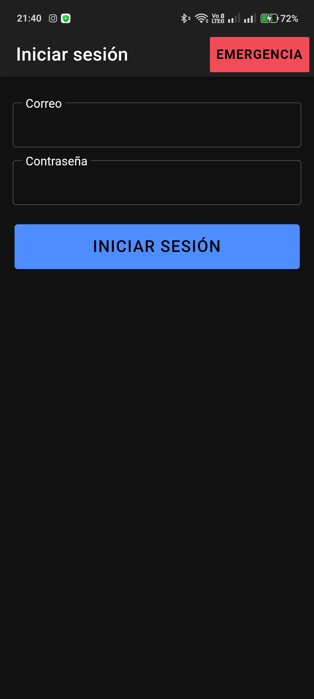 | 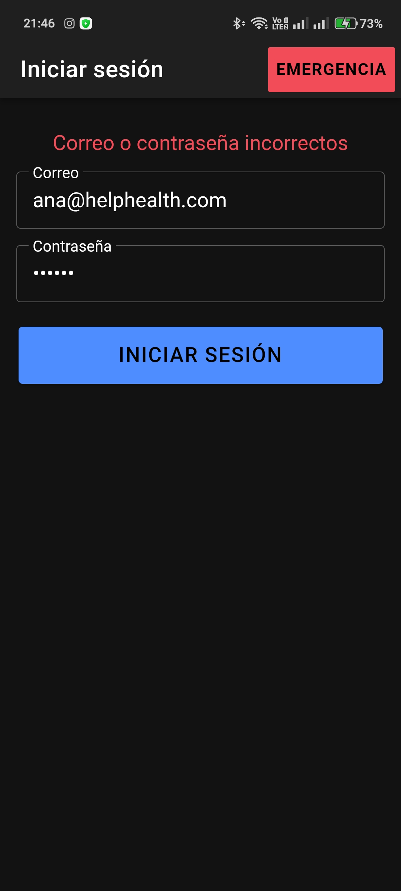 | 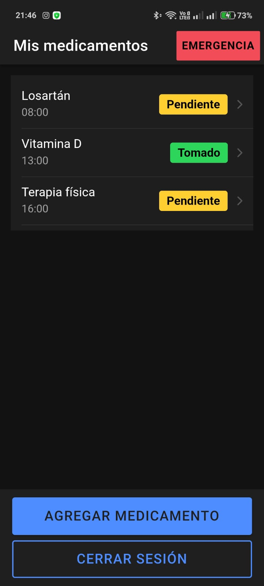 |

| Cabecera Authorization (navegador) | API sin token, 401 (navegador) |
|---|---|
| 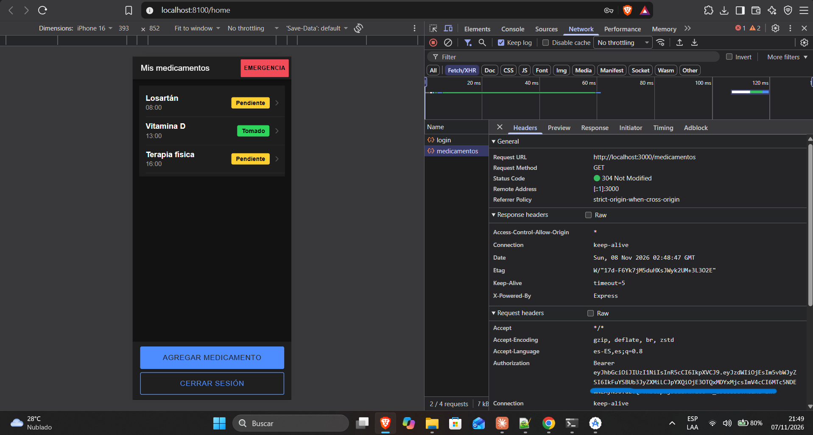 | 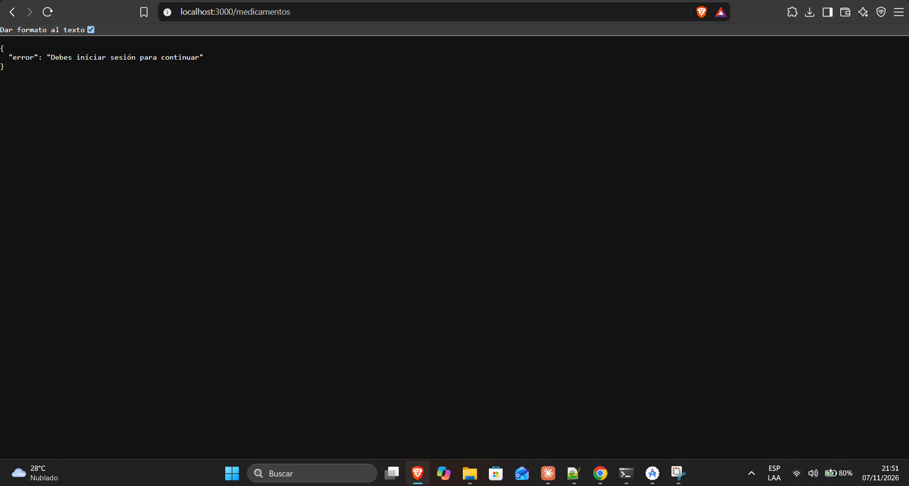 |

| Sesión vencida, 401 (navegador) | Sin conexión (celular) |
|---|---|
| 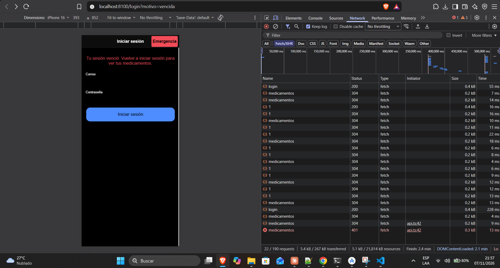 | 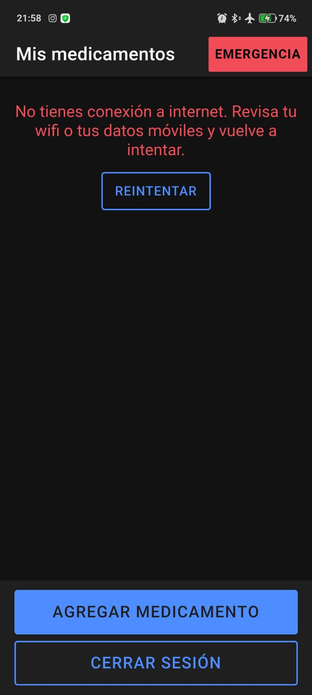 |

En la captura de la cabecera se tapó la parte final del token, porque un token no se debe publicar.

### Plugin de ubicación y permisos

| Permiso solicitado (navegador) | Ubicación obtenida (celular) | Permiso denegado (celular) |
|---|---|---|
| 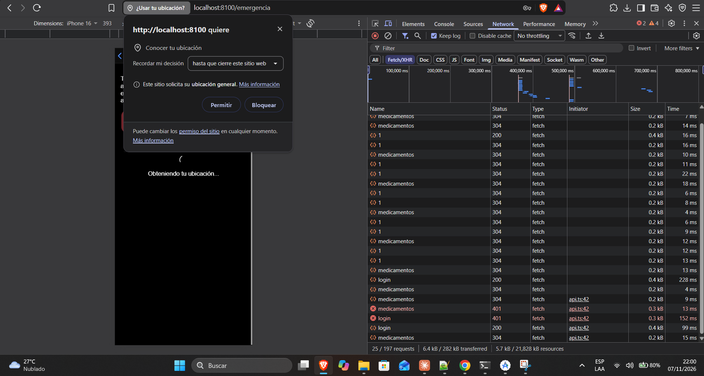 | 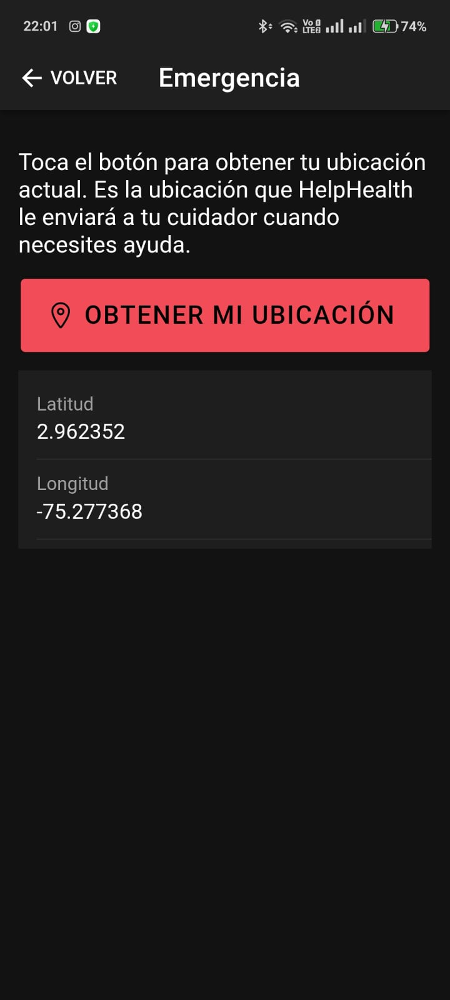 | 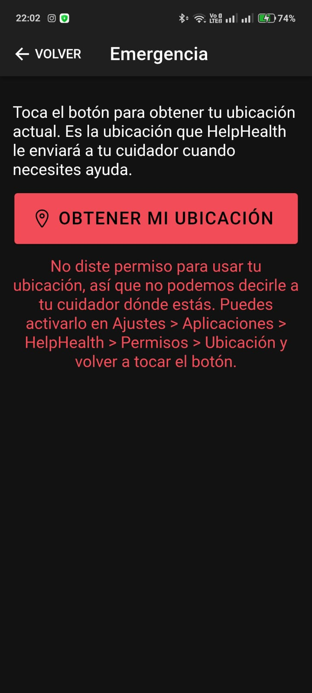 |

### Prueba unitaria (computador)

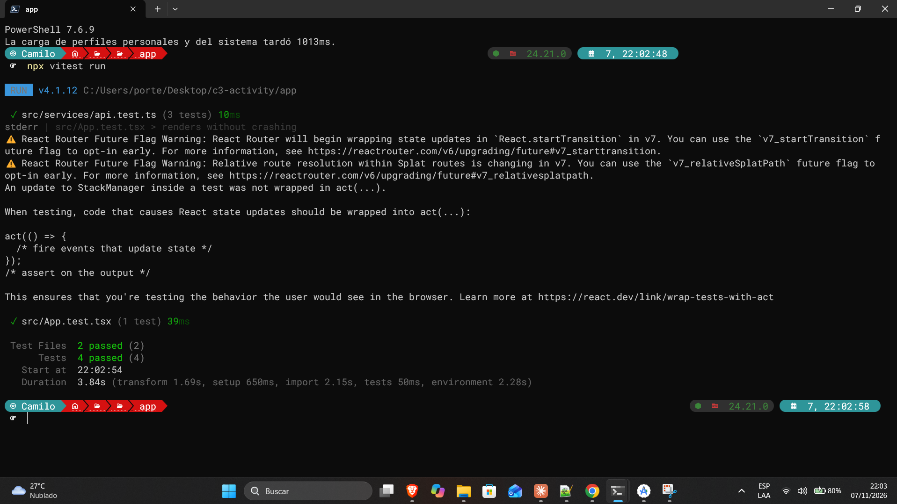