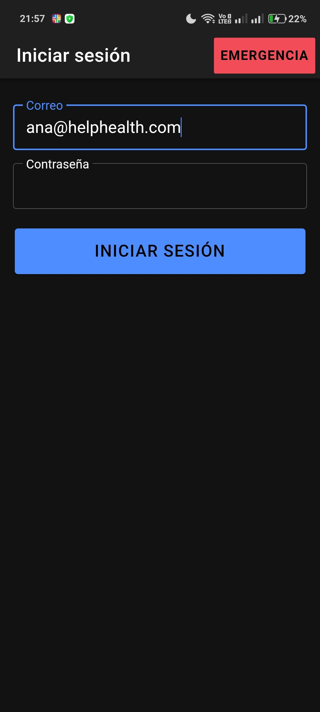
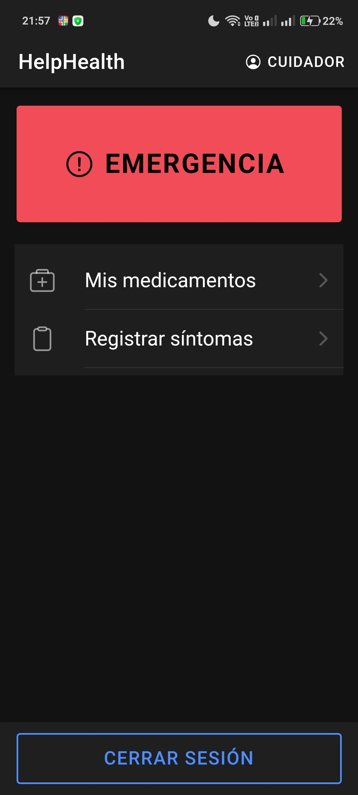
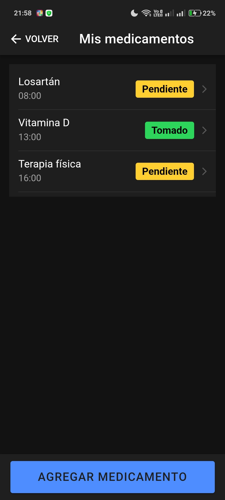
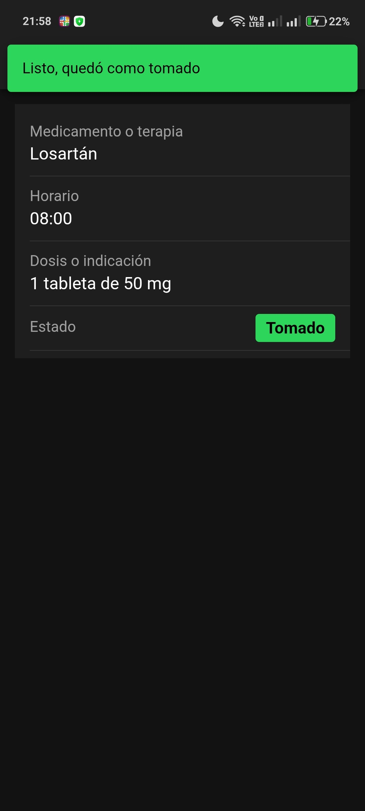
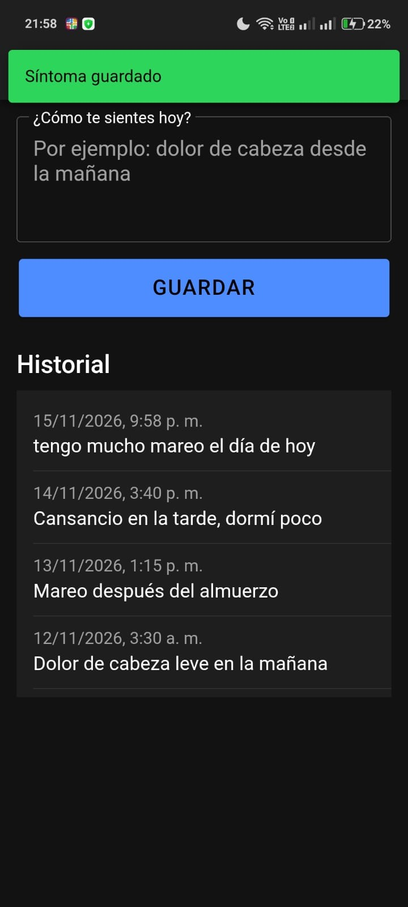
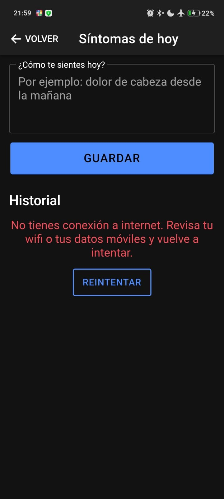
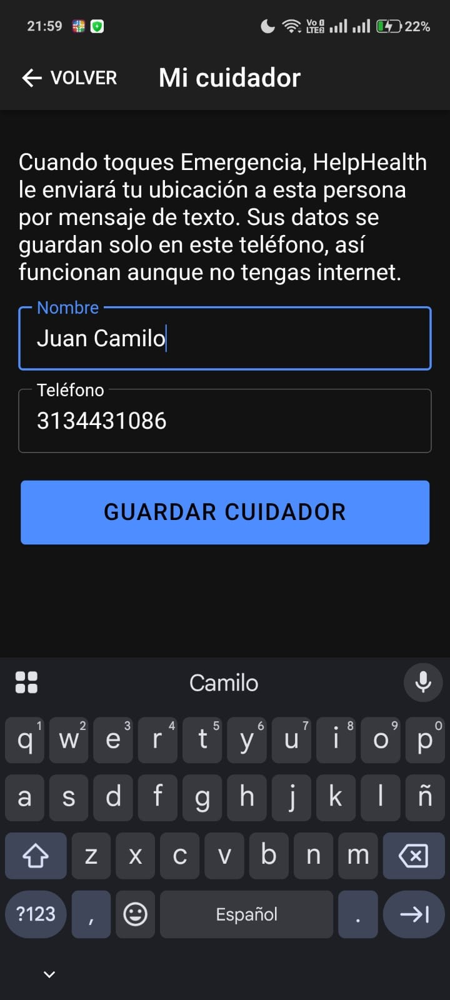
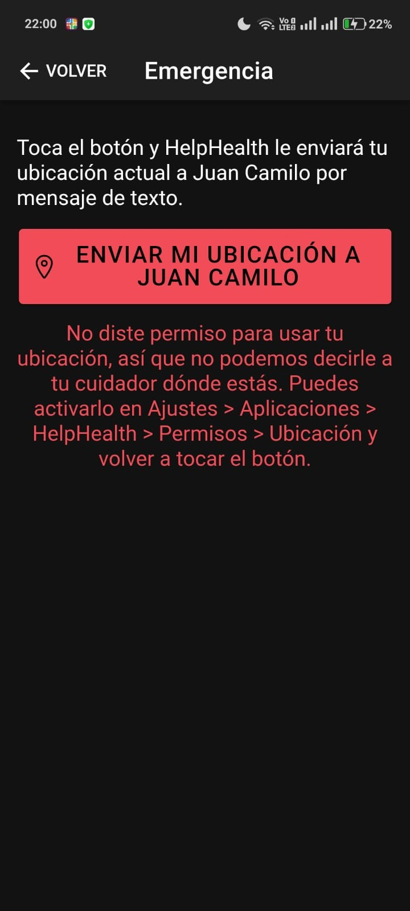
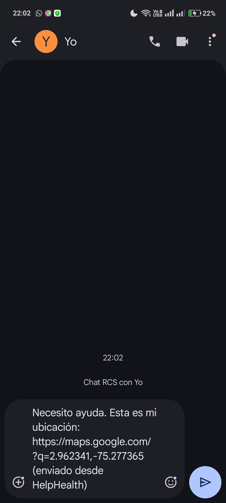
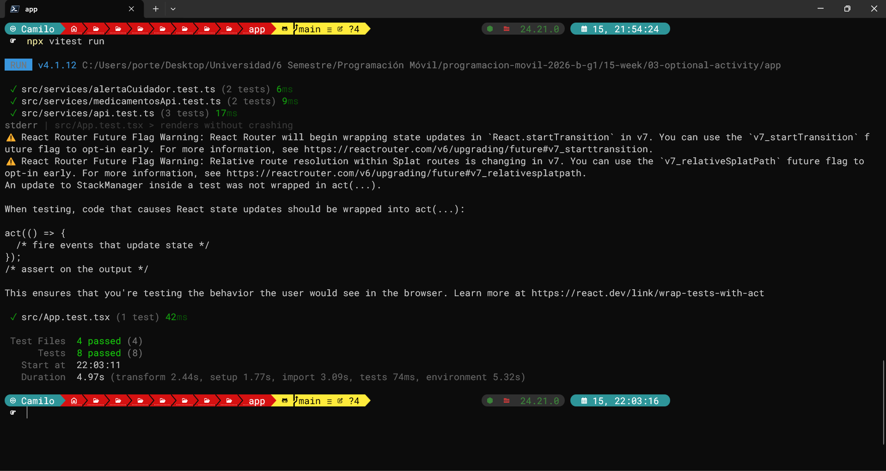

# Semana 15 · HelpHealth: MVP funcional de punta a punta

**Asignatura:** Programación Móvil
**Nombre:** Juan Camilo Bernal Gordillo
**Usuario de GitHub:** JuanBernalCorhuila

## El problema

Las personas con discapacidad motriz, visual o auditiva suelen tener dificultades para manejar su salud por su cuenta: se les olvidan los medicamentos o las terapias, les cuesta pedir ayuda rápido en una emergencia y la mayoría de apps de salud no están pensadas para ellas. **HelpHealth** es una app accesible para estas personas y para sus cuidadores.

Desde el Corte 1 el MVP se definió con tres funciones imprescindibles:

| Historia | Función | Cómo quedó en esta entrega |
|---|---|---|
| **H1** | Medicamentos y terapias | Lista con horario y estado, detalle, agregar uno nuevo y marcarlo como **tomado** o **pospuesto** |
| **H2** | Botón de emergencia | Un toque obtiene la ubicación con el GPS y abre un **SMS al cuidador** con el enlace del mapa |
| **H3** | Registro de síntomas | Escribir cómo se siente la persona y ver el **historial ordenado por fecha** |

Hasta la semana 14 la app tenía el login, los medicamentos y una pantalla de Emergencia que solo mostraba las coordenadas. Esta semana se cerró el flujo completo: se agregó la **pantalla principal** del wireframe 1, el **registro de síntomas** del wireframe 3, la confirmación de los medicamentos y el envío de la ubicación al **cuidador**, que se guarda en el teléfono. Así la app ya hace lo que prometen las tres historias, con las pantallas y el mapa de navegación que se dibujaron en la semana 4.

La planificación completa sigue siendo la del Corte 1 y no cambió: el [backlog con las 6 historias](../../05-week/03-optional-activity/anexos/02-backlog.md) (H1, H2 y H3 imprescindibles en los primeros sprints), los [requerimientos y el caso de uso de emergencia](../../05-week/03-optional-activity/anexos/03-requerimientos-caso-uso.md) y el [modelo de datos con los wireframes y el mapa de navegación](../../05-week/03-optional-activity/anexos/04-modelo-datos-wireframes.md). Las historias deseables (H4, H5 y H6) quedan por fuera del MVP, como estaba previsto.

## Tecnologías elegidas y por qué

| Tecnología | Para qué | Por qué |
|---|---|---|
| **Ionic React + TypeScript** | La app (pantallas, navegación y estado) | Desde la planificación se eligió una app **híbrida**: un solo código para Android e iOS. En la semana 1 se mencionó Flutter como ejemplo, pero se usó Ionic React porque es el énfasis del curso, se escribe con React y TypeScript (lo mismo que se usa en web) y sus componentes ya traen buen soporte de accesibilidad (etiquetas, roles y tamaños táctiles). |
| **Capacitor** | Llegar al hardware del teléfono | Es el puente que usa Ionic para los plugins nativos y para generar el proyecto de Android Studio. |
| `@capacitor/geolocation` | GPS para la emergencia | La ubicación es lo que el cuidador necesita para llegar. |
| `@capacitor/preferences` | Guardar el cuidador en el teléfono (**nuevo**) | El botón de emergencia tiene que funcionar sin internet y sin sesión iniciada, como se decidió en la tabla de almacenamiento de la semana 4. |
| `@aparajita/capacitor-secure-storage` | Guardar el token | El token es como una llave de la cuenta, por eso va cifrado y no en `localStorage`. |
| `@capacitor/network` | Saber si hay internet | Para distinguir "no tienes internet" de "el servidor no responde". |
| **Node.js + Express** | La API | Es liviana, habla JSON y se usa desde la semana 8. |
| **JWT** (`jsonwebtoken`) | Sesión | El servidor no guarda sesiones; cada petición trae su token. |
| **Vitest** | Pruebas unitarias | Viene con el proyecto de Ionic y corre en segundos, sin teléfono ni servidor. |

## Cómo funciona

```
App (pantallas + estado)
   │
   ├─ servicios de la API: authApi, medicamentosApi, sintomasApi
   │     └─> api.ts  (fetch, token, sin red, 401 y errores en un solo lugar)
   │           └─> API Express ──> verificarToken ──> /medicamentos, /sintomas
   │
   └─ plugins del teléfono
         ├─ ubicacionService.ts  ──> Geolocation (GPS con permiso)
         ├─ cuidadorStorage.ts   ──> Preferences (cuidador guardado en el teléfono)
         └─ tokenStorage.ts      ──> almacenamiento seguro (token)
```

### Flujo principal y navegación

```
Login ──> Inicio ─┬─> Mis medicamentos ─┬─> Detalle (Ya lo tomé / Posponer)
                  │                     └─> Agregar medicamento
                  ├─> Registrar síntomas (formulario + historial)
                  ├─> Emergencia ──> SMS al cuidador
                  └─> Cuidador (nombre y teléfono)
```

Es el mismo mapa de navegación de la semana 4: todo parte de **Inicio** y se regresa con "Volver". La única ruta pública, además del login, es **Emergencia**: una persona que necesita ayuda no debe tener que iniciar sesión primero, por eso también se puede abrir desde el login.

## Qué se hizo

### 1. Pantalla principal (`app/src/pages/Inicio.tsx`)

Sigue el wireframe 1: el botón **Emergencia** grande y rojo arriba (8rem de alto, fácil de tocar con poca precisión), debajo los accesos a **Mis medicamentos** y **Registrar síntomas**, y arriba a la derecha el acceso al **Cuidador** (el `[config]` del wireframe). **Cerrar sesión** se pasó aquí, al pie, porque ahora esta es la pantalla de entrada.

Antes de mostrarse revisa si hay sesión; si no la hay, manda al login:

```tsx
useIonViewWillEnter(() => {
  haySesion().then((activa) => {
    if (!activa) router.push('/login', 'root', 'replace');
  });
});
```

La antigua `Home.tsx` pasó a llamarse `Medicamentos.tsx` (ruta `/medicamentos`), porque ya no es la pantalla de inicio. Su pie solo tiene "Agregar medicamento", y sus estilos del pie se movieron a `theme/layout.css` porque ahora los comparten Inicio y Medicamentos.

### 2. Registro de síntomas (H3)

**En la API** (`api/routes/sintomas.js`): `GET /sintomas` devuelve solo los registros del usuario del token, del más reciente al más antiguo; `POST /sintomas` guarda uno nuevo y el servidor pone la fecha y la hora. Las dos rutas pasan por el mismo `verificarToken` de los medicamentos, porque los síntomas también son datos privados.

```js
// server.js
app.use("/sintomas", verificarToken, sintomasRoutes);

// routes/sintomas.js
const propios = sintomas
  .filter((s) => s.usuario_id === req.usuario.id)
  .sort((a, b) => b.fecha.localeCompare(a.fecha)); // las fechas ISO se ordenan como texto
```

Los datos de prueba (`api/data/sintomas.js`) tienen los campos de la entidad **RegistroSintoma** del modelo de datos: `id`, `usuario_id`, `fecha`, `tipo` y `contenido`.

**En la app** (`pages/Sintomas.tsx`): arriba el campo "¿Cómo te sientes hoy?" y el botón **Guardar**; abajo el **Historial**, como en el wireframe 3. Las llamadas están en `services/sintomasApi.ts`, que usa la misma función `pedir()` de los medicamentos, así que el token, la falta de internet y el 401 se manejan igual sin repetir código. El historial muestra un estado a la vez: cargando, error con *Reintentar*, vacío o la lista. La fecha se muestra como la leería una persona ("15/11/2026, 9:15 p. m.") con `toLocaleString('es-CO')`.

Por ahora el registro es por texto; la nota de voz que aparece en el wireframe queda para una versión posterior.

### 3. Marcar un medicamento como tomado o pospuesto (H1)

El modelo de datos ya tenía `estado_confirmacion` (pendiente, tomado o pospuesto), pero la app solo lo mostraba. Ahora el **Detalle** tiene dos botones grandes: **Ya lo tomé** y **Posponer**. Si el medicamento ya está tomado, los botones no aparecen.

La API recibe el cambio con `PATCH /medicamentos/:id` y solo acepta los tres estados válidos:

```js
const ESTADOS = ["pendiente", "tomado", "pospuesto"];

if (!ESTADOS.includes(estado_confirmacion)) {
  return res.status(400).json({ error: "El estado debe ser pendiente, tomado o pospuesto" });
}
```

Se usó `PATCH` y no `PUT` porque solo cambia un campo, no el medicamento completo. En la app, `cambiarEstado()` (`services/medicamentosApi.ts`) borra la copia en memoria de la lista que se agregó en la semana 14; si no, al volver a "Mis medicamentos" se vería el estado anterior durante un minuto.

### 4. Cuidador guardado en el teléfono (almacenamiento local)

`pages/Cuidador.tsx` pide el **nombre** y el **teléfono** del contacto de confianza (entidad **Cuidador** del modelo de datos) y `services/cuidadorStorage.ts` lo guarda con el plugin **Preferences**:

```ts
export async function guardarCuidador(cuidador: Cuidador): Promise<void> {
  // Preferences solo guarda texto, por eso el objeto se convierte a JSON
  await Preferences.set({ key: CLAVE_CUIDADOR, value: JSON.stringify(cuidador) });
}
```

Se guarda en el teléfono y no en la API porque así se decidió en la semana 4: el botón de emergencia tiene que poder usarlo **aunque no haya internet ni sesión**. Si el nombre está vacío o el teléfono tiene menos de 7 dígitos, la pantalla lo explica en lugar de guardar algo que no sirve.

### 5. Emergencia: ubicación por SMS al cuidador (H2)

Antes, la pantalla de Emergencia obtenía las coordenadas y ahí se quedaba. Ahora, con un solo toque, el botón **"Enviar mi ubicación a Carlos"** pide el permiso si hace falta, lee el GPS y abre la app de mensajes del teléfono con el número del cuidador y este texto ya escrito:

> Necesito ayuda. Esta es mi ubicación: https://maps.google.com/?q=2.927300,-75.281900 (enviado desde HelpHealth)

```ts
if (obtenido.tipo === 'ok' && cuidador) {
  const sms = enlaceSms(cuidador, obtenido.ubicacion);
  setEnlace(sms);
  window.location.href = sms; // abre la app de mensajes con el número y el texto
}
```

El mensaje lo arma `services/alertaCuidador.ts` con un enlace `sms:` y un enlace de Google Maps, que el cuidador puede abrir desde cualquier celular. Se eligió el SMS porque no necesita internet (es el flujo alternativo 2 del caso de uso de la semana 3) ni un servidor de notificaciones. La persona solo confirma tocando "Enviar" en su app de mensajes: Android no deja que una app envíe un SMS sin que el usuario lo vea, y eso también evita alertas enviadas por error.

Si todavía no hay cuidador guardado, la pantalla lo dice y ofrece el botón **Guardar mi cuidador**; mientras tanto se puede obtener la ubicación igual. Lo que ya existía se mantiene: el permiso denegado y el GPS apagado se explican con mensajes claros.

### 6. Pruebas

Se agregó `services/alertaCuidador.test.ts` con **2 pruebas** del mensaje que recibe el cuidador, porque si ese enlace sale mal, el SMS va a un número equivocado o sin la ubicación:

```ts
test('el mensaje lleva un enlace de Google Maps con la ubicación', () => {
  const enlace = enlaceSms(cuidador, ubicacion);
  const mensaje = decodeURIComponent(enlace.split('?body=')[1]);

  expect(mensaje).toContain('Necesito ayuda');
  expect(mensaje).toContain('https://maps.google.com/?q=2.927300,-75.281900');
});
```

La otra comprueba que el número quede sin espacios ni guiones (`300 123-4567` → `3001234567`). Las pruebas de las semanas anteriores siguen pasando: 3 de `api.ts` (token, 401 y sin internet), 2 de la copia en memoria y 1 de arranque de la app.

```
✓ src/App.test.tsx (1 test)
✓ src/services/api.test.ts (3 tests)
✓ src/services/medicamentosApi.test.ts (2 tests)
✓ src/services/alertaCuidador.test.ts (2 tests)

Test Files  4 passed (4)
     Tests  8 passed (8)
```

## Estructura

```
15-week/03-optional-activity/
├── README.md
├── .gitignore
├── api/                                  -> backend con Node.js + Express
│   ├── .env.example                      -> JWT_SECRET y JWT_EXPIRES_IN, sin valores reales
│   ├── package.json
│   ├── server.js                         -> /login público; /medicamentos y /sintomas con token
│   ├── middleware/autenticacion.js       -> verifica el token y responde 401
│   ├── routes/
│   │   ├── auth.js                       -> POST /login
│   │   ├── medicamentos.js               -> GET, POST y PATCH (nuevo) de /medicamentos
│   │   └── sintomas.js                   -> GET y POST de /sintomas (nuevo)
│   └── data/
│       ├── usuarios.js
│       ├── medicamentos.js
│       └── sintomas.js                   -> registros de prueba (nuevo)
├── app/                                  -> app Ionic React
│   ├── package.json                      -> se agregó @capacitor/preferences
│   ├── android/                          -> proyecto Android (permisos de ubicación)
│   └── src/
│       ├── App.tsx                       -> rutas y vigilante de sesión
│       ├── theme/layout.css              -> estilos compartidos
│       ├── services/
│       │   ├── api.ts / api.test.ts      -> fetch, token y errores en un solo lugar
│       │   ├── authApi.ts                -> iniciar y cerrar sesión, ¿hay sesión?
│       │   ├── medicamentosApi.ts        -> ahora también cambiarEstado()
│       │   ├── sintomasApi.ts            -> (nuevo)
│       │   ├── cuidadorStorage.ts        -> cuidador con Preferences (nuevo)
│       │   ├── alertaCuidador.ts / .test.ts -> mensaje SMS y sus pruebas (nuevo)
│       │   ├── cacheMedicamentos.ts, tokenStorage.ts, ubicacionService.ts
│       ├── components/                   -> FormularioSintoma y ListaSintomas (nuevos),
│       │                                    EstadoCarga, EstadoVacio, MensajeError, etc.
│       └── pages/
│           ├── Login.tsx
│           ├── Inicio.tsx / .css          -> pantalla principal (nuevo)
│           ├── Medicamentos.tsx           -> antes Home.tsx
│           ├── Detalle.tsx / .css         -> Ya lo tomé / Posponer
│           ├── Agregar.tsx
│           ├── Sintomas.tsx / .css        -> (nuevo)
│           ├── Cuidador.tsx / .css        -> (nuevo)
│           └── Emergencia.tsx / .css      -> ahora envía el SMS
└── capturas/                             -> evidencias
```

## Cómo ejecutarlo

### 1. La API

```bash
cd api
npm install
copy .env.example .env      # en Windows (en Mac/Linux: cp .env.example .env)
```

Abre `.env` y escribe una clave en `JWT_SECRET`, por ejemplo `JWT_SECRET=helphealth-clave-de-desarrollo-2026`. Luego:

```bash
npm start
```

Debe decir `API en http://localhost:3000`. Se necesita Node 20.6 o más reciente.

**Usuario de prueba:** `ana@helphealth.com` / `Salud2026*`

### 2. La app en el navegador

```bash
cd app
npm install
npm run dev -- --port 8100
```

Se abre en `http://localhost:8100`. En el navegador el cuidador queda en `localStorage`, y el enlace del SMS no abre nada porque el computador no tiene app de mensajes: ese paso se prueba en el teléfono.

### 3. Las pruebas

```bash
cd app
npx vitest run
```

### 4. En un teléfono Android

Con Android Studio y la depuración USB activada:

```bash
cd app
npm run build
npx cap sync android
adb reverse tcp:3000 tcp:3000
npx cap open android
```

`npx cap sync` es necesario esta vez porque se agregó el plugin Preferences. En Android Studio se presiona **Run ▶**.

### 5. Recorrido del flujo principal

1. Inicia sesión: aparece **Inicio**.
2. **Mis medicamentos** → toca Losartán → **Ya lo tomé**. Al volver, la lista ya lo muestra como "Tomado".
3. Vuelve a Inicio → **Registrar síntomas** → escribe cómo te sientes → **Guardar**. Aparece de primero en el historial.
4. Vuelve a Inicio → **Cuidador** → guarda un nombre y tu propio número para probar.
5. **Emergencia** → **Enviar mi ubicación a…** → acepta el permiso → se abre la app de mensajes con el texto y el enlace del mapa.
6. Con el modo avión activado, entra a síntomas o medicamentos: aparece el aviso de que no hay conexión y el botón *Reintentar*. La emergencia sigue funcionando, porque el cuidador está guardado en el teléfono.

## Evidencias

| Login | Inicio | Mis medicamentos |
|---|---|---|
|  |  |  |

| Medicamento marcado como tomado | Síntomas e historial | Sin conexión |
|---|---|---|
|  |  |  |

| Cuidador guardado | Permiso de ubicación denegado | SMS al cuidador |
|---|---|---|
|  |  |  |

En la captura 08 el permiso de ubicación estaba negado en el teléfono: la app no se queda en blanco, explica cómo activarlo en Ajustes. Después de activarlo, el mismo botón abrió el mensaje para el cuidador con la ubicación (captura 09).


