# HelpHealth · Entrada de portafolio

**Asignatura:** Programación Móvil (2026-B) · Semana 16
**Nombre:** Juan Camilo Bernal Gordillo
**Usuario de GitHub:** JuanBernalCorhuila

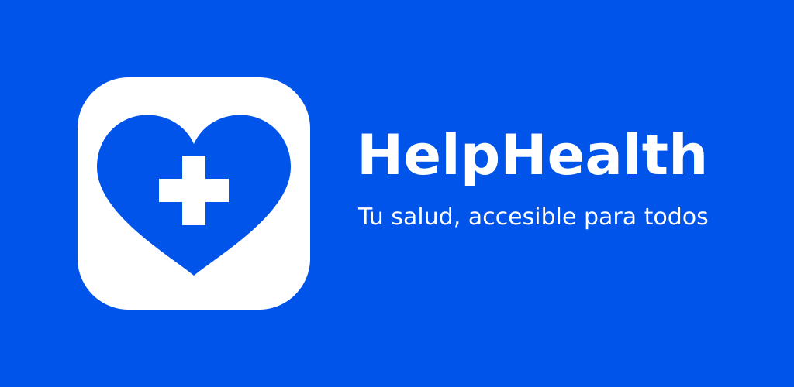

> HelpHealth es una app de salud pensada para personas con discapacidad motriz, visual o auditiva y para quienes las cuidan. Sirve para llevar los medicamentos, pedir ayuda con un botón de emergencia y anotar cómo se siente uno. La hice con Ionic React, Capacitor y una API en Node.js.

Para esta última semana partí del código de la [semana 15](../../15-week/03-optional-activity/README.md), que ya tenía todo lo que fui construyendo desde la semana 8, y lo preparé para publicarlo. La entrega tiene tres partes:

| Parte | Dónde está |
|---|---|
| Cómo se prepara la app para la tienda (build, ícono, permisos, firma y ficha) | [`despliegue.md`](despliegue.md) |
| Los ajustes que hice en la revisión final | [`retroalimentacion.md`](retroalimentacion.md) |
| La entrada de portafolio | Este README |

## Qué hace la app

Muchas personas con discapacidad tienen problemas para manejar su salud solas: se les olvidan los medicamentos o las terapias, les cuesta pedir ayuda rápido en una emergencia y casi ninguna app de salud está pensada para ellas. Por eso HelpHealth se enfoca en tres cosas, que son las tres historias imprescindibles que definí en el Corte 1:

| Historia | Función | Qué puede hacer la persona |
|---|---|---|
| **H1** | Mis medicamentos | Ver sus medicamentos y terapias con el horario y el estado, agregar uno nuevo y marcarlo como **tomado** o **pospuesto** |
| **H2** | Botón de emergencia | Con un solo toque, mandarle su **ubicación por SMS** a su cuidador, aunque no tenga internet ni haya iniciado sesión |
| **H3** | Registro de síntomas | Escribir cómo se siente y ver su **historial** ordenado por fecha |

## Capturas

Esta semana las pantallas no cambiaron (los ajustes fueron de despliegue y configuración), así que las capturas 01 a 10 son las mismas de la [semana 15](../../15-week/03-optional-activity/README.md#evidencias). La del ícono (16) y las del despliegue, que están en [`despliegue.md`](despliegue.md#evidencias-del-despliegue), sí son nuevas.

| Login | Inicio | Mis medicamentos |
|---|---|---|
| 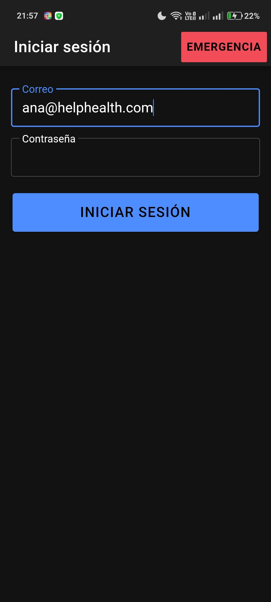 | 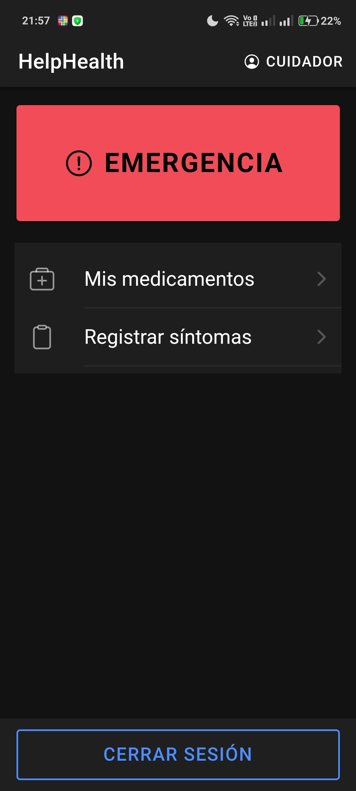 | 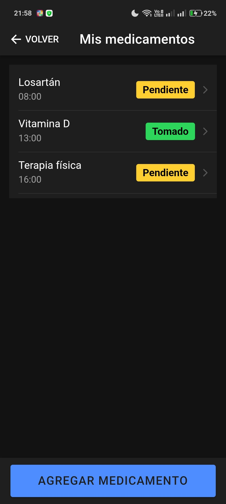 |

| Medicamento tomado | Síntomas e historial | Sin conexión |
|---|---|---|
| 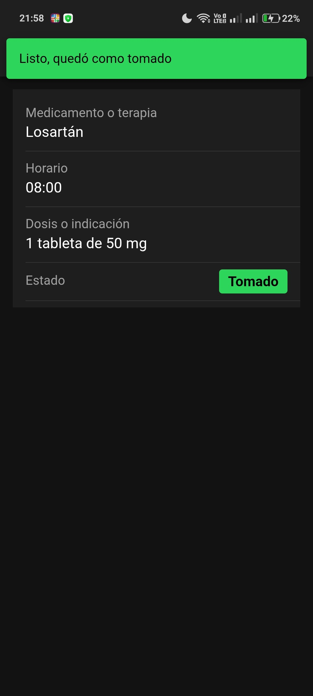 | 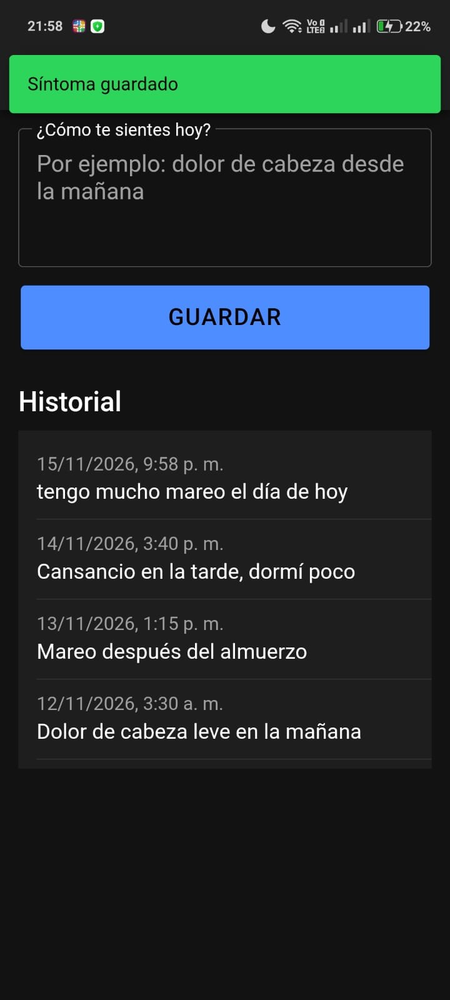 | 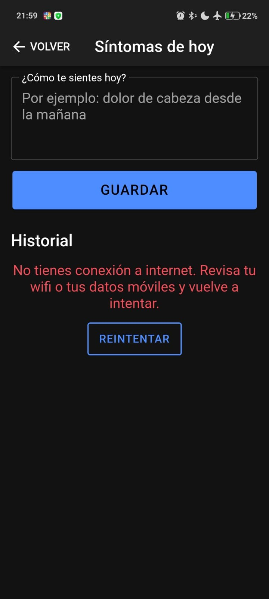 |

| Cuidador | Permiso de ubicación denegado | SMS al cuidador |
|---|---|---|
| 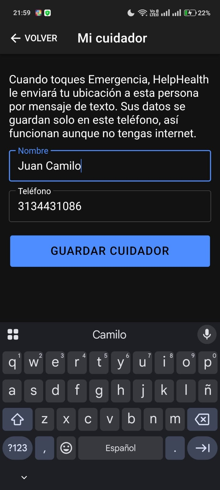 | 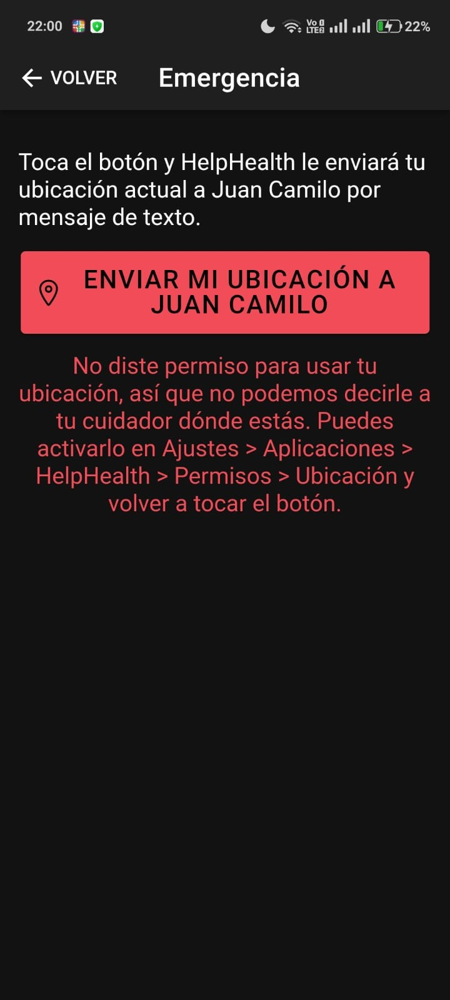 | 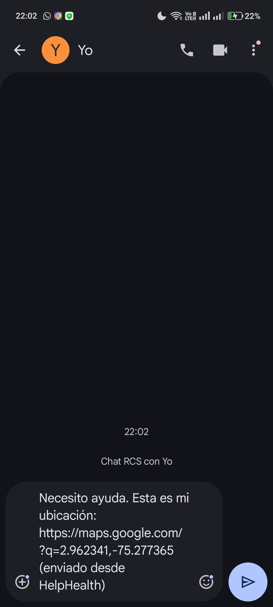 |

| Ícono en el teléfono | Pruebas unitarias |
|---|---|
| 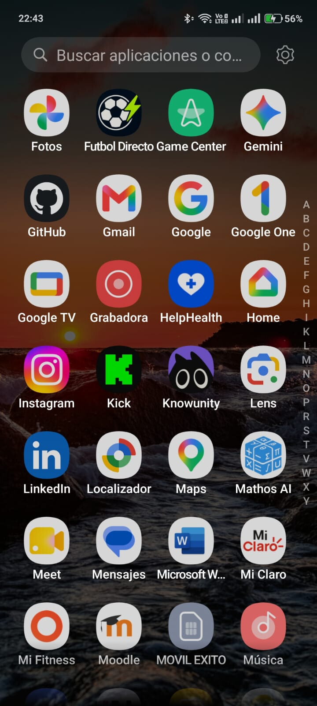 | 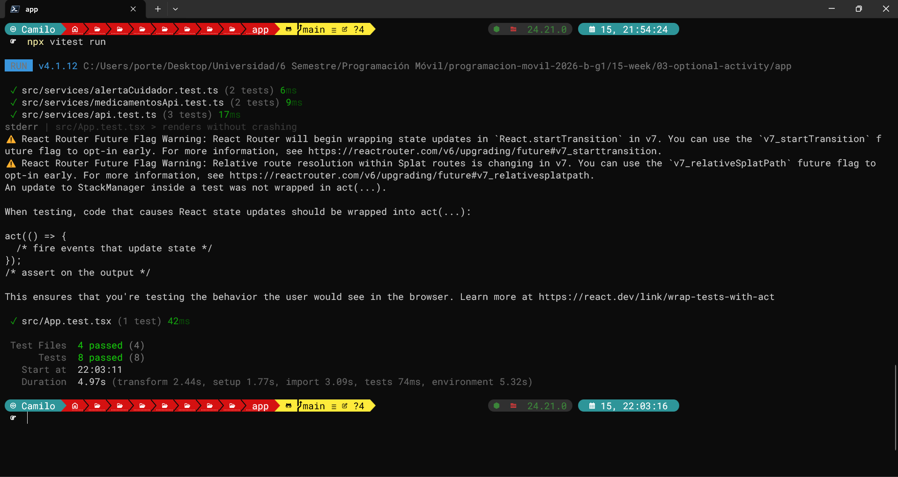 |

## Tecnologías

| Tecnología | Para qué la usé |
|---|---|
| **Ionic React + TypeScript** | Las pantallas, la navegación y el estado, con un solo código para Android e iOS |
| **Capacitor 8** | Llegar al hardware del teléfono y generar el proyecto de Android |
| `@capacitor/geolocation` | El GPS del botón de emergencia |
| `@capacitor/preferences` | Guardar el cuidador en el teléfono |
| `@aparajita/capacitor-secure-storage` | Guardar el token cifrado |
| `@capacitor/network` | Saber si hay internet |
| **Node.js + Express** | La API, que habla JSON |
| **JWT** | La sesión: el servidor no guarda nada, cada petición trae su token |
| **Vitest** | Las pruebas unitarias de los servicios |
| `@capacitor/assets` | Sacar todos los tamaños del ícono y del splash para Android |

## Arquitectura

```
                       ┌──────────────── App Ionic React ─────────────────┐
  Pantallas            │ Login · Inicio · Medicamentos · Detalle · Agregar │
                       │ Síntomas · Cuidador · Emergencia                  │
                       └───────────────┬───────────────────┬──────────────┘
                                       │                   │
  Servicios          authApi · medicamentosApi · sintomasApi   ubicacionService · cuidadorStorage
                                       │                         tokenStorage · alertaCuidador
                                       ▼                   │
                            api.ts (fetch + token +        ▼
                            sin red + 401 + errores)    Plugins de Capacitor
                                       │                (GPS, Preferences, almacenamiento seguro)
                                       ▼                   │
  Backend          API Express ──> verificarToken          ▼
                   /login · /medicamentos · /sintomas   Hardware del teléfono
                                                         (GPS, app de mensajes)
```

Así se navega por la app (es el mismo mapa que dibujé en la semana 4):

```
Login ──> Inicio ─┬─> Mis medicamentos ─┬─> Detalle (Ya lo tomé / Posponer)
                  │                     └─> Agregar medicamento
                  ├─> Registrar síntomas (formulario + historial)
                  ├─> Emergencia ──> SMS al cuidador
                  └─> Cuidador (nombre y teléfono)
```

## Las decisiones que tomé y por qué

1. **Una app híbrida con Ionic React.** Con un solo código sirve para Android y para iOS, se escribe con React y TypeScript, y sus componentes ya vienen con etiquetas, roles y tamaños táctiles accesibles. Para una app pensada en personas con discapacidad, eso me importaba más que el rendimiento extra de hacerla nativa.
2. **Que la emergencia no dependa de nada.** Es la única pantalla que se abre sin iniciar sesión, y el cuidador se guarda en el teléfono y no en la API. Si alguien necesita ayuda, no puede quedarse esperando un login o una conexión.
3. **SMS en lugar de notificaciones push.** El SMS funciona sin internet y no necesita un servidor de notificaciones. Además, la app no pide el permiso `SEND_SMS`: abre la app de mensajes y la persona confirma el envío, lo que también evita mandar alertas por error.
4. **Un solo lugar para hablar con la API.** `api.ts` pone el token, distingue entre "no hay internet" y "el servidor no responde" y maneja la sesión vencida (401). Las pantallas solo muestran el mensaje.
5. **El token cifrado, nunca en `localStorage`.** Es la llave de la cuenta, y la cuenta tiene datos de salud.
6. **Accesibilidad primero.** El botón de emergencia mide 8rem de alto, cada pantalla muestra un estado a la vez (cargando, error con *Reintentar*, vacío o datos), los errores se leen con el lector de pantalla gracias a `role="alert"`, los colores cumplen el contraste WCAG y, esta semana, quité el bloqueo del zoom.
7. **Lista para la tienda.** Tiene identificador propio, un ícono con buen contraste, solo los permisos que necesita y la URL de la API se puede cambiar para el paquete final ([ver el despliegue](despliegue.md)).

## Cómo ejecutarlo

Se necesita Node 20.6 o más reciente y, para probar en el teléfono, Android Studio con la depuración USB activada.

**1. La API**

```bash
cd api
npm install
copy .env.example .env      # en Windows (en Mac/Linux: cp .env.example .env)
```

En el `.env` se escribe una clave en `JWT_SECRET` (por ejemplo `JWT_SECRET=helphealth-clave-de-desarrollo-2026`) y después se corre `npm start`. Tiene que salir `API en http://localhost:3000`.

**Usuario de prueba:** `ana@helphealth.com` / `Salud2026*`

**2. La app en el navegador**

```bash
cd app
npm install
npm run dev -- --port 8100
```

**3. Las pruebas**

```bash
cd app
npx vitest run
```

**4. En un teléfono Android**

```bash
cd app
npm run build
npx cap sync android
adb reverse tcp:3000 tcp:3000
npx cap open android
```

En Android Studio se le da **Run ▶**. Si en el teléfono está la versión de las semanas anteriores, toca desinstalarla primero, porque con el identificador nuevo sale como otra app.

**5. El paquete para la tienda:** está explicado en [`despliegue.md`](despliegue.md), pasos 4 a 6.

## Qué aprendí

En el curso pasé por todo el camino de una app, y HelpHealth fue creciendo con cada tema:

| Unidad | Qué aprendí | Dónde se ve en HelpHealth |
|---|---|---|
| **U1 · Planificación** | A definir un MVP pequeño pero útil, escribir y priorizar historias de usuario, y diseñar antes de programar | Las 6 historias (H1, H2 y H3 imprescindibles), el caso de uso de emergencia, el modelo de datos, los wireframes y el mapa de navegación (semanas 1 a 5) |
| **U2 · Tecnologías** | A montar el entorno, construir una API REST con JSON y trabajar con un framework híbrido | La API en Express (semana 8) y la app en Ionic React con componentes, estado y navegación (semanas 9 y 10) |
| **U3 · Experiencia** | A diseñar los estados y la accesibilidad, usar el hardware con plugins, manejar la red y la sesión, probar y publicar | Los estados de carga, error y vacío (semana 11), el GPS (semana 12), el JWT y el modo sin conexión (semana 13), la caché y las pruebas (semana 14), el MVP completo (semana 15) y el despliegue (semana 16) |

Lo que más me llevo:

- **Pensar en quién va a usar la app.** Muchas decisiones salieron de ahí: la emergencia sin login, el SMS que funciona sin internet, el botón grande y, en esta semana, quitar el bloqueo del zoom que venía en la plantilla.
- **Los errores también hacen parte de la app.** Un "no tienes conexión" claro o un permiso denegado bien explicado es lo que hace que uno confíe en la app.
- **Que funcione en clase no significa que esté lista para publicar.** El identificador de la plantilla, la URL fija en `localhost` o la llave de firma sin proteger no se notan probando en el computador, pero frenan la publicación.

Más allá de lo técnico, disfruté mucho armar HelpHealth. Empezó como una idea y unos wireframes, y semana a semana fue tomando forma: la API, la lista de medicamentos, el GPS, el login y, al final, los síntomas y el cuidador. Verla ahora funcionando en mi celular y mandándole la ubicación al cuidador con un solo toque me hace sentir muy orgulloso, porque sé todo lo que tiene por dentro y por qué está hecha así.

También disfruté mucho Health Track, el proyecto del curso que hicimos en equipo con mis compañeros. Por momentos fue tedioso y hubo dificultades, pero lo sacamos adelante, quedó una buena app y me siento orgulloso de lo que logramos juntos.

## Próximos pasos

- **Publicarla de verdad:** subir la API a un servidor con HTTPS y hacer la prueba cerrada de 14 días en Google Play con cuidadores reales ([paso 8 del despliegue](despliegue.md#8-publicación-en-google-play-console)).
- **Recordatorios sin internet:** guardar los medicamentos también en el teléfono, como lo decidí en la tabla de almacenamiento de la semana 4, y avisar a la hora de cada toma con notificaciones locales.
- **Las historias que faltan:** H4 (personalizar la accesibilidad), H5 (avisarle al cuidador si no se confirma un medicamento) y H6 (agenda de citas), además de la nota de voz para los síntomas.
- **Seguir aprendiendo:** manejo de estado más avanzado y notificaciones push, y probar React Native o Kotlin nativo para comparar.

## Estructura

```
16-week/03-optional-activity/
├── README.md                 -> entrada de portafolio
├── despliegue.md             -> proceso de despliegue paso a paso
├── retroalimentacion.md      -> hallazgos y ajustes aplicados
├── politica-privacidad.md    -> política de privacidad para la tienda
├── .gitignore                -> ahora protege la llave de firma y los paquetes
├── tienda/                   -> ícono 512 × 512 y gráfico destacado 1024 × 500
├── capturas/                 -> pantallas de la app y evidencias del despliegue
├── api/                      -> API Node.js + Express
└── app/                      -> app Ionic React
    ├── assets/               -> imágenes fuente del ícono y el splash (nuevo)
    ├── .env.example          -> VITE_API_URL (nuevo)
    ├── capacitor.config.ts   -> appId co.edu.corhuila.helphealth
    ├── android/              -> proyecto Android con ícono, splash e identificador nuevos
    └── src/
        ├── services/api.ts   -> URL de la API desde VITE_API_URL
        └── pages/Detalle.tsx -> useCallback (sin avisos de ESLint)
```
