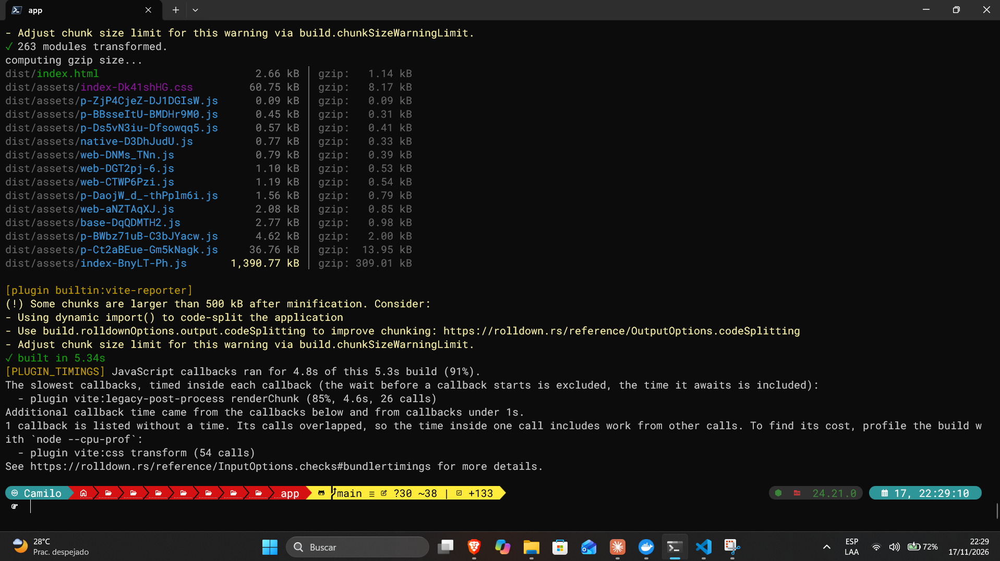
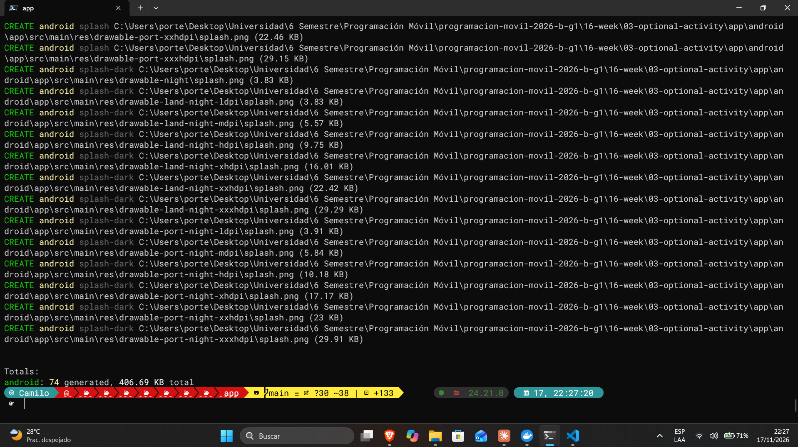
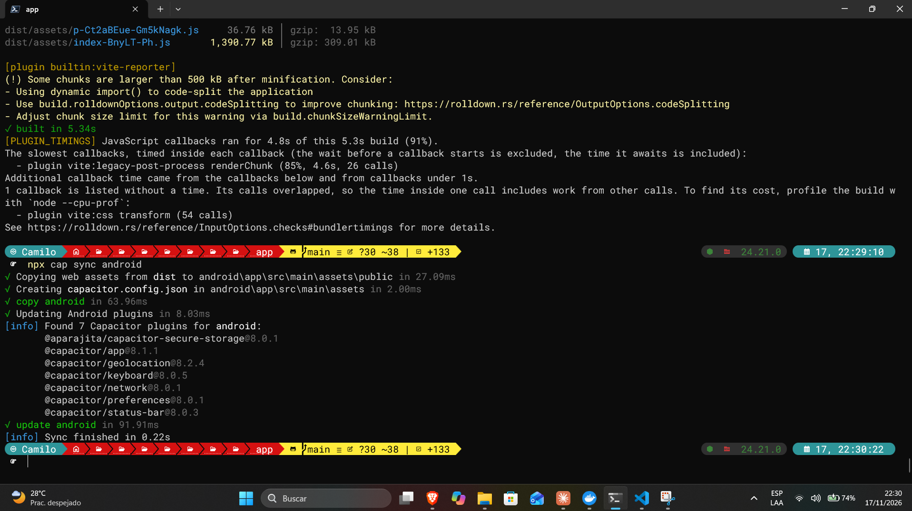
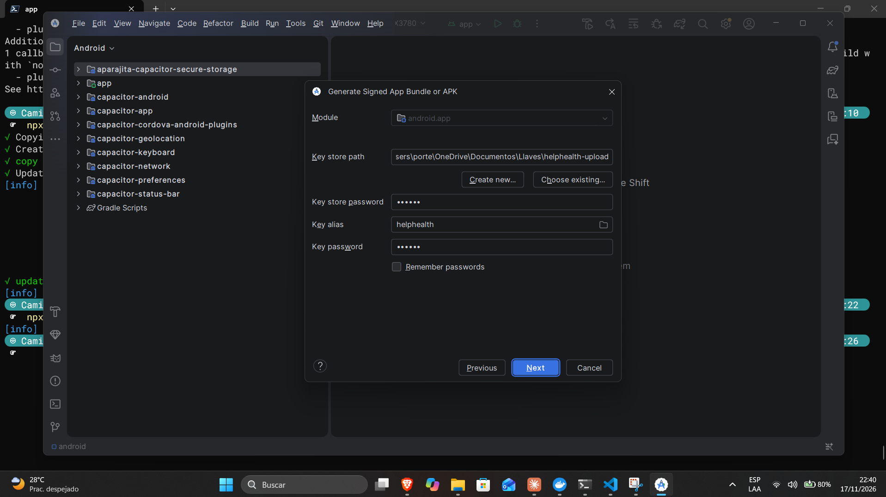
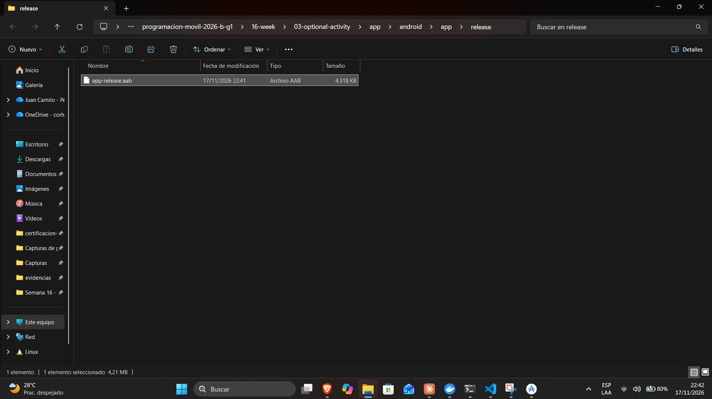
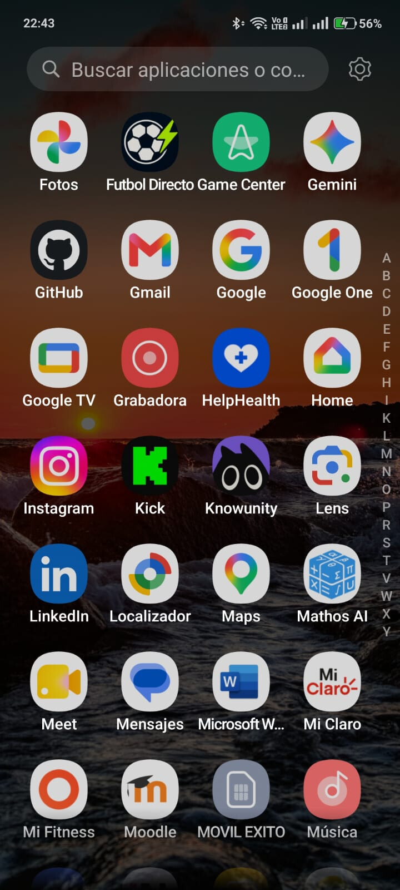
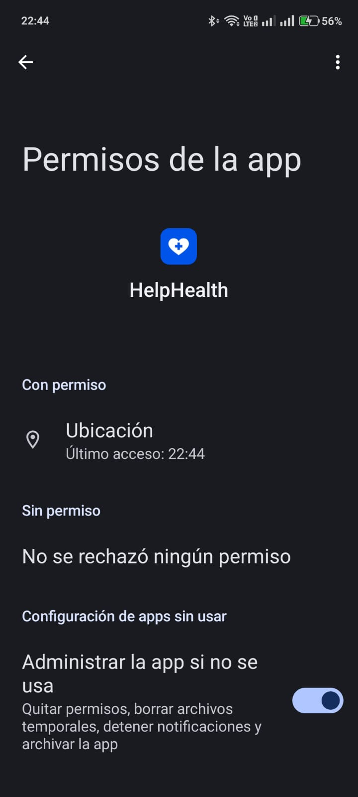

# Proceso de despliegue de HelpHealth

Este documento describe cómo se preparó HelpHealth para publicarla en **Google Play**: desde el código hasta el paquete firmado y la ficha de la tienda. Se sigue el mismo camino que se vio en clase:

```
Código ──> npm run build ──> npx cap sync android ──> Android Studio ──> AAB firmado ──> Google Play Console
 (React)     (carpeta dist)     (copia la web al        (proyecto       (app-release.aab)    (ficha, prueba
                                 proyecto nativo)         nativo)                             y publicación)
```

`ionic build` hace lo mismo que `npm run build` (por dentro llama a ese script); aquí se usa `npm run build` porque es el comando que se ha usado en el curso desde la semana 8.

**Hasta dónde llegó esta entrega:** la app quedó lista para la tienda (identidad, ícono, permisos, versión) y se generó el **AAB firmado**. No se subió a Google Play porque para eso hace falta una cuenta de desarrollador (pago único de 25 USD), la API publicada en un servidor con HTTPS y una prueba cerrada de 14 días (ver el paso 8). Esos pasos quedan descritos para cuando se publique de verdad.

## 0. Requisitos de la tienda revisados antes de empezar

Como dice el tip de la clase, los requisitos se revisaron primero, no el día de publicar:

| Requisito de Google Play | Cómo lo cumple HelpHealth |
|---|---|
| Subir un **Android App Bundle (AAB)**, no un APK | Se genera `app-release.aab` firmado (paso 6) |
| Un **identificador único** que no se puede cambiar después de publicar | `co.edu.corhuila.helphealth` (paso 1) |
| Apps nuevas deben apuntar a **Android 16 (API 36)** desde el 31 de agosto de 2026 | `targetSdkVersion = 36` en `app/android/variables.gradle` (ya venía así) |
| Ícono de 512 × 512, gráfico destacado de 1024 × 500 y capturas del teléfono | Carpeta [`tienda/`](tienda/) y carpeta [`capturas/`](capturas/) |
| **Política de privacidad** con URL pública (la app usa ubicación y datos de salud) | [`politica-privacidad.md`](politica-privacidad.md) |
| **Permisos justificados**: solo los que la app usa | Se revisaron uno por uno y se quitó uno que sobraba (paso 3) |
| Cuestionario de **clasificación de contenido** y formulario de **seguridad de los datos** | Respuestas preparadas en el paso 7 |
| Cuentas personales nuevas: **prueba cerrada con 12 personas durante 14 días** antes de producción | Descrito en el paso 8 |

## 1. Identidad de la app

| Dato | Antes (semana 15) | Ahora | Dónde |
|---|---|---|---|
| Identificador (`appId` / `applicationId`) | `io.ionic.starter` | `co.edu.corhuila.helphealth` | `capacitor.config.ts`, `android/app/build.gradle`, `strings.xml` |
| Paquete de `MainActivity` | `io/ionic/starter/` | `co/edu/corhuila/helphealth/` | `android/app/src/main/java/` |
| Nombre visible | HelpHealth | HelpHealth | `strings.xml` |
| Versión para el usuario (`versionName`) | 1.0 | 1.0.0 | `android/app/build.gradle` |
| Número de versión interno (`versionCode`) | 1 | 1 | `android/app/build.gradle` |

`io.ionic.starter` es el identificador de la plantilla de Ionic: miles de proyectos lo tienen y la tienda lo rechaza. El identificador es el "nombre real" de la app en Google Play y **no se puede cambiar después de publicarla**, por eso se eligió uno definitivo con el dominio de la universidad al revés (`corhuila.edu.co` → `co.edu.corhuila`), que es la convención de Android.

```ts
// app/capacitor.config.ts
const config: CapacitorConfig = {
  appId: 'co.edu.corhuila.helphealth',
  appName: 'HelpHealth',
  webDir: 'dist'
};
```

El `versionCode` es el que mira la tienda para saber qué versión es más nueva: cada vez que se suba una actualización hay que subirlo (2, 3, 4...). El `versionName` es el que ve la persona en Ajustes.

## 2. Ícono y pantalla de inicio (splash)

La app tenía el ícono de Capacitor. Se diseñó un ícono propio: un **corazón blanco con una cruz médica** sobre el azul principal de la app (`#0054e9`, el mismo `primary` de Ionic que usan los botones). El blanco sobre ese azul tiene mucho contraste, lo que ayuda a las personas con baja visión a encontrar la app en el teléfono.

Las imágenes fuente están en `app/assets/` y todos los tamaños de Android se generan con la herramienta oficial de Capacitor:

| Archivo fuente | Tamaño | Para qué |
|---|---|---|
| `icon-only.png` | 1024 × 1024 | Ícono completo (Android antiguo y tienda) |
| `icon-foreground.png` | 1024 × 1024 | Corazón del ícono adaptable (Android 8 o más) |
| `icon-background.png` | 1024 × 1024 | Fondo azul del ícono adaptable |
| `splash.png` / `splash-dark.png` | 2732 × 2732 | Pantalla de inicio en modo claro y oscuro |

```bash
cd app
npx @capacitor/assets generate --android
```

El comando crea los íconos (`mipmap-*`) y las pantallas de inicio (`drawable-*`) en `android/app/src/main/res/` (74 archivos). El corazón ocupa el centro del ícono y deja margen, porque Android recorta el ícono adaptable en círculo, gota o cuadrado según el teléfono.

## 3. Permisos justificados

Google Play pide que cada permiso tenga una razón. Se revisó el `AndroidManifest.xml` y también los permisos que agrega cada plugin al compilar:

| Permiso | Quién lo pide | Por qué lo necesita HelpHealth |
|---|---|---|
| `INTERNET` | La app | Hablar con la API (login, medicamentos y síntomas) |
| `ACCESS_FINE_LOCATION` y `ACCESS_COARSE_LOCATION` | La app (`@capacitor/geolocation`) | El botón de emergencia lee la ubicación **solo cuando la persona lo toca**, para enviársela al cuidador. No se usa ubicación en segundo plano |
| `ACCESS_NETWORK_STATE` | `@capacitor/network` | Saber si hay internet y decir "no tienes conexión" en vez de un error genérico |
| ~~`VIBRATE`~~ | ~~`@capacitor/haptics`~~ | **Se quitó**: el plugin venía con la plantilla de Ionic y la app nunca lo usa |

Dos decisiones que ayudan con la tienda:

- **El SMS no necesita permiso.** La app no envía el mensaje por su cuenta: abre la app de mensajes con un enlace `sms:` y la persona toca "Enviar". Así no hace falta el permiso `SEND_SMS`, que Google Play restringe y casi nunca aprueba.
- **La ubicación se pide en el momento de usarla**, no al abrir la app, y si se niega la pantalla explica cómo activarla (captura 08).

## 4. La dirección de la API

En la semana 15 la URL de la API estaba escrita en el código (`http://localhost:3000`). Eso sirve para probar con `adb reverse`, pero un teléfono de la tienda no tiene la API en su `localhost`. Ahora la URL se lee de una variable de entorno al compilar:

```ts
// app/src/services/api.ts
const API_URL = import.meta.env.VITE_API_URL ?? 'http://localhost:3000';
```

- **Desarrollo:** no hay que hacer nada; si no existe la variable se usa `localhost`.
- **Versión para la tienda:** se crea `app/.env.production` (copiando `app/.env.example`) con la URL **HTTPS** de la API publicada. `npm run build` la lee sola y la deja dentro del paquete.

El archivo `network_security_config.xml` solo permite HTTP sin cifrar hacia `localhost` (para desarrollo); cualquier otro dominio exige HTTPS, que es lo que pide Android y lo que necesitan los datos de salud. El AAB de esta entrega se compiló sin `.env.production` porque la API todavía no está publicada; por eso es un paquete de prueba que funciona con la API del computador.

## 5. Build web y sincronización

```bash
cd app
npm install                              # se quitó @capacitor/haptics del package.json
npm run build                            # TypeScript + Vite -> carpeta dist/
npx @capacitor/assets generate --android # íconos y splash (paso 2)
npx cap sync android                     # copia dist/ al proyecto Android y actualiza los plugins
npx cap open android                     # abre Android Studio
```

`npx cap sync` es necesario esta vez por dos razones: copia la versión nueva de la web y regenera la lista de plugins de Android (`capacitor.settings.gradle` y `capacitor.build.gradle`), que ya no incluye `haptics`.

## 6. Firmar y generar el AAB

Android solo instala apps firmadas, y Google Play usa la firma para saber que una actualización viene del mismo autor. En Android Studio:

1. **Build → Generate Signed App Bundle or APK...** → elegir **Android App Bundle** → *Next*.
2. **Key store path → Create new...** y guardar la llave **fuera del repositorio**, por ejemplo en `Documentos/llaves/helphealth-upload.jks`. Se llenan la contraseña, el alias (`helphealth`) y los datos del certificado (nombre y organización: Corhuila). Android Studio propone 25 años de validez, que es lo que pide la tienda.
3. Elegir la variante **release** → *Create*.
4. Al terminar aparece el aviso *"App bundle(s) generated successfully"* y el archivo queda en `app/android/app/release/app-release.aab`.

**La llave no se sube a GitHub.** Si alguien la tiene, puede publicar una "actualización" falsa de la app. Por eso el `.gitignore` de esta semana ignora `*.jks`, `*.keystore` y `keystore.properties`, y también `*.aab`, `*.apk` y la carpeta `release/`: el paquete se entrega a la tienda, no al repositorio. Con **Play App Signing** (activado por defecto) Google guarda la llave definitiva y la que se creó aquí funciona como *llave de subida*: si se pierde, Google permite cambiarla.

## 7. Ficha de la tienda

Textos listos para copiar en **Play Console → Presencia en la tienda → Ficha principal**:

| Campo | Contenido |
|---|---|
| Nombre de la app (máx. 30) | HelpHealth |
| Descripción breve (máx. 80) | Medicamentos, botón de emergencia y síntomas en una app accesible. |
| Categoría | Medicina |
| Correo de contacto | El correo institucional del autor |
| Ícono (512 × 512) | [`tienda/icono-512.png`](tienda/icono-512.png) |
| Gráfico destacado (1024 × 500) | [`tienda/grafico-destacado-1024x500.png`](tienda/grafico-destacado-1024x500.png) |
| Capturas del teléfono (mín. 2) | `capturas/02-inicio.jpeg`, `03-medicamentos.jpeg`, `04-detalle-tomado.jpeg`, `05-sintomas.jpeg`, `09-sms-cuidador.jpeg` |

**Descripción completa:**

> HelpHealth es una app de salud pensada para personas con discapacidad motriz, visual o auditiva y para quienes las cuidan.
>
> • Mis medicamentos: consulta tus medicamentos y terapias con su horario y marca cada uno como tomado o pospuesto.
> • Botón de emergencia: con un solo toque, HelpHealth toma tu ubicación y prepara un mensaje de texto para tu cuidador con el enlace del mapa. Funciona aunque no tengas internet ni hayas iniciado sesión.
> • Registro de síntomas: escribe cómo te sientes y consulta tu historial ordenado por fecha.
>
> Botones grandes, textos claros y compatibilidad con el lector de pantalla del teléfono.
>
> HelpHealth no reemplaza la atención médica. En una emergencia grave, llama a la línea de emergencias de tu país.

**Contenido de la app** (Play Console → Política → Contenido de la app):

| Sección | Respuesta preparada |
|---|---|
| Política de privacidad | URL pública de [`politica-privacidad.md`](politica-privacidad.md) en GitHub |
| Acceso a la app | La app pide inicio de sesión: se entrega a los revisores el usuario de prueba `ana@helphealth.com` |
| Anuncios | No tiene anuncios |
| Clasificación de contenido | Sin violencia, lenguaje ofensivo, compras ni chat entre usuarios: la clasificación esperada es para todo público |
| Público objetivo | Personas adultas (18 años o más) |
| Declaración de apps de salud | App de bienestar y gestión de medicamentos; no es un dispositivo médico ni da diagnósticos |
| Seguridad de los datos | Se recogen correo electrónico (para iniciar sesión) y datos de salud (medicamentos y síntomas), cifrados en tránsito con HTTPS; no se comparten con terceros. La ubicación y el cuidador **no** salen del teléfono por la app: se usan para armar el SMS que la persona envía |

## 8. Publicación en Google Play Console

Pasos para cuando se publique (no se hicieron en esta entrega por lo explicado al inicio):

1. Crear la cuenta de desarrollador en Google Play Console (pago único de 25 USD) y verificar la identidad.
2. Publicar la API en un servidor con HTTPS, crear `app/.env.production` con su URL y volver a generar el AAB (paso 6), subiendo el `versionCode`.
3. **Crear app**: nombre HelpHealth, idioma español (Latinoamérica), tipo app, gratuita.
4. Completar la **ficha** y el **contenido de la app** con lo del paso 7.
5. **Pruebas → Prueba cerrada**: subir `app-release.aab` e invitar al menos a **12 personas**, que deben quedarse inscritas **14 días seguidos** (requisito para cuentas personales creadas después de noviembre de 2023). Es una buena oportunidad para que cuidadores reales prueben la app.
6. Pasados los 14 días, **solicitar acceso a producción** respondiendo las preguntas sobre la prueba.
7. **Producción → Crear versión** con el mismo AAB y enviarla a revisión. Google revisa la app (puede tardar varios días) y la publica.

**¿Y en iOS?** El camino es el mismo con Xcode: `npx cap add ios`, `npx cap sync ios`, firmar con una cuenta de Apple Developer (99 USD al año) y subir el **IPA** a App Store Connect. Hace falta un Mac, por eso esta entrega se enfoca en Android, que es donde se ha probado la app todo el semestre.

## Evidencias del despliegue

| Build web | Íconos y splash generados | Sincronización con Android |
|---|---|---|
|  |  |  |

| Llave de firma | AAB firmado generado |
|---|---|
|  |  |

| Ícono nuevo en el teléfono | Permisos de la app en Ajustes |
|---|---|
|  |  |
